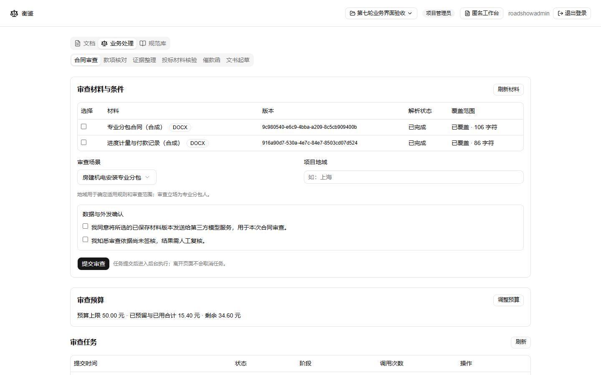
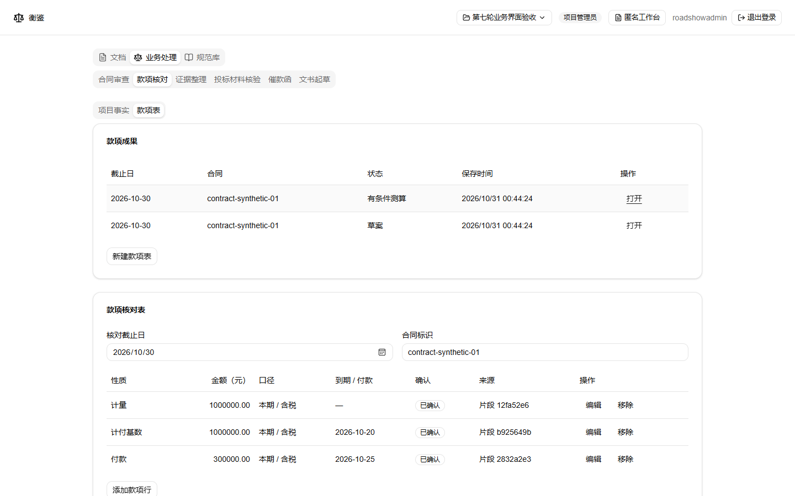
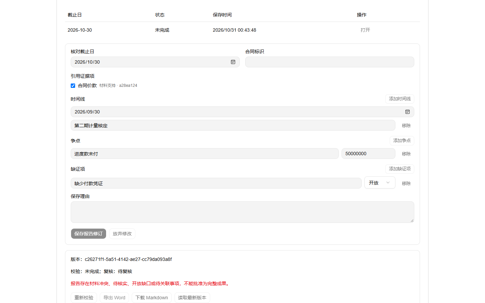
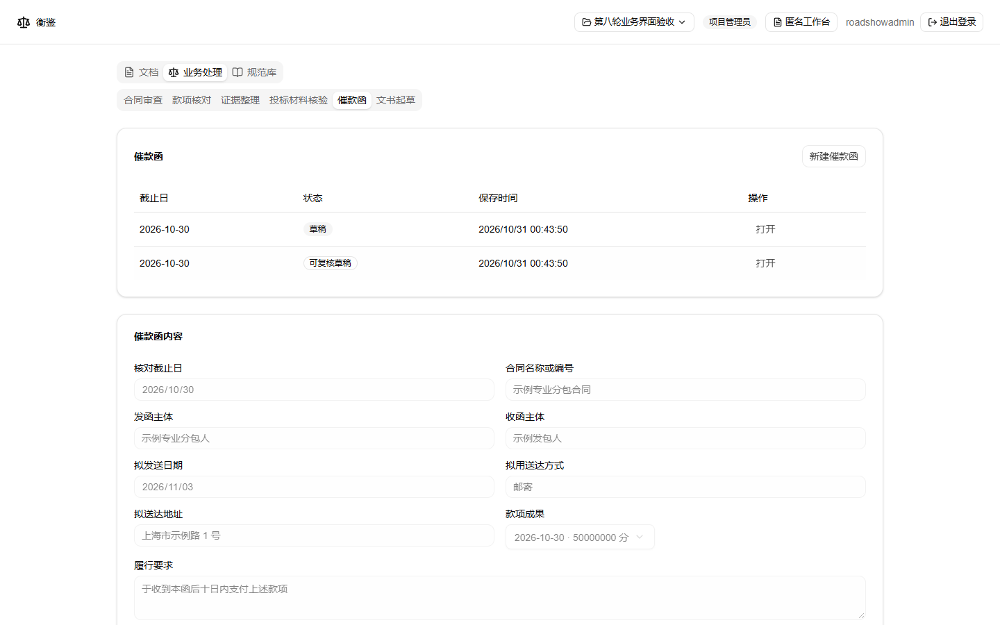

# 衡鉴 EquiLens

**让合同有据，让款项有数。** 面向工程专业分包企业的法律风险与文书协同工作台。


[](https://github.com/alaala-daka/EquiLens/actions/workflows/ci.yml)

[在线入口](https://equilens.zeabur.app) · [本地启动](#本地启动) · [实机展示](#核心功能实机展示) · [部署指南](docs/deployment.md) · [规格索引](spec/README.md)

> 项目处于 Demo 开发与授权联调阶段。海报表达产品定位，实机截图展示已实现界面；两者均不代表法律业务验收通过。在线版本可能与当前源码不同。

## 为谁解决什么问题

衡鉴首先聚焦中国大陆房建机电安装专业分包，代表**专业分包人**组织合同、履约材料与工程款依据。

| 核心人群 | 日常痛点 | 衡鉴的处理方式 |
| --- | --- | --- |
| 企业法务、合同管理人员 | 合同条款分散，审查意见难以回到原文，修订版本容易混淆 | 选择保存版本审查，保留原文引文、审查记录与独立修订建议稿 |
| 商务、结算人员 | 计量、应付、已付、未到期与争议金额混用 | 按合同、主体、期间与口径登记事实和款项，再进行核对 |
| 项目负责人、资料人员 | 履约材料零散，发生争议时难以说明时间线和缺失证据 | 将来源片段与事实关联，整理证据项、时间线、争点及缺证项 |
| 催收协作人员 | 催款函金额和合同依据反复核对，文书容易引用旧数据 | 显式选择款项、事实与证据版本，形成可复核、可导出的催款函草稿 |

目标工作流：**合同审查 → 款项核对 → 证据整理 → 催款函**。资料围绕同一项目组织，成果保留所引用的来源与版本；更新上游材料后，需要明确发起新的处理。

## 核心功能实机展示

以下为仓库已有本地浏览器演示的原始截图，使用合成项目与材料，来自第七轮模型联调和第八轮演示留存。本次重写逐张核对并复制至版本库，未用文生图制作产品界面。截图中的金额、项目、状态仅用于展示交互，不是业务准确率或云上验收证据。

### 1. 合同审查：明确材料、场景与外发授权

选择已解析材料的保存版本、地域和审查场景，确认外发授权后提交后台任务。审查采用场景识别、主审与独立复核；支持范围或依据不足时保留失败、部分完成及待核实状态。



当前机电安装、装饰装修、幕墙、钢结构四类专业分包仅供授权联调。内置规则尚未领域签核，不能作为正式法律结论依据。选择生成修订稿时，另存建议稿并核对，不覆盖原件和人工内容。详见[网页审查说明](docs/contract-review-web.md)。

### 2. 款项核对：把金额与计算口径放在一起

登记款项性质、金额、期间、到期或付款时间及材料来源；区分计量、应付款、付款、未到期款和争议主张。材料不足或口径未确认时保留草案或有条件测算状态，不把计量值直接当作已到期未付额。



### 3. 证据整理：保留时间线，也保留缺口

将证据项关联到来源片段与项目事实，组织时间线、争点和缺证项。报告保存为独立版本，材料冲突、待核实和缺证状态不能通过复核按钮消除。



### 4. 催款函：从已保存依据生成草稿

选择款项、事实与证据版本，填写发函主体、收函主体、履行要求和送达计划，使用固定模板生成草稿，复核后导出 DOCX。**不提供自动发送、送达回执或利息／违约金自动计算。**



截图来源与边界见[素材说明](docs/assets/readme/README.md)；工程验证见[第七轮记录](docs/reviews/2026-10-30-round-seven-integration.md)与[第八轮记录](docs/reviews/2026-10-30-round-eight-integration.md)。各段验证不等于四业务端到端新输入验收通过。

## 当前能力与边界

| 能力 | 当前状态 |
| --- | --- |
| 浏览器 Word 编辑 | 新建、导入、编辑、保存、重开和导出真实 DOCX；保存不可变版本，导出复用保存字节 |
| 工作台与账号 | 文档／规范库、编辑器与右侧 Agent；账号登录、项目成员及权限机制已有本地验证；登录不接管匿名文档 |
| 合同审查 | 匿名文档与项目审查任务、受限模型调用、来源校验、人工复核及版本化导出；正式依据仍缺领域签核 |
| 项目事实与款项核对 | 事实来源与版本、款项行及确定性计算；依赖人工确认主体、口径与分配关系 |
| 证据整理与催款函 | 人工录入配合服务端确定性组装；不依赖模型生成，不提供催款函正文自由编辑或发送 |
| 规范与模板 | 发布须受控维护及独立领域核对；当前没有经领域签核并发布的真实规则／模板，规范库不能作为已有权威知识库宣传 |
| 云服务与发布 | SQLite 已有本地验证；真实 GaussDB、私有 OBS、MaaS／OCR、公网 HTTPS、Linux 容器及 CI 结果需单独验收 |

单个 DOCX 上限 **20 MiB**；不承诺任意 Word 版式无损还原，不支持旧版 DOC、宏、加密文件、实时协作或完整扫描件审查。图片、页眉页脚、域、批注与修订等的保留能力按[Word 验证记录](docs/reviews/2026-10-22-word-editing-validation.md)逐类判定；不提供 Word 修订的接受／拒绝功能。

项目按实际开工后十二天 Demo、随后一个月完善的两阶段范围推进。工程测试、合成演示与真实法律业务验收分开记录，尚无 24／60 个独立业务质量案例的完整发布验收结论。

## 本地启动

### 1. 准备环境与源码

安装 Git、**Node.js 24** 和 **pnpm 11.6.0**。以下终端命令适用于 PowerShell；macOS／Linux 的文件复制命令见下一步。

```powershell
node --version
# 已有正确版本的 pnpm 时跳过安装
npm install --global pnpm@11.6.0
pnpm --version

git clone https://github.com/alaala-daka/EquiLens.git
cd EquiLens
pnpm install --frozen-lockfile
```

依赖使用 pnpm 与已提交的锁文件安装；不要使用 npm／yarn 安装项目依赖或生成其他锁文件。

### 2. 配置本地环境

首次运行复制配置文件；已有 `.env.local` 时直接编辑，避免覆盖私有配置。

```powershell
Copy-Item .env.example .env.local
```

macOS／Linux 对应命令：`cp .env.example .env.local`。

编辑 `.env.local`，先使用不调用模型的最小配置：

```dotenv
DATABASE_PROVIDER=sqlite
SQLITE_PATH=data/equilens.sqlite
APP_ORIGIN=http://127.0.0.1:3000
ANONYMOUS_DATA_RETENTION_DAYS=7
AI_API_KEY=
EQUILENS_SYNTHETIC_STORAGE=0
```

这里的 7 天仅是本地合成资料体验示例，实际用途和保留期限由负责人登记后确定。`APP_ORIGIN` 必须与浏览器域名和端口严格一致，不带末尾斜线。其余配置可保留示例值，无模型密钥时不提交审查任务。

SQLite 在运行时创建数据库；无需另装数据库服务。不要将 `.env.local`、数据库或真实合同提交 Git。

### 3. 启动并验证

```powershell
pnpm dev
```

打开 [http://127.0.0.1:3000](http://127.0.0.1:3000)。在另一个终端进入仓库执行：

```powershell
pnpm smoke http://127.0.0.1:3000
```

启动命令会先构建文档校验、解析与保留维护程序，不要直接运行 `next dev`。按 `Ctrl+C` 停止，调整配置后重新启动。

如 Windows 环境因 Turbopack 创建目录联接失败，可使用 `pnpm dev --webpack`。端口被占用时可运行 `pnpm dev --port 3001`，同时将 `APP_ORIGIN` 与访问地址改为 `http://127.0.0.1:3001`。

### 4. 完成第一次文档操作（无需模型或云账号）

1. 点击「新建文档」，确认资料保留期限，输入标题和正文并保存。
2. 返回列表、重开文档，核对内容，再使用「导出 Word」下载保存版本。
3. 点击「导入 Word」，选择合成样本 [`sample-contract.docx`](tools/contract-review/fixtures/sample-contract.docx)，体验导入与编辑。
4. 修改正文后使用保存按钮或 `Ctrl/Cmd+S`；导出时有修改会先保存。保存失败不会替换已有导出。

匿名文档由当前浏览器 cookie 隔离。清除 cookie、换浏览器或隐私窗口不会找回原列表；请在到期前导出需保留的文件。固定期限不会随访问或保存续期，历史 IndexedDB 文档也不会自动上传。

### 5. 可选：配置合同审查联调

只使用合成或明确授权的材料。在 `.env.local` 配置有权访问的模型服务：

```dotenv
AI_BASE_URL=https://your-provider.example/v1
AI_MODEL=your-model-id
AI_API_KEY=your-private-key
AI_REVIEW_MODE=debug
AI_REVIEW_RETENTION_DAYS=7
AI_REVIEW_MAX_PROMPT_CHARS=240000
AI_AGENT_MAX_CALLS=25
```

替换服务地址、模型和密钥；提示字符上限须按实际模型能力调低，240000 只是应用允许的上限。重启服务，打开已保存 DOCX，在右侧「合同审查」确认地域、版本、未核对规则提示及外发授权后提交。

提交会向配置的第三方模型发送材料并可能产生费用。无密钥、超时、预算耗尽或输出无效时会失败或部分完成，不以演示答案替代。生产默认 `published`，未发布规则会被拒绝；不要用 debug 结果作为正式法律结论。更多配置见[网页审查说明](docs/contract-review-web.md)。

### 6. 可选：账号与项目合成联调

匿名编辑不需要账号。首次初始化管理员可在 `.env.local` 同时设置 `BOOTSTRAP_ADMIN_USERNAME` 与 `BOOTSTRAP_ADMIN_PASSWORD`，密码为 12–128 个字符、UTF-8 不超过 512 字节，没有默认账号。启动创建成功后移除两项并重启；访问 `/login` 登录，账号后续维护见[运维说明](docs/operations.md#受控账号维护与认证就绪)。

项目材料的本地合成联调需要显式设置 `EQUILENS_SYNTHETIC_STORAGE=1`，再重启开发服务。文件默认保存至 `data/dev-objects/`，只允许合成资料；该开关生产环境拒绝使用，不代表 OBS 已实现。登录、项目成员权限、材料解析及审查预算仍需按各自流程配置，不会由匿名样本自动生成完整项目。

### 7. 生产构建与容器部署

```powershell
pnpm build
pnpm start
```

生产启动前将运行环境的 `APP_ORIGIN` 改为实际 **HTTPS** 入口，并配置 TLS 反向代理；开发回环 HTTP 不能作为生产认证配置。单独执行 `pnpm build` 不表示业务服务已验证。

Docker Compose 首次部署：复制 `.env.example` 为 `.env`，填写实际 HTTPS `APP_ORIGIN` 和已登记的保留天数，配置反向代理后执行：

```powershell
docker compose up --build -d
docker compose logs --tail=100 app
```

Compose 发布至 `127.0.0.1:3000`，SQLite 固定单副本并保留 `equilens-data` 持久卷。不要运行 `docker compose down --volumes`。管理员初始化变量需要在 Compose 的 `app.environment` 显式传入，仅填写 `.env` 不会自动注入。

生产私有对象存储仍有缺项，不能据此承诺完整项目材料处理已可上线。ECS、Zeabur、GHCR 镜像发布、配置和备份恢复以[部署指南](docs/deployment.md)为准。完整备份必须包含数据库、私有对象与删除日志；只复制 SQLite 文件不算完整项目备份。

### 常见启动问题

| 现象 | 检查与处理 |
| --- | --- |
| 新建或导入返回 503 | 检查资料保留天数是否为正整数、数据库和删除日志目录是否可写、日志重放是否成功 |
| 登录或写入失败 | 检查 `APP_ORIGIN` 是否与当前访问地址严格一致；生产需 HTTPS |
| 模型任务无法完成 | 检查模型权限、容量、外发确认、预算与 debug／published 依据准入，不把失败视为无风险 |
| `/healthz` 正常但业务不可用 | 健康接口只检查应用存活，不检查数据库、登录或模型就绪 |
| 换浏览器后文档不见 | 匿名资料按会话隔离，登录不会接管匿名文档；使用原会话并及时导出 |

## 开发与验证

单个 **Next.js App Router + TypeScript + Node.js** 应用承载页面、接口与数据库任务；通过 `DATABASE_PROVIDER` 选择 SQLite 或 GaussDB 集中式，不增加独立 API／Worker 服务。GaussDB 需要独立真机验证，连接失败不会回退为 SQLite，切换配置不会自动迁移数据。

| 操作 | 命令 |
| --- | --- |
| 代码、路由类型与 TypeScript 检查 | `pnpm check` |
| 文档、权限、任务、业务及持久化测试 | `pnpm test` |
| 离线合成审查示例 | `pnpm review:contract:example` |
| 生产构建 | `pnpm build` |
| 检查运行中的服务 | `pnpm smoke [url]` |
| 一次真实模型合成消息连通测试（可能计费） | `pnpm ai:smoke` |
| 空白错误检查 | `git diff --check` |

界面使用官方 shadcn/ui 组件与 SuperDoc 1.47.2。开发规则见 [DEVELOPMENT.md](DEVELOPMENT.md)，贡献检查见 [CONTRIBUTING.md](CONTRIBUTING.md)，验收依据见 [spec/](spec/README.md)。历史截图和工程检查不替代业务 AC、领域签核、真实云服务或 GitHub CI 验收。

## 文档与许可

- [产品与验收](spec/01-product.md)：两阶段范围、主体、金额、来源与 AC-01—AC-26。
- [工作台规格](spec/02-workbench-ui.md) · [Word 编辑](spec/03-word-editing.md) · [数据库部署](spec/04-database-deployment.md)。
- [合同审查联调](docs/contract-review-web.md) · [审查 CLI](tools/contract-review/README.md) · [部署](docs/deployment.md) · [运维与恢复](docs/operations.md)。

采用 [AGPL-3.0-only](LICENSE)，第三方组件遵循各自许可，见 [THIRD_PARTY_NOTICES.md](THIRD_PARTY_NOTICES.md)。页面「源代码」入口对应部署版本；对外分发与镜像发布须完成相应许可和源码提供安排。
