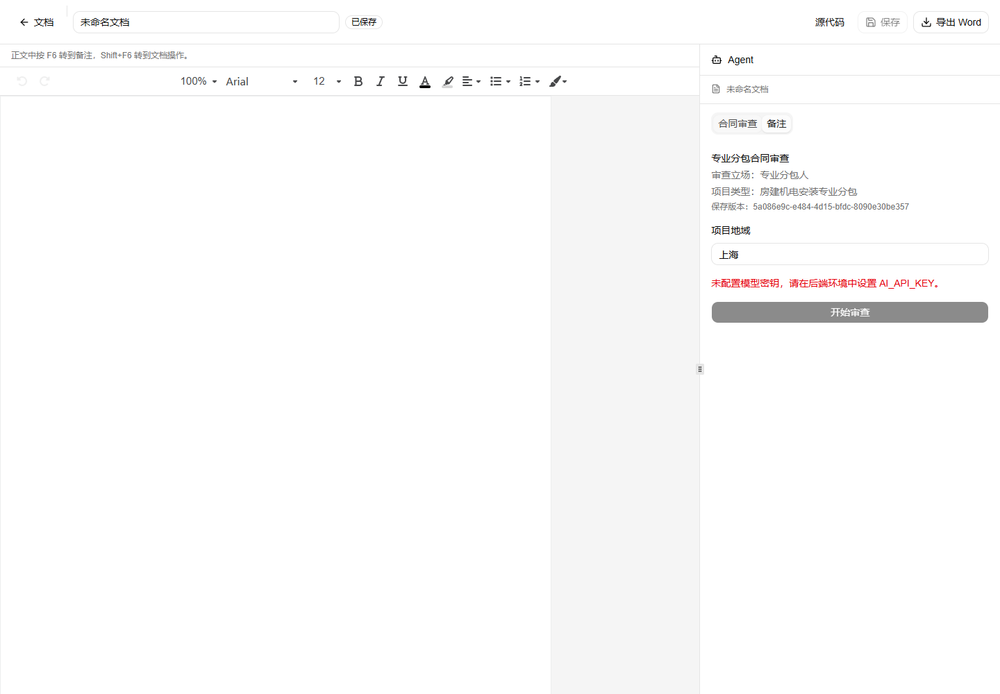
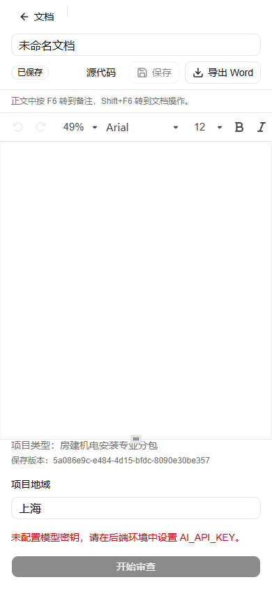

# 合同审查与主分支整合验证

日期：2026-10-23。交付阶段：Demo 开发联调，不是法律业务验收。
整合基线：合同审查 `7b182d5` 与 `origin/main` `337d500`；本记录随本地整合提交保存。

## 修改与边界

- 解决 9 个合并冲突，保留 main 的文档列表、匿名固定期限、会话上下文、编辑会话控制器和离开/冲突保护。
- 审查任务复用文档服务的数据库和删除日志就绪屏障；HTTP、任务事务、领取和每次外发预留检查会话权限及 contextId。
- 到期、撤销、未登记存量拒绝访问/处理；只读导出窗口拒绝新任务、重试和外发。任务期限不晚于原资料期限。
- 恢复保留累计请求预算；旧执行令牌不能写回。缺少 contextId 的旧任务不得恢复外发，需重新确认新任务。
- 内置规则包、规则及法律来源恢复待核对状态，移除临时 reviewer 的测试例外；正式模式保持拒绝，debug 保留确认和报告标记。
- 修复 fork 参数的 Turbopack 忽略标记；规则及技能由 standalone 脚本显式复制，动态路径不再追踪整个项目。
- 右侧审查与备注页签沿用 main 的编辑控制器。页签保留输入；保存版本变化使外发确认失效；F6 聚焦备注，Shift+F6 返回文档操作。
- `.env.example` 保留原有匿名保留配置并补充模型配置；原未提交文件另存于忽略的 `.superpowers/merge-integration/env.example.before`。

## 实际执行

环境：Windows、Node.js 24.16.0、项目固定 pnpm 11.6.0。应用依赖没有新增。

| 检查 | 结果 |
| --- | --- |
| `pnpm install --frozen-lockfile` | 通过，项目锁文件不含临时浏览器依赖 |
| `pnpm check` | ESLint、Next 路由类型、TypeScript 通过 |
| `pnpm test` | 186 项：185 通过、0 失败、1 跳过 |
| `pnpm build` | Turbopack 与 standalone 打包通过，最终日志无 warning/error |
| `pnpm smoke http://127.0.0.1:18081` | 页面、健康接口、CSS、公共资源通过 |
| 文档数据库冒烟脚本 | 真实 HTTP 的期限确认、隔离、保存竞争、来源、无效文件拒绝通过 |
| 停止/重启生产服务后 `--verify` | 原文档版本、字节摘要、cookie/contextId、固定到期日保持一致 |
| 生产审查接口 | 缺失上下文 400、错误上下文 409、正确上下文私有响应 200；模型未配置时不可提交 |
| `git diff --check` | 通过 |

新增测试先复现了缺失上下文、超出源资料期限、撤销和只读状态仍可处理的失败，再实现修复并通过。
新增覆盖：HTTP 同源/确认/响应序列化后的再鉴权、浏览器拒绝过时上下文、任务幂等/隔离/到期/撤销/
只读/预算恢复/旧令牌/删除级联，以及真实 AI SDK 工具循环的读取、引文、逐次预留和预算耗尽。
所有自动化模型回复均为离线合成桩；未发起真实模型、OCR 或云端请求。

跳过项为既有 Linux 文件/目录 fsync 持久性测试；Windows 逻辑测试不证明 Linux 断电持久性。
本次未运行 GitHub CI、Docker、真实 GaussDB、线上部署、Microsoft Word 或法律业务独立样本验收。
测试数量不能代替产品规格的 24/60 个独立业务样本，也不计入法律准确率。

## 浏览器与界面

使用独立无头 Chrome、合成数据库，验证 1440×1000 与 390×844：
首次期限确认、新建、编辑器就绪、页签可见性与备注保留、保存/重开、F6/Shift+F6、窄屏无页面横向溢出，
审查按钮可经面板滚动到达。浏览器无 pageerror。实际后端没有模型密钥，未点击提交审查。
另对配置展示使用浏览器响应桩，验证确认后按钮可用、保存新版本后确认撤销；这不是模型端到端验收。

官方起点：[Blocks/dashboard-01](https://ui.shadcn.com/blocks) 不适用现有双面板工作区，
采用 [官方 Tabs 示例](https://github.com/shadcn-ui/ui/blob/main/apps/v4/registry/new-york-v4/examples/tabs-demo.tsx)
与既有 Radix 组件组合。必要适配仅为既有全屏/分栏滚动容器及 forceMount 后隐藏非当前页签，避免切页丢失状态。
截图已逐张查看，仅代表合成资料下的布局及真实未配置错误，不是审查成功或业务验收证据。

忽略目录 `.superpowers/merge-integration/` 保存计划、原始测试/构建日志、合成数据库、浏览器脚本和结果；不提交这些本机产物。
后续可推送本地整合分支发起 PR，由 GitHub CI 完成 Linux 与容器检查。没有推送、修改远程 main 或发布制品。
