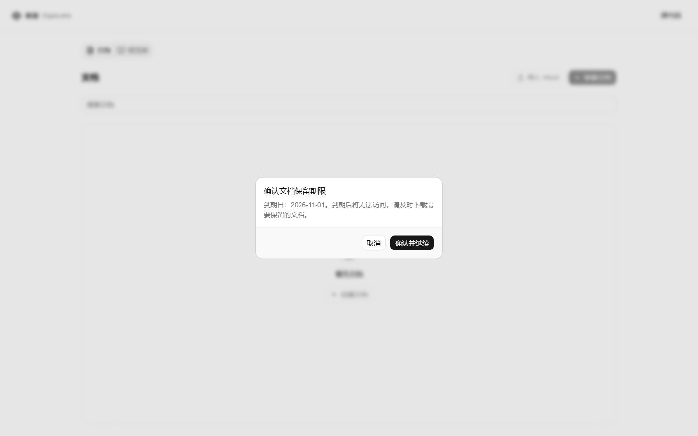
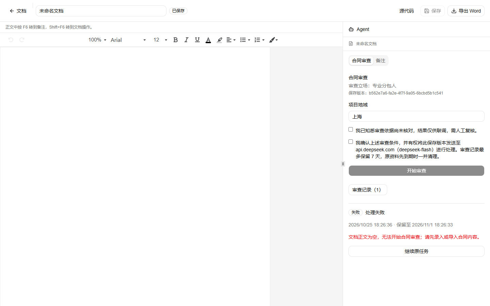

# 可用性跟进修复验证

日期：2026-10-25。范围：合同审查入口与文档命名的界面修复；不改变审查规则、提示词或结果格式。模型调用上限调整见同日规格变更（默认 25、最多 40）。

## 修复

| 问题 | 处理 |
| --- | --- |
| 新建文档时「正在新建文档／取消」与保留期限确认框同时出现 | 确认框打开期间隐藏操作进行中提示，确认后才显示真正的创建中状态；取消入口只保留在确认框内 |
| 空白文档也能提交审查 | 任务解析后若无任何正文，直接以 `REVIEW_INPUT_EMPTY` 失败，**不发送模型请求**；面板显示「文档正文为空，无法开始合同审查；请先录入或导入合同内容」，且不再提供无意义的「继续原任务」 |
| 标题默认「未命名文档」、命名入口不明显 | 打开新文档后自动聚焦并全选标题输入框；改名并保存即更新列表标题（列表内直接重命名仍未提供） |
| 审查报告无法导出 | 报告底部与场景停止页增加「导出报告（Markdown）」，使用已保存结果生成，不新增模型调用 |
| 场景停止时重复提示 | 报告只保留任务错误信息，删除与之重复的「请核对合同类型或补充材料后重新审查。」 |
| 长报告滚动时窗口可滚到空白区域 | 编辑器根容器固定为视口高度并隐藏溢出，报告在右侧面板内滚动 |

## 工程验证

Windows / Node.js 24.16.0 / pnpm 11.6.0：

- `pnpm check`：通过。
- `pnpm test`：232 项，231 通过、0 失败、1 项既有 Linux fsync 检查在 Windows 跳过。新增「空文档在任何模型请求前失败」的任务层用例。
- `git diff --check`：通过。

## 真实浏览器验证（本机 Chromium，不调用模型）

| 检查 | 结果 |
| --- | --- |
| 确认框打开时是否出现「正在新建文档」 | 否 |
| 新文档标题是否自动全选 | 是（焦点在「文档标题」，选区覆盖全文） |
| 编辑器页是否产生窗口滚动（900px 视口） | 否（scrollHeight = 900） |
| 空文档提交审查 | 任务 `failed`，错误 `REVIEW_INPUT_EMPTY`，调用次数 0 |

## 仍未处理

- 文档列表内直接重命名；标题只能在打开文档后修改。
- 报告导出仅提供 Markdown，没有 PDF 或带格式的 DOCX。
- 移动端 390px 布局、非法文件导入、失败/超时/限流与长文档预算耗尽路径未复测。
