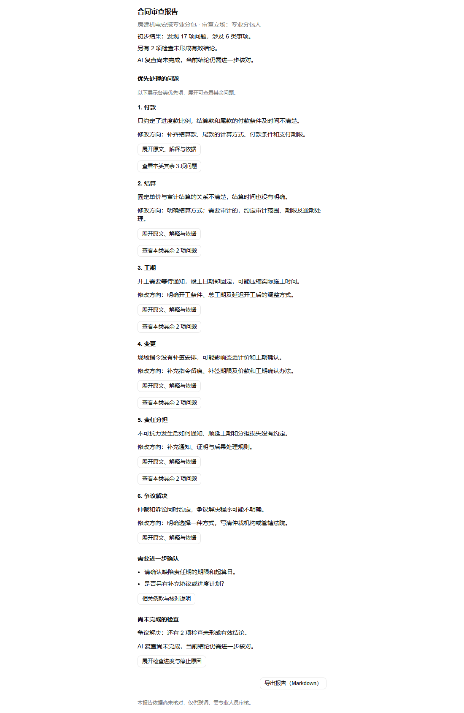
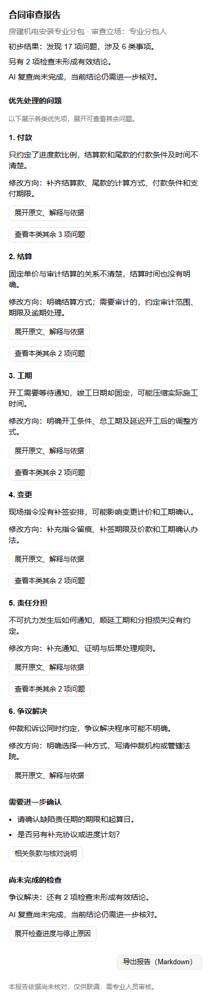

# 合同审查报告可读性调整

日期：2026-10-26（Asia/Shanghai）。阶段：Demo 授权联调。基线：`b3871a3`，本次改动尚未提交、推送或部署。
契约归属：`spec/02-workbench-ui.md`「匿名合同审查联调」；对应 AC-03、AC-21 及报告 UI 检查，不作为法律业务准确率验收。

## 行为

- 首页按「场景与立场 → 问题数/类别数及初步结果提示 → 各类优先问题与修改方向 → 需要进一步确认 → 尚未完成的检查 → 导出」展示。
- 问题仍按原严重程度及原文位置排序，每类默认一个代表项，其余独立结论按需展开。具体规则编号、等级、来源状态、完整文字、引文定位和对应 AI 复查意见在详情中保留。
- 原本「独立复核」在报告中称为「AI 复查」。未完成及需人工核对数在首页提示，具体进度、未复查规则、拒绝意见与错误在检查详情中保留。
- `getReportView` 统一网页和 Markdown 的数量及分组。相同原文的实际待确认事项合并展示，并保留关联规则；后端占位、未定位及没有后续有效回答的拒绝项按规则去重，单列未完成检查。
- 仅 debug 模式、整段匹配已知声明时，把共性调试声明归入报告末的统一提示。混合具体疑点、否定语句、未知措辞和 published 模式内容保守保留。不同措辞的相似疑点不作语义合并。
- 原始待核实记录、覆盖、来源版本、执行错误与警告均可展开核对，JSON 不变；完整无风险闸门、人工复核状态、调用预算和规则发布资格不变。
- 生成表达约束补充易读中文及 pending 用途，机电技能升为 `1.0.3-draft`。后续新任务读取新版本；本次未实际调用模型，不能据此声称新模型输出一定遵循表达要求。

历史报告读取时即使用新展示投影，不自动重跑、改写或追加摘要模型调用。开发服务仍在运行时刷新页面查看；需要新的后台技能配置时重启服务。

## 官方界面来源

已读取 [官方 Blocks](https://ui.shadcn.com/blocks) 及 dashboard 源码，其侧栏和统计图结构不适合报告；按当前界面契约组合官方 [Collapsible](https://ui.shadcn.com/docs/components/radix/collapsible) 和 [实际示例源码](https://raw.githubusercontent.com/shadcn-ui/ui/main/apps/v4/registry/new-york-v4/examples/collapsible-demo.tsx)。
沿用现有 Button、Table、Badge、AlertDialog、Collapsible；未新增依赖、自定义 CSS、颜色或动画。原文弹窗继续沿用当前固定版本定位。

## 实际验证

本机 Node.js 24 / pnpm 11.6.0：

| 检查 | 结果 |
| --- | --- |
| 报告针对性测试先运行 | 新归类测试通过，旧 Markdown 因仍显示「19 项待核实」失败；随后实现共享展示 |
| `pnpm check` | 通过：ESLint、Next 路由类型、TypeScript |
| `pnpm test` | 236 项，235 通过、0 失败、1 项既有平台检查跳过 |
| `pnpm build` | standalone 构建通过 |
| `git diff --check` | 通过 |

完整回归曾发现导出详情遗漏原模式及「未定位/未执行、不计为通过」说明，已恢复后重跑通过。首次普通沙箱内 pnpm 启动器因访问 registry 失败，未执行测试；改为获准环境执行上述最终命令，不将早期失败计为通过。

浏览器采用本机 Chromium、真实报告组件和本次生产 CSS，使用合成的 69 段/19 项结果；测试入口为隔离报告页面，不包含完整 Word 编辑器或真实任务重跑。

- 17 项问题与 2 项未完成检查分开显示；重复声明不计为问题，同一实际问题去重后只显示一次。
- 键盘展开、同类其余问题、固定版本原文高亮、原始待核实记录及 Markdown 下载通过。
- AI 复查疑点（包含默认折叠的非优先条目）、正常无问题、全部回答无效、场景不支持等合成状态通过。
- 390px 宽度及展开原文弹窗无横向溢出，浏览器无页面错误；输入对象未被修改。
- 未读取 `.env.local`、未外发用户合同、未调用模型或新增费用；没有运行 GitHub CI、容器、GaussDB、真实端到端任务或法律业务验收。

本机可重复运行默认 `pnpm test`；隔离浏览器脚本及机器日志保留在忽略目录 `.superpowers/`，不作为 CI 已覆盖的证据。

## 合成预览

[Markdown 导出示例](assets/readable-review-report/report-example.md)

[检查详情](assets/readable-review-report/progress-desktop.png) · [手机原文弹窗](assets/readable-review-report/citation-mobile.png)
