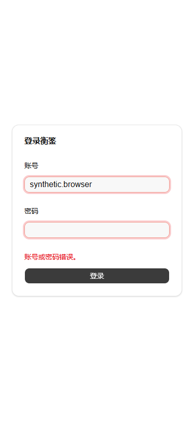
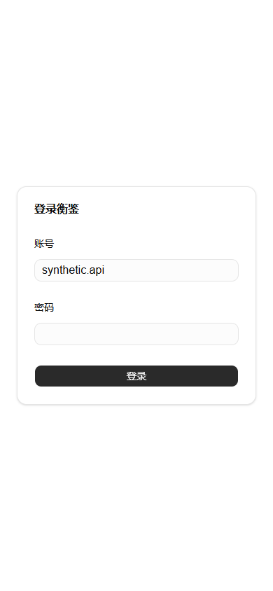

# A1 认证 HTTP 与会话本地验证

开始日期：2026-10-27；续验归档：2026-10-28 15:35，Asia/Shanghai。阶段：Demo 开发，A1 Task 8。基线提交 `f37dceec30b2afef29104cfd7842344070337ec9`，含未提交修改。未提交、推送、部署或对外发送消息。

## 结果与边界

A1 已实现受控账号、`/login`、登录/当前会话/退出 HTTP、server-only 身份及内部会话重验、固定 12 小时会话、持久化账号/部署来源限流、显式初始化与有界清理、私有维护。本地检查、SQLite 真实接口闭环、默认生产构建、生产启动/冒烟及本地 TLS 浏览器交互已通过。

本地 TLS 使用临时自签证书，Playwright 设置 `ignore_https_errors=True`；这证明合成环境中浏览器接收并发送 Secure cookie，**不等于有效公网 HTTPS 验收**。项目授权和 A2 未保存对象工作区接点尚未交付，不计 AC-01、AC-15、UI-14/UI-15 或 A1 联合闸门通过。

## 集成修复

按产品规格 §3.2 恢复既有契约，未新增业务范围：

- 共享方法策略与薄静态 Route Handler 导出补齐 405 / OPTIONS 的 `private, no-store`，保留空 405、OPTIONS Allow、GET 派生 HEAD；未支持方法不调用认证服务，无新错误码。
- Next instrumentation 和路由分别评估模块，原先各自持有认证 runtime，实际 session 错返 503。改为进程内共享生命周期，导入仍不连接，instrumentation 显式启动。
- 不同 bundle 的 AuthError 类身份不同，凭据错误/限流原先错返 503。内部 `Symbol.for` 品牌和已知错误码白名单替代 HTTP 的类身份判断；消息仍取固定安全表，未品牌化数据库错误保持安全 503，Retry-After 仅接受有限数字。
- 维护测试显式保留 NODE_ENV，修复构造 ProcessEnv 的 TypeScript 错误。

登录页来源为 [官方 login-01](https://ui.shadcn.com/blocks/login#login-01)，结构和受控账号偏离由工作台规格 §5.1 拥有。本次未改界面样式。

## 命令与结果

Node `v24.14.1` / pnpm `11.6.0`。每次 pnpm 命令均先设置固定工具路径：

```powershell
$env:Path = (Resolve-Path .superpowers/sdd/2026-10-27-a1-auth-http-session-plan/bin).Path + ';' + $env:Path
```

| 实际检查 | 结果 |
| --- | --- |
| 方法策略 RED → GREEN | 退出 1 → 0；新增测试先因实现缺失失败 |
| `pnpm exec tsx --test src/server/auth/*.test.ts src/server/database/migrations.test.ts` | 0；最初 42/42，后增的生命周期与品牌各一项另测并纳入全量 |
| `pnpm exec tsx --test src/lib/auth/*.test.ts` | 0；6/6 |
| runtime 定向 / error-brand + HTTP 定向 | 0；含独立模块评估和异类身份测试，品牌先 RED 再 GREEN |
| 首次 `pnpm check` | 2；维护测试 ProcessEnv 类型错误，已修复 |
| 最终冻结源码 `pnpm check` | 0；ESLint、Next route typegen、TypeScript |
| 最终冻结源码 `pnpm test` | 0；242 项，241 通过、0 失败、1 跳过 |
| 默认 `pnpm build` 初期 | 1；Turbopack CSS worker 连接前退出 0，多次重试输出均保留本地 |
| 默认 `pnpm build` 观察性诊断重试 | 0；仅 scratch net 连接观察 preload，不改编译器/源码/配置 |
| 默认 `pnpm build` 无 preload 再试 | **0**；同一默认命令，无源码/配置/编译器变更，见 `build-final.txt` |
| 该无 preload 构建的 `pnpm start` / `pnpm smoke http://127.0.0.1:3187` | 服务已就绪；smoke **退出 0**（健康、页面、CSS、公共资源）。启动进程后续手动清理，日志终止码为 `4294967295`，不是正常退出 0 |
| 实际生产 HTTP API 脚本 | 0；方法策略、缓存、Origin、cookie 属性、登录/会话/退出 |
| 本地 TLS 浏览器 / 补充浏览器 | **0 / 0**；真实生产构建页面与 API，网络/时序案例见下 |
| `git diff --check` | 0；文档续验更新后再次执行 |

完整检查按 check → test → build 顺序运行；后续构建与浏览器重试只针对尚未通过的环境验证，未改应用源码。唯一跳过为 `DB-08: Linux file journal persists, reopens and reuses a single durable intent`；Windows 逻辑测试不替代 Linux 文件/目录 fsync 证据。工程测试不计入 24/60 个法律业务样本，不声明法律准确率。

## 环境、失败与复现

根目录已有用户开发服务 PID 45680，本次未停止、复用或访问其数据。最初 scratch 开发副本未复制 `.env.local`，使用合成 SQLite、3188 回环 origin；真实 API 验证通过，但 `/login` CSS 编译导航超时，浏览器交互当时未运行。

生成 worker 的独立诊断表明：受限执行时本地 TCP 连接返回 EACCES，然后 worker 的关闭处理以 0 退出；同一小型复现提权后连接成功。这解释该复现的症状，**不确证每次完整构建失败的唯一原因**。完整构建随后在提权 + 仅观察 localhost net 事件 preload 下成功，再次移除 preload 的默认构建也成功。未修改系统防火墙、信任库、依赖或生产编译配置。成功重试使用工具 `sandbox_permissions=require_escalated`、`yield_time_ms=1000`；结果属于本机验证，非 GitHub CI。

生产首次以合成 HTTPS Origin 配置、实际 HTTP 3187 传输运行 smoke/API；仅用于属性检查。续验使用同一无 preload 构建，在绝对路径合成库 `task8-localtls-synthetic.sqlite`、`APP_ORIGIN=https://127.0.0.1:3443`、HTTP 后端 3187 启动；Python TLS 代理仅在 127.0.0.1:3443 转发真实页面/API，保留 Origin/cookie，不改写来源头。临时证书含 localhost/127.0.0.1 SAN，证书及私钥仅留忽略 scratch，未导入系统信任库。

浏览器为 Python Playwright 1.64.1 + 系统 Edge，headless 独立 context、390×844。自签证书仅在该测试 context 中忽略；无用户 profile、真实账号/资料、AI 任务或模型请求。截图密码字段均为空，输出不含密码、cookie、令牌、散列或原始响应头。

## 真实 API 与浏览器观察

- 三路由的未支持方法 405 / OPTIONS 204、Allow、HEAD 空正文、`private, no-store` 通过。
- 无 Origin 登录 403；真实 login 200 → session 200 → logout 204 → 旧 cookie session 401；重复 cookie 401。生产 cookie 的 Secure / HttpOnly / SameSite=Lax / Path、无 Domain、剩余 Max-Age≤12 小时、公开 JSON 字段均检查。
- 跨 bundle 修复前未知账号与限流错返 503；修复后五次 401 `INVALID_CREDENTIALS`，随后 429 `LOGIN_RATE_LIMITED` + 整数 Retry-After。
- 键盘输入、Tab、Enter 提交错密码，出现安全错误、保留账号、清空密码；390px 页面无水平溢出。
- 真实正确凭据登录，浏览器接收 `__Host-equilens-auth` Secure/HttpOnly/Lax cookie，随后真实 session 200；恶意外站 returnTo 回到同源根路径，合法相对 returnTo 实际接受，成功后密码为空。
- 网络失败案例由 Playwright **主动中断登录请求**，实际界面显示网络错误并清空密码；计数 1 秒内只有 1 请求，无自动重试。
- 重复提交案例由 Playwright **挂起并回填一条 401 登录响应**以控制时序，按钮忙碌禁用，连续 requestSubmit 仍仅 1 请求；不能把这条回填响应计作真实凭据验证。
- 真实浏览器 context 会话到期 401：仅在合成库把 expires_at 改为过去，不冒充经过 12 小时。私有 AuthService maintain 停用/重新启用后，原浏览器会话均 401；真实 API logout 204 后 session 401。没有工作区退出 UI 的通过声明。

首次本地 TLS 脚本因测试期望网络错误文案不符而超时，改为实际客户端安全消息后通过，未改产品实现；另补充计数验证及合法回跳。





## 尚未运行

| 联验 | 原因 |
| --- | --- |
| C0 真实交接、丙/乙外部身份/业务签收 | 未对外发送消息，未取得真实版本签收 |
| C1/C3 项目三角色/撤权/无项目/材料访问/下载另存旁路 | 真实项目接点未交付；无假项目页面或自动授权 |
| A2 整个工作区未保存对象注册、退出保护、旧页签视图清除 | 真实工作区接点未交付；API 退出不替代界面联验 |
| 有效公网 HTTPS / 真实部署 | 本地自签 TLS 仅合成测试，未授权部署 |
| GaussDB 实例版本/模式、Linux 容器、GitHub CI | 未提供或未执行真实环境 |

## 可随变更审阅的原始证据

[证据目录](2026-10-27-a1-auth-evidence/) 中 `.txt` 和 PNG 不受全局 `*.log` 忽略影响：

- `check-final.txt`、`test-final.txt`、`build-final.txt`、`production-start.txt`、`production-smoke.txt`：最终工程/精确产物检查。
- `production-api.txt`、`browser-localtls.txt`、`browser-supplement.txt`、`localtls-production-start.txt`、`localtls-proxy.txt`：真实生产接口及本地 TLS 浏览器结果。
- `runtime-api-red.txt` / `runtime-api-green.txt`、`error-mapping-red.txt` / `error-mapping-green.txt`：真实接线 RED/GREEN。
- `method-policy-red.txt` / `method-policy-green.txt`、`auth-targeted.txt`、`client-targeted.txt`、`runtime-targeted.txt`、`error-brand-targeted.txt`：定向回归。
- `build-initial-failure.txt`、`browser-initial-timeout.txt`：代表性初期失败。

源码摘要与脱敏复现脚本另见证据目录 `source-manifest.txt` 和 `reproduce/README.md`。所有原始 `.log`、其余重复失败、原始 scratch 脚本、临时证书/合成库、详细执行报告仍留在忽略的 `.superpowers/sdd/2026-10-27-a1-auth-http-session-plan/`，不作为已提交证据宣称可随变更交付。

清理：续验结束已按记录的自建 PID 停止生产服务和 TLS 代理；3187/3188/3443 三个测试端口监听数为 0。用户原开发服务 PID 45680 未停止或复用。

## 独立工程审查（2026-10-28）

逐项审查及整体验收代码审查已完成，本地 A1 实现范围无遗留审查问题。审查读取上述实际验证证据，未重复运行测试；不替代 C0/C1/C3/A2 联验、真实平台验收或乙丙签收。本次保留分支及未提交修改，未提交、推送或部署。
