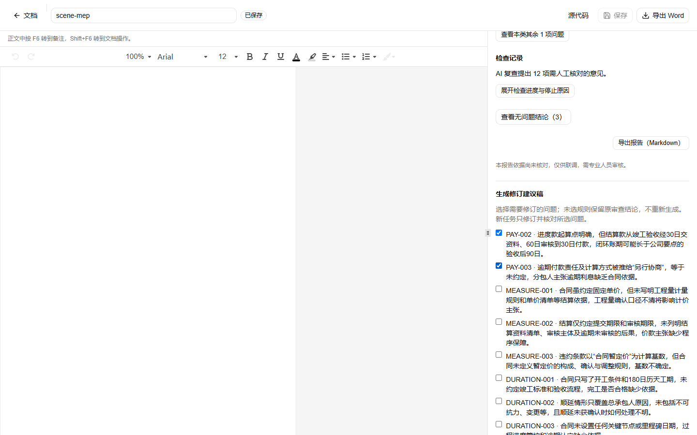
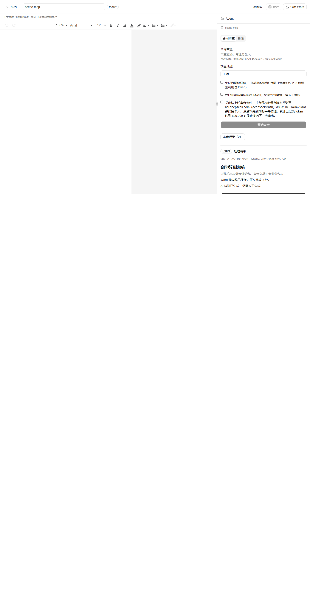

# 按选中问题生成修订稿（revision-only）

日期：2026-10-27（Asia/Shanghai）。阶段：Demo 授权联调。基线：本地未提交的成本与修订改动。

## 原因

此前的修订流程与审查绑在同一个任务里：即使只想改几条问题，也要先跑路由、主审、整份修订和全部规则核对。本地任务 `44f61e19` 的账本显示，2,129 字合同共 257,715 token，其中修订 116,254、改后核对 87,575，合计 79%；纯审查约 5.4 万 token。

## 行为

- 审查完成后（默认不勾选修订），报告底部出现「生成修订建议稿」：只列出有有效依据的「发现问题/缺失条款」，用户勾选需要处理的问题后提交。
- 新任务固定 `revision-only-v1`：输入保存原主审结果、所选规则和原场景包摘要，跳过场景识别与主审，不再调用主审模型；只修订并核对所选规则。
- 未选规则保留原审查结论，不重新生成；未修改正文由程序从原快照重建，导出前再次校验草稿摘要与未改段落。
- 独立核对范围仅限所选规则；所选规则全部取得有效意见且无「存在问题」项才允许导出 Word，报告和 Word 标注本次修订范围。
- 新任务独立计次、600 秒和已记录 token 阈值（默认 600,000），保留期限不超过原任务；下载仍读取已保存的不可变字节。
- 接口：`POST /api/contract-reviews/[id]/revision`，要求同源、会话上下文、`Idempotency-Key`、`externalProcessingConsent: true` 和 1–22 个规则 ID；原任务必须是已完成、场景匹配的普通审查。

## 文件

- 领域：`tools/contract-review/src/agent/pipeline.ts`（`reviewRevisionOnly`）、`agent/revision.ts`（`targets` 参数）、`revision.ts`（`validateRevision` 目标范围）
- 服务：`src/server/contract-review/tasks/{service,repository,handlers,schema,http-services,workflow}.ts`、revision 路由
- 界面：`src/components/contract-review-report.tsx`（选择与提交）、`contract-review-panel.tsx`、`src/lib/contract-reviews/client.ts`
- 文档：`spec/00-overview.md`、`spec/01-product.md`、`docs/contract-review-web.md`

## 验证

| 检查 | 结果 |
| --- | --- |
| `pnpm check` | 通过 |
| `pnpm test` | 273 项，272 通过、0 失败、1 项既有平台检查跳过 |
| 新增测试 | 只修订流程：无路由/主审调用、只修订与核对所选规则、导出闸门通过、未知规则在发请求前拒绝；任务层：原审查固定、保留期限继承、跨所有者拒绝；HTTP：缺授权 422、合法请求 202 |

## 未验证 / 限制

- 未修改段落采用"按原快照重建 + 草稿摘要校验"，不是对原始 DOCX 字节做逐字节 diff；渲染器仍会在子进程二次校验。
- 仅适用于已完成且场景匹配的普通审查；旧任务和其他工作流不自动转换。

## 真实合成联测（2026-10-27）

隔离 SQLite（`.superpowers/live-db2`）、本机 Chromium、真实 DeepSeek，仓库合成机电合同；不发送用户业务合同。

| 阶段 | 调用 | 本任务 token | 结果 |
| --- | ---: | ---: | --- |
| 纯审查 | 15 | 107,223 | `success`，19 条结论，16 条可修订 |
| 仅修订（选 PAY-002、PAY-003） | 3 | 16,844 | `success`，2 条处理说明、2 条核对（均「需确认」），Word 已保存并下载 |

两段合计 124,067 token；同一合同的整份修订旧路径为 257,715 token，约省 52%。下载文件 2,352 字节，正文含 AI 修订标记；浏览器无 pageerror 或 console error。

联测发现并修复：修订任务的 `usage` 原先把固定主审的 107,223 计入，显示为 124,067；现只统计本任务实际调用（16,844），token 停止阈值同样只对新任务外发生效。

