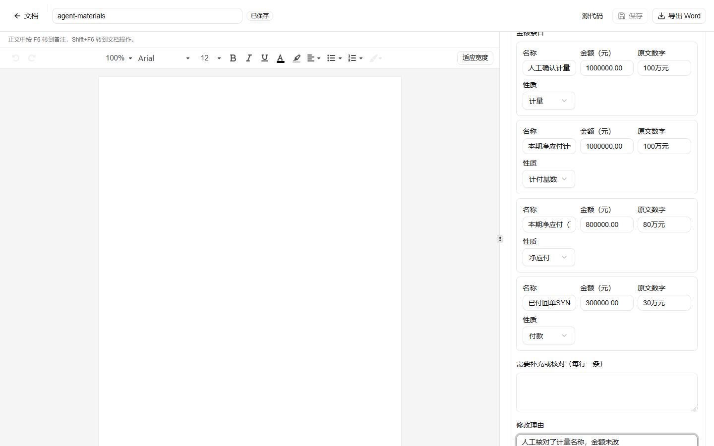
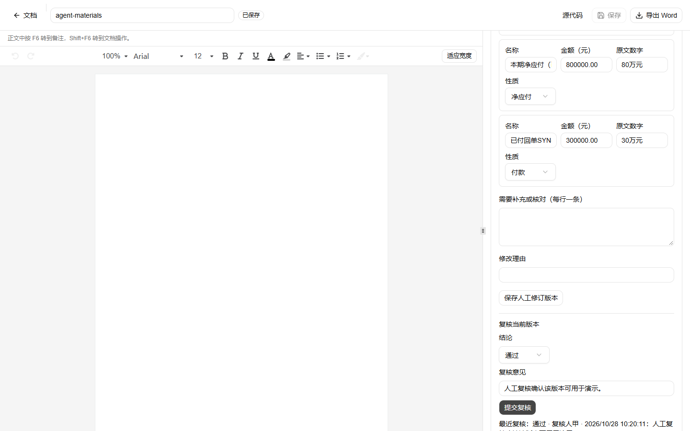
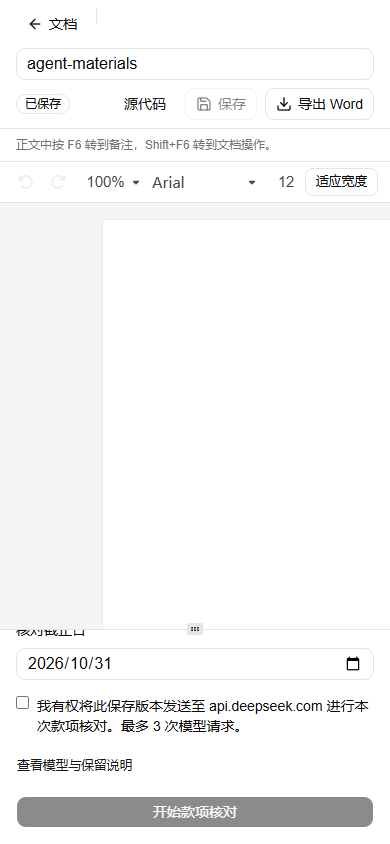

# 文档 Agent 网页增量（款项/证据/催款函）

日期：2026-10-28。分支：`feat/review-panel-polish` 上的未提交工作（Codex 实现 + 本次补修）。未提交、未推送。

## 已实现

- 面板内「处理业务」选择：合同审查、款项核对、证据整理、催款函；沿用当前保存版本、匿名会话、任务历史与结果页，不新增顶层 Tab。
- `document-agent-v1` 任务：整理 Agent 提取结构化材料事实，独立核对 Agent 检查引文、金额、主体和缺证；最多 3 次请求，共用预算与恢复。
- 款项核对：整数分金额、本期/累计、扣抵、付款去重、有条件测算；不足时不输出确定欠款。
- 证据整理：时间线、争点、材料记载/陈述/拟约定、缺口；结果 Markdown 导出。
- 催款函：固定 `collection-letter-v1` 模板、拟发送计划、引用同会话同版本款项/证据结果、独立核对、DOCX 保存与受会话守卫的下载。
- 测试 306 项（305 通过、1 平台跳过），`pnpm check`、`pnpm build` 通过。

## 真实合成 smoke

隔离 SQLite + 本机服务 + 真实 DeepSeek，合成机电分包对账材料，三项任务连续执行：

| 任务 | 状态 | 调用 | token | 结果 |
| --- | --- | ---: | ---: | --- |
| 款项核对 | success | 3 | 16,441 | 有条件余额 500,000.00 元，引文与金额逐条核对 |
| 证据整理 | success | 2 | 7,244 | 时间线、双方签认与付款事件，独立核对完成 |
| 催款函 | partial | 3 | 19,065 | 草稿生成并保存 Word；金额引用款项结果，下载摘要一致 |

smoke 退出码 0，脚本断言三项审计完成、款项精确 500,000 元、催款函有导出且下载字节摘要一致。

## 浏览器端真实流程

隔离 SQLite + 本机 Chromium + 真实 DeepSeek，从网页导入合成 DOCX 后依次执行三个业务入口：

| 任务 | 状态 | 调用 | token | 页面结果 |
| --- | --- | ---: | ---: | --- |
| 款项核对 | success | 2 | 8,169 | 页面显示有条件测算余额 **500,000.00 元**（800,000 − 300,000） |
| 证据整理 | success | 2 | 8,428 | 4 条时间线事件、争点、原文展开与 Markdown 导出 |
| 催款函 | partial | 2 | 13,011 | Word 草稿生成并下载，2,410 字节；正文引用 800,000 / 300,000 / 500,000 |

催款函显示 `partial` 是因为材料只有合同抬头、没有合同正文条款，属于明确的待补充草稿；金额取自已保存款项结果，不由模型补造。

## 本次补修

1. **非法 JSON 工具参数**：证据整理的独立核对返回 `"gaps": [],, "notes"`，AI SDK 判为无效调用。新增 `repairToolCall`，只修重复逗号/尾随逗号，内容仍由 schema 校验。
2. **重复付款行**：模型把回单和汇总表各记一笔付款。改为按金额、日期、主体和口径去重，并在备注中要求核对凭证；主体或口径冲突时仍不出余额。
3. **金额范围表述不一致**：同一合同被写成“合成机电分包合同本期工程款”和“上述合同…本期含税工程款”。改为归一化后允许概括写法，出现不同合同名仍拒绝。
4. **催款函误报缺口**：整理技能明确“未列金额/事件是任务要求”，用户已填的发函方、地址、日期不算正文缺口，避免阻断导出。
5. **金额引文约束**：每个金额的引文必须包含原始数字与单位，计付基数不得用比例引文代替。

## 尚未完成

- 催款函在缺少合同正文时保持 `partial`，草稿与已复核 Word 均可下载；这是材料范围限制，不是执行失败。
- 未提交、未推送；未做项目/账号权限，仍是匿名文档增量。
- 未验证 Microsoft Word 排版、GaussDB、容器部署和业务准确率。

## 人工修订与复核（A）

- 机器结果固定为版本 0；人工修订通过 `/api/contract-reviews/[id]/revisions` 保存为不可变版本 1..n，保存时重新校验引文和金额并按修改后的款项重算，基础版本过期拒绝覆盖。
- 复核通过 `/api/contract-reviews/[id]/revisions/[revisionId]/review` 记录到明确版本，字段为复核人、时间、通过/驳回/退回修改及意见。
- 结果页可修改款项金额/口径、证据事件性质与支持状态、缺口说明，以及催款函正文；催款函复核通过后通过 `/revisions/[revisionId]/letter` 下载“已复核 Word”。
- 导出区分“机器结果”“人工草稿”“已复核版本”；机器结果和旧版本始终可读。
- 浏览器真实流程已验证：款项任务 → 修改计量名称 → 保存 v1 → 复核通过；机器结果仍为“本期计量确认金额”，v1 为“人工确认计量”。催款函任务 → 改正文 → 保存 v1 → 复核通过 → 下载已复核 Word（2,462 字节）。

## 状态与版本语义

- 任务详情在状态徽标下显示解释：`success` 表示执行与覆盖完成，不等于无风险；`partial` 表示存在未完成项、预算或材料限制，不代表部分条款本身有问题。
- 结果基于旧保存版本时显示“历史保存版本”边框提示，说明当前文档修改未进入该结果，并提示重新提交才会审查新版本。
- 仅修订任务显示其来源审查任务编号，避免把“审查”和“修订”当成同一种结果。

验证：`pnpm test` 309 项（308 通过、1 平台跳过）；`pnpm check`、`pnpm build` 通过。

## 移动端与业务切换

- 390×844 视口完整跑通款项、证据、催款函，页面 `scrollWidth = 390`，无横向溢出；已复核 Word 2,466 字节可下载。
- 切换“处理业务”时清空上一个业务的结果选择，并自动显示该业务最新任务；不再把款项结果留在证据整理页。
- 继续原任务的文案改为不限定“审查”，避免资料整理任务出现“继续原审查任务”的错位。

