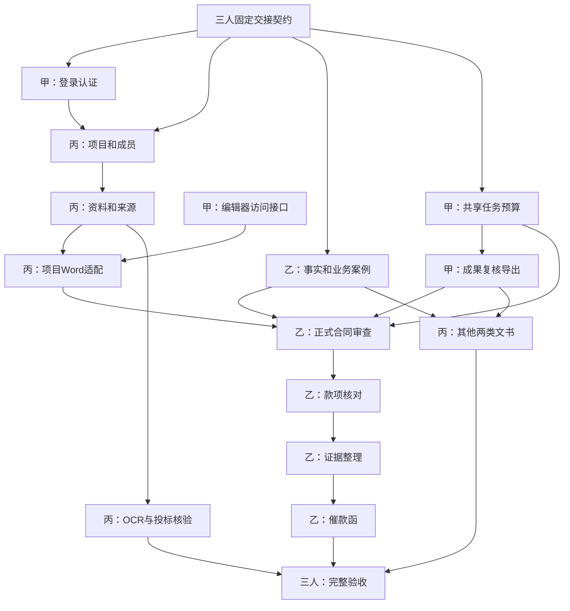

# EquiLens 三人并行开发 Plan

> 执行说明：按工作包逐项实现、验证、交叉审查后合并。使用代理执行时，可按需使用 subagent-driven-development 技能；本计划本身不启动代理或实施开发。
> 本文件是任务分配与实施计划，不是新增产品契约、完成记录或发布授权。不自动创建 Issue、提交、推送或部署。

**Goal:** 三人协作补齐现有工程能力，贯通“合同审查 → 款项核对 → 证据整理 → 催款函”，同时完成 Demo 其余业务、三模板及平台验收。

**Architecture:** 保持一个 Next.js Node.js 应用、一套数据库抽象和一个持久化串行任务执行入口。甲负责既有能力收尾及其共用机制，乙负责主线业务，丙负责新增项目/资料平台和其余业务；通过固定版本引用及服务端授权接口衔接。

**Tech Stack:** Node.js 24、pnpm 11.6.0、Next.js App Router、TypeScript、SQLite / GaussDB 集中式、SuperDoc 1.47.2、官方 shadcn/ui、既有 AI SDK，以及 server-only 的私有 OBS、MaaS 和已验证 OCR 适配器。


## 个人计划入口

| 负责人 | 独立文件 | 工作包 |
| --- | --- | --- |
| 甲 | [甲：已有能力完善与共用机制开发 Plan](2026-10-27-person-a-foundation-plan.md) | A1、A2、A3、A4、A5 |
| 乙 | [乙：合同审查到催款函主线开发 Plan](2026-10-27-person-b-mainline-plan.md) | B1、B2、B3、B4、B5 |
| 丙 | [丙：项目平台与其余新增业务开发 Plan](2026-10-27-person-c-platform-plan.md) | C1、C2、C3、C4、C5、C6、C7 |

共享约束和跨人协作仍由本文件负责，个人任务详情及进度以对应独立文件为准。

## 1. 基线、范围与文档关系

- 编写日期：2026-10-27，Asia/Shanghai；本地代码基线 `3aebc0f`。
- 本轮进度调研已执行：199 项测试，198 通过、0 失败、1 项 Linux 持久性测试跳过；ESLint、路由类型、TypeScript 和空白检查通过。pnpm 启动未返回输出，测试和检查通过直接调用已安装工具完成；不记作 pnpm 启动成功。
- 本计划编写不新增业务验证结论，不把历史构建、浏览器、模型或部署记录作为当前版本全量通过证明。
- 已存在 Word 编辑、匿名文档版本、期限清理、合同审查联调任务、认证核心；账号登录与项目权限未闭环，内置法律规则仍待核对。
- 姓名尚未指定，以下用甲、乙、丙表示三个实际开发负责人；甲兼技术集成人，不另设第四名开发者。
- 继续沿用十二天 Demo、随后一个月完善的两阶段目标。已有记录确认实际开工日为 2026-10-21，并要求按依赖和验收推进；本计划不重置开工日、不另起十二天、不以虚构工期保证交付。

### 1.1 权威来源

| 文档 | 本计划采用内容 |
| --- | --- |
| [规格索引](../../../spec/README.md) | 合同归属、实现与目标的区分 |
| [架构](../../../spec/00-overview.md) | 单体、模型、审查、持久化任务与生命周期 |
| [产品](../../../spec/01-product.md) | §2—4 输入/权限/业务，§6—10 来源/版本/恢复，§12—13 验收及阶段 |
| [工作台](../../../spec/02-workbench-ui.md) | §5 业务接入、UI-14—UI-23 |
| [Word](../../../spec/03-word-editing.md) | 编辑支持范围、保存、往返、WD 检查 |
| [数据库](../../../spec/04-database-deployment.md) | 项目边界、迁移、双 provider、匿名生命周期 |
| [工程规则](../../../DEVELOPMENT.md)、[部署说明](../../deployment.md) | UI 来源、构建、容器和发布操作 |
| [原业务计划](2026-10-24-business-step-three.md) | 保留原任务细节和历史状态；本计划负责当前三人分工、依赖及交接 |

任务是否完成以代码与验证记录为准，不以两份计划的复选框推断。执行者在所属验证记录中写入本计划工作包编号，避免重复记账。若发现行为缺规格，先补拥有规格，写清范围、输入输出、失败、权限和验收，再实现；计划中的文件名和接口草案不自动成为已接受契约。

## 2. 全局约束

- 一个应用、首版单实例；不新增独立 API/Worker、Redis、向量数据库、队列服务或通用 Agent 平台。
- 使用固定 pnpm 和 `pnpm-lock.yaml`；不改用 npm/yarn，不无关升级依赖。
- 页面与 HTTP 入口保持薄；凭据、数据库和云适配器只在 server-only 边界使用；私有数据不进入共享缓存。
- 三角色为项目管理员、可编辑成员、只读成员；只读仅下载已有原件/导出，不生成新导出或触发任务。
- 每次读取、关联 ID、历史下载、任务领取和外发前重查权限；匿名 owner/contextId 不充当项目授权。
- 原件、文档/解析/事实/款项/成果/规则/模板和导出均保留不可变版本。匿名资料只能导出后重新导入项目，形成独立副本。
- 默认输入：文档 20 MiB、图片 4 MiB、PDF 100 页、每任务最多 10 文件、DOCX 100,000 字符、总提取 200,000 字符；不静默截断。模型上下文另行实测。
- 解析在默认 512 MiB / 60 秒受限子进程运行；默认任务累计 600 秒、最多 3 次尝试、15 秒心跳/60 秒租约。
- 全局执行 1、排队最多 10、每用户未终结最多 2；批量解析一个父任务计数。匿名兼容任务也不能绕过全局执行槽。
- 固定流程默认合计最多 3 次模型请求；审查 Agent 累计最多 25 次、可信配置 1—25；证照最多 2 次 OCR。重试/恢复不重置次数、时间或费用占用。
- 付费外发前登记并持久化任务/项目预算预留；预算缺失、额度不足、未知授权时不发送。外部请求结果未知时不承诺恰好一次或无费用。
- 金额用整数分或精确十进制；不经过浮点金额转换，不把计量额当到期额，不把负余额取零，不推断利率或起息日。
- 每次人工保存后重验结构、来源、关键数值和必填项，重置整份复核；复核不能豁免缺证、冲突或无效引用。
- 导出所选保存版本，不调用模型重新生成，不覆盖已有导出；完整/草稿/部分完成状态按产品契约保留。
- UI 实施前读取官方 [Blocks](https://ui.shadcn.com/blocks) 的实际源码和最接近示例；无匹配时组合官方组件。在变更描述记录来源和必要偏离。本次仅写计划，未新增界面或宣称已重新检查这些源码。
- 不增加自由聊天、自动发送催款函、全文扫描合同处理、任意合同起草、无损 Word 还原、修订痕迹或实时协作。

## 3. 三人分工总表

| 人员 | 主职责 | 必须交付 | 不承担的主实现 |
| --- | --- | --- | --- |
| 甲：现有能力完善与集成 | 登录接入、编辑器收尾、审查工程、共享任务/预算、通用成果修订/导出、数据库及部署验证 | 可靠且可复用的认证、执行、修订、导出底座；现有匿名能力无回归 | 不编写款项算法、证据业务、催款内容，不代替领域人员发布法律规则 |
| 乙：催款主线 | 主线事实准备、正式合同审查、款项核对、证据整理、催款函 | 一条可用新资料真实运行并人工复核导出的纵向流程 | 不另建登录、权限、存储、任务、成果仓储或通用导出服务 |
| 丙：其余新增能力 | 项目/成员/关系、资料库、OBS/解析/OCR、项目 Word 适配、来源服务、投标核验、其他两模板、知识发布接入、项目生命周期 | 向主线提供有授权和版本的资料平台；补齐四业务与三模板 | 不重复实现审查 Agent、款项计算和催款函，不另建任务执行器 |

### 3.1 容易重叠的事项只有一个实现负责人

| 交界项 | 主实现 | 消费/协作 | 交接规则 |
| --- | --- | --- | --- |
| 登录与项目权限 | 甲做身份，丙做成员授权 | 乙调用两者 | 服务端从会话取账号，再按资源所属项目授权；不信任前端 accountId |
| 合同审查 | 甲做模型/任务工程，乙做业务 | 丙提供材料与来源 | 乙拥有规则、场景、审查业务与界面；甲不另做第二套正式审查页面 |
| 法律规则发布 | 乙整理内容，丙做版本/发布仓储 | 甲执行发布守卫 | 实际领域核对人提供签核；三名开发者不能用测试标记代替法律核对 |
| 项目 Word 读写 | 甲抽取编辑器访问接口，丙实现项目适配器 | 乙选择保存版本 | 保留匿名适配器与既有冲突/导出行为，不给 owner 换名充当 projectId |
| 共享事实 | 乙拥有事实模型和更正逻辑 | 丙的投标/文书复用 | 丙不另建事实表；业务特有字段通过受控类型扩展 |
| 来源读取 | 丙拥有授权读取与历史定位，甲提供引文校验共用接点 | 乙负责结论关联和来源 Sheet | 来源服务不判定法律适用，引用有效不等于结论正确 |
| 成果/修订/复核/导出 | 甲拥有共用机制 | 乙、丙提供结构、必填项和模板 | 业务验证器按任务类型固定注册，不接收用户上传脚本或任意工具 |
| 三模板 | 乙拥有催款函；丙拥有专业分包合同、补充协议及模板版本仓储 | 甲负责通用渲染 | 共同约定模板清单；三人不分别创建导出引擎 |
| 备份恢复 | 甲负责数据库/容器，丙负责对象/项目生命周期 | 乙核对历史业务可用性 | 一次完整项目恢复验收，不把局部恢复拼成通过 |

## 4. 目录与集成所有权

标“拟新增”的文件仅为实现落点，执行前检查是否已有同职责代码；不为完成目录表预建空模块。

| 文件/目录 | 唯一主维护人 | 说明 |
| --- | --- | --- |
| `src/server/auth/`、`src/server/ai/` | 甲 | 复用现有核心；登录 HTTP/cookie、模型适配 |
| `src/server/tasks/`、`src/server/results/`、`src/server/exports/`（拟新增） | 甲 | 执行、预算、成果、复核、导出 |
| `src/server/contract-review/tasks/`、`src/instrumentation.ts` | 甲 | 共享 runner 接入与匿名兼容 |
| `src/lib/documents/editor-session.ts`、`editor-access.ts`（后者拟新增）、`src/components/document-editor.tsx`、`word-canvas.tsx` | 甲 | 编辑器依赖注入、统一保存与回归 |
| `src/server/contract-review/index.ts`、`tools/contract-review/src/`、`rules/`、`skills/` | 乙 | 业务入口、Agent/固定编排语义、适用条件与规则 |
| `src/server/facts/`、`payments/`、`evidence/`、`collection/`（拟新增） | 乙 | 事实与催款主线领域逻辑 |
| `src/components/contract-review-*.tsx`、`src/components/business/mainline/`（拟新增） | 乙 | 主线任务、来源和业务表单 |
| `src/server/projects/`、`materials/`、`storage/`、`verification/`、`knowledge/`、`templates/`（拟新增） | 丙 | 项目、新资料、核验、发布资料和模板仓储 |
| `src/lib/business/documents-client.ts`、`src/server/materials/editor.ts`（拟新增） | 丙 | 项目 Word 访问实现 |
| `src/server/drafting/`、`src/components/business/platform/`（拟新增） | 丙 | 专业分包合同/补充协议、项目与资料 UI |
| `src/components/workbench.tsx`、项目 API 的公共宿主 | 丙 | 甲乙提交子组件与明确接线要求，丙统一接入 |
| `src/server/database/migrations.ts`、连接抽象、构建脚本、CI、部署文档 | 甲 | 甲编排迁移，业务 SQL 由所属负责人编写并共同审查 |
| `src/lib/business/contracts.ts`（拟新增） | 甲协调，三人签收 | 对外类型的唯一入口，不直接导出数据库行或 SDK 类型 |
| `spec/` | 按行为归属修改，甲编排合并 | 丙更新权限/资料，乙更新业务，甲更新执行/存储；同文件串行合并 |

分支建议：`alaaladaka/foundation-completion`、`alaaladaka/collection-mainline`、`alaaladaka/project-and-other-modules`。每个工作包独立 PR，不把三条长期分支全部做完后一次合并；共享文件变更先交给主维护人集成。

业务迁移保持已有 `0001` 内容不变，甲在实际合并前分配下一个连续编号；不得三人各改 `0002`、改旧摘要或重编号已应用迁移。沿用 SELECT + 条件 UPDATE；需扩展 RETURNING/CTE 时先验证两个 provider。

## 5. 共享交接契约与依赖

### 5.1 C0：最早完成的契约包（甲协调，乙丙会签）

- [ ] 核对拥有规格并固定账号、项目、资料、快照、事实、任务、成果及导出的引用字段和错误分类。
- [ ] 在 `src/lib/business/contracts.ts` 维护不含凭据/数据库/模型 SDK 的共享类型；以下是最小交接草案，落地前补齐对应规格，不能作为完整数据 schema 直接照抄。

```ts
type ProjectRef = { projectId: string }
type VersionRef = ProjectRef & { id: string; versionId: string }
type PublishedRef = { id: string; versionId: string; sha256: string }
type MaterialInput = {
  document: VersionRef
  parseSnapshotId: string
  sha256: string
}
type AnalysisManifest = ProjectRef & {
  materials: MaterialInput[]
  facts: VersionRef[]
  ledger: VersionRef | null
  upstreamResults: VersionRef[]
  rules: PublishedRef[]
  knowledge: PublishedRef[]
  templates: PublishedRef[]
}
type SaveRevision<T> = {
  baseVersionId: string
  operationId: string
  value: T
  reason: string
}
```

- [ ] 甲定义认证入口 `requireAccount(request)`，仅由服务端返回当前已验证账号/会话；丙定义 `requireProjectAccess(account, projectId, action)`，覆盖 read/edit/manage；结果带权限判定时所需的可撤销身份信息。
- [ ] 丙提供 `readMaterialVersion(account, ref)`、`readParseSnapshot(account, ref)` 和 `readSource(account, sourceRef)`；返回归属、摘要、覆盖和真实定位，不返回其他项目内容。
- [ ] 甲提供受限任务类型的 `submitTask(account, { kind, operationId, manifest, conditions })`；清单由服务端解析并固定，不接受浏览器指定的规则全文、模型地址或任意执行器。
- [ ] 乙定义 `saveFactRevision(account, ref, command)`、`calculateLedger(input)` 的确定性输入输出；付款归属、口径和证据状态必须是显式字段。
- [ ] 甲提供共用成果 `saveResultRevision`、`validateResult`、`reviewResult`、`createExport`；所有请求固定项目和所选版本，业务校验器由乙/丙提供。
- [ ] 三人固定 HTTP 错误映射：未登录、无权限/不存在、冲突、超限、预算不足、来源无效、服务不可用；私有响应 no-store，同源写检查，错误不泄漏 SQL/密钥/材料正文。
- [ ] PublishedRef 指向受控发布版本，与项目私有资料引用分开；服务端仍校验适用范围、发布/停用状态和使用权限，不能把合法版本 ID 当作自动适用。
- [ ] 每个接口先有生产实现旁的合成契约测试；离线桩只用于自动化，不挂到用户界面冒充成功。接口变化先改契约和消费者测试，再合并实现。

### 5.2 交接顺序



箭头表示正式联调前置，不意味着后续人员必须空等。乙可先实现确定性计算、合成案例和纯业务校验；丙可先做成员仓储、解析和模板字段；甲可并行做执行器与编辑器检查。完整 M0 仍需真实 GaussDB 首闭环证据，缺实例不阻止 SQLite 技术开发。

## 6. 甲的开发清单：已有能力完善与共用机制

详细职责、任务步骤和个人进度已拆至[甲的独立开发计划](2026-10-27-person-a-foundation-plan.md)，包含 A1、A2、A3、A4、A5。个人任务只在该文件维护；本总计划保留共用契约、交接、批次及验收汇总。

## 7. 乙的开发清单：合同审查到催款函主线

详细职责、任务步骤和个人进度已拆至[乙的独立开发计划](2026-10-27-person-b-mainline-plan.md)，包含 B1、B2、B3、B4、B5。个人任务只在该文件维护；本总计划保留共用契约、交接、批次及验收汇总。

## 8. 丙的开发清单：其余新增平台与业务

详细职责、任务步骤和个人进度已拆至[丙的独立开发计划](2026-10-27-person-c-platform-plan.md)，包含 C1、C2、C3、C4、C5、C6、C7。个人任务只在该文件维护；本总计划保留共用契约、交接、批次及验收汇总。

## 9. 并行批次与每批退出条件

P0 是 Demo 必需或其依赖；P1 仅在所属规格接受后实施。以下批次不是新的交付阶段，也不是固定日历承诺。

| 批次 | 甲 | 乙 | 丙 | 退出条件 |
| --- | --- | --- | --- | --- |
| 0：契约与样本 | C0、认证接口、迁移编排 | 事实/金额结构、规则核对清单、主线案例 | 项目/资料/模板接口、投标/文书案例 | 三人签收接口和目录所有权；真实外部资源缺项登记 |
| 1：基础并行 | A1、A2 访问接口、A3a | B1、B3 纯计算及反例、B2 离线业务 | C1、C2 的 DOCX/来源、C6 P0 | 项目授权、保存版本和来源可用；真实 GaussDB 首闭环单列结果 |
| 2：合同纵向联调 | A3b/c、A4 | B2 正式闭环、B3 表单 | C3、C2 文字 PDF/OBS、C4 OCR 验证 | 合同选版本到复核导出通过；缺规则/模型验证不称正式完成 |
| 3：主线贯通及其余业务 | A2 剩余验证、A5 平台 | B3 → B4 → B5 | C4、C5、C7 | 主线新资料演练通过；投标和另外两模板分别通过 |
| 4：交付冻结 | 全量工程/平台、发布版本核对 | 主线质量首轮修复/回归 | 投标/文书修复、完整恢复 | 24 例业务与独立冒烟、完整恢复和 AC 记录齐全，缺项不计通过 |

业务案例准备从批次 0 开始，每条业务首次闭环立即评测；不能等批次 4 才发现领域缺陷。甲在 A1/A3/A4 完成后转向集成与平台，丙优先 C1—C3 解除乙依赖，再推进核验/模板，避免三人同时堆积界面而底层未通。

### 9.1 每个工作包统一执行步骤

- [ ] 核对 Git 状态、拥有规格、上游接口版本及本包文件范围，保留他人改动。
- [ ] 先为金额、权限、版本、任务或真实失败等行为写正常/反例测试；运行观察缺实现或错误行为，再实现到通过。不写仅镜像实现的无意义测试。
- [ ] 接入真实持久化、调用/来源守卫和界面；记录输入、失败、权限与覆盖。低影响纯文案/布局修正不强制新增单元测试。
- [ ] 执行本包定向检查及受影响回归；更新操作说明/验证记录/真实截图，核对没有把未执行项写通过。
- [ ] 交指定审查人；修复缺陷后独立提交，简短使用 `feat:`、`fix:`、`docs:` 等消息，不夹带其他工作包。
- [ ] 合并后由下游对同一接口版本运行契约测试，签收后再标本包完成；生产发布不包含在普通合并动作中。

### 9.2 审查与验收负责人

| 交付 | 主审 | 专项核对 |
| --- | --- | --- |
| 甲的认证/任务/导出 | 丙 | 乙核对业务不会被预算/结果状态误判 |
| 乙的事实/审查/款项/证据/催款 | 甲 | 丙核对项目/来源；法律内容另需实际领域核对人 |
| 丙的项目/资料/其他业务 | 甲 | 乙核对主线接口及事实/模板语义 |
| 完整恢复、最终演练 | 三人共同 | 领域核对与真实账号权限不能由开发审查替代 |

## 10. 验证矩阵和交付证据

### 10.1 AC 与 UI 的主责分配

| 验收范围 | 主责工作包 | 协作 |
| --- | --- | --- |
| AC-01 登录/HTTPS、AC-12 持久化恢复 | A1、A3、A5 | C1/C3 |
| AC-02 新资料处理 | C2/C4 | A3 |
| AC-03 合同审查 | B2 | A3/A4、C2/C6 |
| AC-04 投标核验、AC-14 外部核验 | C4 | B1、A3/A4 |
| AC-05 三模板 | B5、C5 | A4 |
| AC-06 纠纷、AC-20 款项 | B3/B4 | B1、C2 |
| AC-07 复用、AC-19 事实来源 | B1—B5 | C2/C5、A4 |
| AC-08 来源、AC-09 版本 | C2、A4 | B1/B2、C3/C6 |
| AC-10 人工保护、AC-11 导出、AC-22 重验 | A2/A4 | B/C 各业务校验器 |
| AC-13 失败/部分结果、AC-23 任务预算 | A3 | B2、C4、A4 |
| AC-15 权限 | C1 | A1/A3、全部资源入口 |
| AC-16 完整恢复、AC-25 生命周期 | A5/C7 | 乙核对历史业务 |
| AC-17 新输入真实演示 | B5/C4/C5 | A5 汇总 |
| AC-18 研发证据 | A5 汇总 | 三人随提交记录实际使用，不补造 CodeArts/码道证据 |
| AC-21 覆盖/适用、AC-24 文件/文档安全 | B2、C2/C4 | A3、C6 |
| AC-26 容量/质量/价值 | A5 容量，乙丙各自业务质量 | 三人共同完整任务观察 |
| UI-14/15 | A1/A2、C1—C3、B1 | 撤权、只读、统一离开保护 |
| UI-16—UI-20 | A3/A4、B2、C2 | 状态、来源、修订、变化提示 |
| UI-21—UI-23 | B3—B5、C4/C5、A4 | 主线、四业务、三模板及导出 |
| UI-01—UI-13、WD、DB | A2/A5 | 丙回归项目适配，不能关闭未执行平台项 |

### 10.2 样本责任与门槛

| 验证集 | 乙 | 丙 | 甲 |
| --- | --- | --- | --- |
| Demo 独立业务至少 24 例 | 合同 8、纠纷 4、催款函 2 | 投标 6、其他两类文书 4 | 维护运行工具、版本清单及结果汇总；工程测试不凑业务例数 |
| 完善版独立业务至少 60 例 | 合同 20、纠纷 12、催款函 4 | 投标 16、其他两类文书 8 | 复现、容量、组合故障和质量汇总 |
| 另设 20—30 冒烟检查 | 主线操作 | 项目/投标/其他文书 | 工程/入口/恢复，合计清单去重 |

- 原件、来源授权/合成标识、独立性、输入及版本摘要先登记，领域人员在运行前标注必检/正常/合理待核实/拒绝条件及支持来源。只改姓名或金额不能算新独立案例。
- Demo 声明支持规则的必检项在验证集中全部通过；齐备材料一律待核实属于失败。高影响法律适用或债权金额错误修正前不开放完整成果。
- 完善版按产品 §12.1：合同/投标扩展检查检出率及各分析模块结论精确率暂定不低于 90%，运行封存集前由领域核对人确认。分模块报告分母，包含被过滤的原始结论，不事后降门槛。
- 报告原始机器输出、拒绝项、漏检、误报、正确/无必要待核实及引用支持；人工修订后漂亮的文书不能替代机器质量评测。
- 至少一次完整新案例演练，记录耗时、错误和操作数；完善期增加产品 §1.3 岗位观察与独立人工对照。

### 10.3 工程命令与实际环境记录

```powershell
pnpm install --frozen-lockfile
pnpm check
pnpm test
pnpm build
pnpm start
# 在另一个终端检查同一已启动构建
pnpm smoke http://127.0.0.1:3000
git diff --check
```

安装/全量测试/构建在集成工作区顺序运行，三人不同时重写同一 `.next` 或生成目录。新增测试路径由甲纳入 `package.json` 默认测试命令，不能只有手工定向运行才覆盖。

实际发布前还需 Docker/卷重启、真实 GaussDB/OBS/MaaS/OCR、浏览器、Word、HTTPS/源码版本、恢复及业务质量证据；命令退出 0 不能替代这些专项。真实材料只用明确授权样本，真实付费联调按已登记目标和预算执行。

每包记录：提交/代码摘要、环境、规格和 AC、实际命令及退出码、样本/版本、截图/原始日志位置、失败与修复、未运行项。日志与原件保存在授权私有位置，公共文档仅保留脱敏索引；不输出 cookie、凭据或真实材料。

## 11. 外部依赖、风险与可继续工作

| 条件 | 主跟进人 | 可继续 | 不得宣称完成 |
| --- | --- | --- | --- |
| GaussDB 无实例/权限 | 甲，丙提供项目测试 | SQLite 仓储、迁移、接口测试 | GaussDB 首闭环、完整 M0/平台兼容 |
| OBS 未验证 | 丙 | 纯存储契约、失败/残留对象测试、合成离线解析 | 私有业务原件存储及完整项目恢复 |
| MaaS/上下文/价格额度未验证 | 甲 | 任务/预算/离线 Agent；乙做业务校验 | 正式模型外发和真实业务端到端 |
| OCR 未验证 | 丙 | 要求提取与人工核验流程、OCR 失败反例 | 真实证照 OCR、完整 AC-02/04 |
| 领域核对人/规则/模板未签核 | 乙协调主线，丙协调其他模板/投标 | 合成输入、结构/来源/确定性金额开发 | 正式法律结论及封存质量通过 |
| 项目资料授权/保留期限未登记 | 丙 | 合成资料开发 | 接收真实项目资料 |
| Linux/容器环境不可用 | 甲 | Windows 工程测试 | fsync、非 root、卷/容器恢复 |
| 三人共享文件冲突 | 对应主维护人 | 各自独立领域任务 | 未审合并或改写已应用迁移 |

上述为技术与发布条件，不增加逐项用户审批流程。资源不可用时保留明确缺项并继续独立任务；不采购、部署云资源或创建 Issue 来假定解决前置。

## 12. Demo 与完善期交付清单

### 12.1 Demo 总交付（全部未勾选）

- [ ] 甲：A1—A5 所需 P0 完成，共用机制及既有匿名能力回归，平台与部署证据齐备。
- [ ] 乙：B1—B5 主线新输入、人工修订、复核及导出完成，合同/纠纷/催款质量案例通过。
- [ ] 丙：C1—C7 中 P0 完成；项目资料、真实 OCR/核验、其他两模板、受控知识发布和项目生命周期可验证。C6 P1 页面单列范围与状态。
- [ ] 三人：四业务、三固定模板、UI-14—UI-23、相关 WD/DB 和 AC-01—AC-26 按证据逐项判断，未通过项不包装为完成。
- [ ] 三人：至少 24 独立业务案例、独立冒烟、用户演练、容量/用量和完整项目恢复记录齐备。
- [ ] 甲汇总：README/运行与部署说明、已支持范围、真实研发证据、版本/镜像/部署对应、未完成清单和恢复说明。

### 12.2 Demo 后一个月完善（独立于 Demo 计数）

| 人员 | 完善工作 | 验证出口 |
| --- | --- | --- |
| 甲 | 组合故障/反复重启、容量调优、长表分页字体与渲染升级、细化依赖提示、回收/恢复韧性 | 原有不变量不退化，平台与恢复扩展证据 |
| 乙 | 同专业合同规则与跨期款项/扣抵深化、复杂证据反例、催款字段与来源质量、岗位观察 | 主线对应 60 例分工及人工对照，报告漏检/误报和修订成本 |
| 丙 | 同类解析/OCR样本、补遗/等级/条件边界、两模板章节选项、对象误删恢复；已接受范围内规范库管理 | 核验/文书对应 60 例分工，异常仍能转人工，旧版本可恢复 |

不将两阶段均排除的扫描全文、任意起草、无损 Word、协同编辑或开放 Agent 平台塞入完善期。

## 13. 计划自查与首次交接

- [ ] 三人分别认领：甲 A1—A5，乙 B1—B5，丙 C1—C7；甲兼集成，法律签核与外部服务权限另记实际负责人，不假设已到位。
- [ ] 首次共同确认 C0：角色、版本引用、任务清单、授权/预算守卫、编辑器访问接口、业务校验与导出接点。
- [ ] 甲先交身份与编辑器接口；丙先交项目/资料/来源；乙立即推进事实/金额纯逻辑、规则核对和独立样本。
- [ ] 每次合并核对所有权、迁移连续性、契约消费者和默认测试路径，拒绝重复队列/事实/导出实现。
- [ ] 汇总每项的“未开始 / 实现中 / 已实现待验收 / 已验收 / 外部缺项”状态；只有有证据的已验收项可勾完成，计划写完不算开发完成。

本计划自查已覆盖前两份清单：现有能力收尾由甲主责；主线由乙主责；其余项目平台、资料、核验、两模板与生命周期由丙主责。合同审查、权限、事实、模板、导出和恢复均有唯一主实现及明确协作方，规范库管理的现行范围例外已单列处理。
