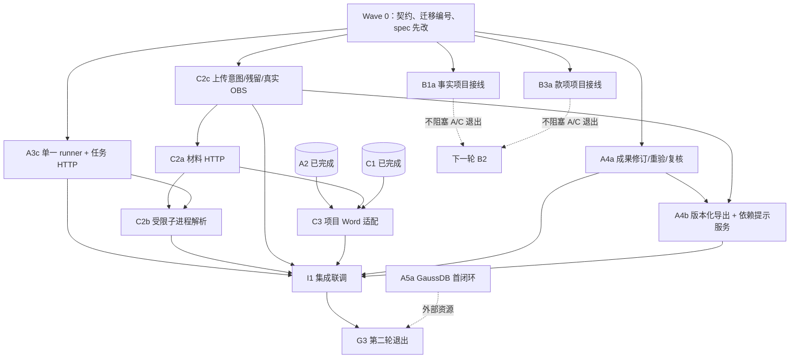

# EquiLens 第二轮开发 Plan：A3c / A4 与 C2 前置 / C3

> 执行说明：本文件是第二轮实施计划，沿用[总计划](2026-10-27-three-person-development-plan.md)的工作包编号（A3c、A4、A5、B1、B3、C2、C3）；为便于并行，细分包记作 A4a/A4b、C2a—C2c、B1a/B3a，不新增主任务编号。它不新增产品契约，不是完成记录，也不表示任何工作包已验收；不自动创建 Issue、推送、部署或发布。本文件编写不启动实现或代理派发，开工以 Wave 0 任务板与分支建立为准。
> 基线：`develop-after/a2-a3-c1-c2-integration` @ `436ab99`。该提交的本地验证见[集成验证记录](../../reviews/2026-10-29-a2-a3-c1-c2-integration-validation.md)：`pnpm check` exit 0、`pnpm test` 521 项（520 通过、0 失败、1 跳过）、`pnpm build` exit 0、`pnpm smoke` 通过、浏览器主流程通过。本轮从该基线切出并行分支，合并回集成分支后再统一执行门禁。任务状态以代码和验证记录为准，不以本文件复选框推断。

**Goal:** 在已合入的 A2 / A3a / A3b / C1 / C2 基线上，补齐“单一全局任务执行器 → 共享成果修订/复核/导出”和“受限解析/私有对象 → 项目 Word 读写”两条纵线，并完成一次可复核的联调验收，为 B2 合同审查与 C4—C7 解除工程依赖。

**Architecture:** 保持一个 Next.js Node.js 应用、一个数据库抽象、一个进程内串行任务执行入口。A 线交付 `src/server/tasks/runner.ts` 统一领取与 `src/server/results/`、`src/server/exports/` 共享成果机制；C 线交付材料 HTTP、受限子进程解析、上传意图生命周期、项目 Word 适配；B 线只把已有事实/款项纯逻辑接入项目授权与迁移账本，不提前做主线界面。两线通过 Wave 0 冻结的接口和固定迁移编号并行，由 Lead 按合并顺序集成。

**Tech Stack:** Node.js 24、pnpm 11.6.0、Next.js 16 App Router、React 19、TypeScript、SQLite / GaussDB 集中式、`node:sqlite`、SuperDoc 1.47.2、官方 shadcn/ui、私有 OBS（S3 兼容接口）、既有 MaaS/OCR 适配边界。

## 1. 基线：已完成与第二轮目标缺口

### 1.1 已合入基线（`436ab99`）

| 线 | 已完成 | 证据 |
| --- | --- | --- |
| C0 | `src/lib/business/contracts.ts` 冻结 `ProjectRef`/`VersionRef`/`PublishedRef`/`MaterialInput`/`AnalysisManifest`/`SaveRevision<T>`/三角色与错误码 | `eae81c6`；乙侧会签仍缺 |
| A2 | 可注入 `EditorAccess`、匿名适配器、工作区未保存登记 | `2704dfb`；126 项文档测试通过 |
| C1 | 项目/成员/三角色、`requireProjectAccess`、项目 HTTP、工作台宿主与请求门 | `0490b0a`；两项目/三角色/撤权测试通过 |
| A3a/A3b | 持久任务提交、幂等/准入、租约与执行令牌、四类预算预留与终态结算 | `9226f32`；48 项任务测试通过 |
| C2 | 材料登记、不可变解析快照/来源片段、私有对象接口、合成与故障适配器 | `436db69`；37 项材料/存储测试通过 |
| 集成 | 迁移 0004—0006 与 checksum 冻结；默认测试命令纳入新目录；spec §3.4、§5.1 等契约 | `7600541`、`fdcda1a`、`702d875`、`436ab99` |

### 1.2 本轮要补齐的缺口

| 缺口 | 现状 | 所属包 |
| --- | --- | --- |
| 任务执行入口 | 只有匿名审查 runner；通用任务表有 `claimNext` 但无执行循环、无 `authorizeClaim`、无 `/api/tasks` 路由、无服务端预算估价 | A3c |
| 成果机制 | `src/server/results/`、`src/server/exports/` 不存在；无保存修订、重验、复核、版本化导出 | A4a/A4b |
| 材料 HTTP | 只有服务层；无上传/列表/下载/快照/来源/重解析 API，浏览器无法使用 | C2a |
| 解析位置 | `parseMaterial` 在主进程同步执行；未用 512 MiB / 60 s 受限子进程 | C2b |
| 上传残留 | `store.put` 与数据库提交之间崩溃会留下无登记对象；无上传意图/恢复扫描 | C2c |
| 真实 OBS | 仅接口 + 合成/故障适配器；真实适配器 fail-closed | C2c（外部门槛） |
| 项目 Word | 编辑器只有匿名适配器；无项目文档 API、项目 `EditorAccess`、页头项目显示 | C3 |
| B 前置 | 事实/款项/证据为纯仓储与测试，未接入生产迁移账本与项目授权 | B1a/B3a（可选并行） |
| GaussDB | 无真机首闭环 | A5a（外部门槛） |

### 1.3 外部缺项（本轮不因代码完成而关闭）

- 真实 GaussDB 实例/版本/模式、真实 OBS 桶与 AK/SK、MaaS 价格与额度、OCR 真机能力。
- 领域核对人对规则、模板与法律内容的签核。
- A1 下游签收、C0 乙侧会签、AC-01/AC-15 与 UI-14/UI-15 联合验收。
- 产品决策：`spec/01` §3.4 “已登录账号可创建项目”与 §3.1 角色表“项目管理员创建”的措辞冲突，仍待确认；未决前不新增“新建项目”入口。

## 2. 本轮目标、退出条件与范围

### 2.1 目标

1. **任务闭环：** 登录账号提交任务 → 单一 runner 领取 → 领取后重验账号/成员/项目 → 阶段执行前重验 → 终态可查；预算/租约/令牌/幂等不回归。
2. **解析闭环：** 上传 DOCX/文字 PDF → 原件进入私有对象接口 → 持久化解析任务 → 受限子进程解析 → 不可变快照与覆盖状态可查；崩溃残留可回收或可恢复。
3. **项目 Word 闭环：** 项目内打开 DOCX → 编辑保存新版本 → 冲突、复制、下载、只读/撤权语义正确；匿名编辑器行为不回归。
4. **成果机制就绪：** 保存成果修订、保存后重验、整份复核、导出所选版本的服务与 HTTP 可用；UI 组件按首个真实生产者再接入。
5. **B/C 后续解耦：** 事实/款项纯逻辑完成生产迁移与项目授权接线（若乙侧人力未就位，本项不阻塞 A/C 退出）。

### 2.2 退出条件（G3，全部满足才可宣告第二轮完成）

- [ ] A3c、C1b、C2a、C2b、C2c、C3、A4a、A4b 各自定向测试与受影响回归通过，证据写入对应记录。
- [ ] 集成浏览器流程通过：上传 DOCX → 解析任务排队/处理 → 覆盖状态显示 → 项目编辑器打开 → 保存 → 重开字节一致 → 冲突另存 → 只读/撤权拒绝写入。
- [ ] `pnpm check`、`pnpm test`、`pnpm build`、`pnpm smoke` 在集成分支顺序执行并记录原始结果；新增测试目录已进入默认 `pnpm test`。
- [ ] 迁移 0007—0011（按实际完成范围）注册、应用、checksum 冻结；0001—0006 未被改写。
- [ ] 交叉审查完成：A 审 C2/C3，C 审 A3c/A4，Lead 核对最终 diff 与全量命令。
- [ ] 未执行的外部项、未通过的 AC/UI 明确列在验证记录，未写成通过。

### 2.3 不在本轮范围

- B2 合同审查项目闭环、B3 款项 UI、B4 证据整理、B5 催款函（仅 B1a/B3a 纯逻辑接线）。
- C4 OCR/投标核验、C5 两模板、C6 知识发布、C7 项目生命周期。
- A5 的容器/Linux/CI/完整恢复/容量验证；本轮只保留条件性的 GaussDB 首闭环。
- A4 结果业务 UI 接入真实入口（等 B2/C4 产生首个真实成果后再接，避免展示测试夹具或空成果）。
- 公众注册、自动外发、扫描件全文处理、任意合同起草、无损 Word 还原、实时协作。

### 2.4 本轮不得宣称

- 不宣称 AC-01/AC-15 通过（需 A1 签收与跨线联验）。
- 不宣称 AC-02/AC-24 通过（真实 OBS 未验证前只有合成/故障适配器证据）。
- 不宣称 AC-16/AC-25 完整恢复通过（C7/A5 未开始）。
- 不宣称任何真实 MaaS/OCR 业务质量或费用结果。
- 不把“测试夹具跑通”写成“业务成果已可用”。

## 3. 分工、写作用域与并行批次

### 3.1 分工

| 执行者 | 工作包 | 建议分支 |
| --- | --- | --- |
| Agent A（甲：共用机制） | A3c、A4a、A4b，条件性 A5a | `round2/a-foundation` |
| Agent C（丙：项目平台） | C1b、C2a、C2b、C2c、C3 | `round2/c-platform` |
| Agent B（乙：主线，若有） | B1a、B3a；无则本轮只保留接口与迁移占位 | `round2/b-domain` |
| Lead（集成） | Wave 0 契约/迁移编号、合并、门禁、证据汇总 | `round2/integration` |

### 3.2 写作用域（并行时不得越界）

| 作用域 | 唯一主写者 | 说明 |
| --- | --- | --- |
| `src/server/tasks/{runner,executors,estimates,access}.ts`、`src/app/api/tasks/`、`src/instrumentation.ts` | A | 只改执行侧；不动 `contract-review/tasks/runner.ts` 的匿名语义，改用兼容包装 |
| `src/server/results/`、`src/server/exports/`、`src/app/api/projects/[id]/results*`、`exports*` | A | 新目录；HTTP 路由由 A 挂载 |
| `src/server/materials/`、`src/server/storage/`、`src/app/api/projects/[id]/materials/`、`documents/` | C | 材料与项目文档服务、路由、子进程入口 |
| `src/lib/business/documents-client.ts` | C | 消费 A2 `EditorAccess`，不新建第二套编辑器控制器 |
| `src/server/projects/authorization.ts`、`access.ts`、`src/server/auth/service.ts`（只读账号状态） | C（C1b） | 新增后台执行授权；A 只消费 |
| `src/server/facts/`、`payments/`、`evidence/`、`document-agent/` 的业务语义 | B | 纯逻辑与仓储；不改 A/C 文件 |
| `src/components/workbench.tsx`、`src/components/business/platform/` | C | 工作台宿主与项目上下文；A2 编辑器只按注入接口使用 |
| `src/components/document-editor.tsx` | A（A2 所有者） | C3 只提页头项目显示需求，由 A 或 Lead 做最小改动并互审 |
| `src/lib/business/contracts.ts` | Lead 审批 | 任何新增/变更 shared type 先提交 Lead 与消费者共同确认 |
| `src/server/database/migrations.ts`、`migrations.test.ts`、`package.json` | Lead | 各包只交 `schema.ts` 语句数组；编号与注册由 Lead 统一提交 |

### 3.3 依赖图



箭头表示正式联调前置；A4a/A4b 的单元与 HTTP 测试不依赖 B2，可用服务端测试夹具，但不得把夹具接到用户入口。

### 3.4 并行批次与每批退出条件

| 批次 | A 线 | C 线 | B 线（可选） | 退出条件 |
| --- | --- | --- | --- | --- |
| W0 契约与编号 | 冻结 runner/结果/导出接口；改 spec §9/§8 | 冻结材料 HTTP/C3 接口；改 spec §5.1/§4 | 冻结事实/款项接口；确认迁移占位 | 接口文件与迁移编号表签收；分支建立 |
| W1 基础并行 | A3c；A4a | C1b；C2c；C2a | B1a | 任务领取重验、上传意图/残留恢复、材料 HTTP、成果修订/复核各自定向测试通过 |
| W2 纵线并行 | A4b | C2b；C3 | B3a | 受限子进程解析、项目 Word 保存/冲突/单字节下载通过；导出无模型调用 |
| W3 合流 | I1 集成联调 | I1 集成联调 | 接口核对 | 浏览器闭环与全量门禁通过；外部缺项登记 |
| W4 收口 | 证据汇入 review 记录 | 证据汇入 review 记录 | B 线证据 | G3 退出条件逐项核对，未执行项不勾选 |

批次不是固定日历承诺；W1/W2 内各包可交换顺序，但 A3c 必须先于 C2b 的生产接线，C2a 必须先于 C3 的项目版本选择。

## 4. Wave 0：接口与决策冻结

以下接口是本轮并行工作的最小交接面。接口草案可在实现中微调，但调整必须先改本文件和消费者测试，避免两边各自定义同名类型。

### 4.1 任务执行接口

```ts
// src/server/tasks/runner.ts（A3c 交付）
export type TaskExecutionResult = {
  outcome: "success" | "partial" | "failed" | "cancelled"
  resultSummary?: string
  errorCode?: string
  errorMessage?: string
}

/**
 * 执行器只处理“已领取且已重验”的任务；不得自行领取、不得读浏览器输入。
 * refreshAccess() 由 runner 注入，执行器在每个付费调用/阶段读取前调用；
 * 失败必须终止本次尝试，不能降级为演示结果。
 */
export type TaskExecutor = (job: ClaimedTask, context: {
  signal: AbortSignal
  heartbeat(elapsedMs: number): Promise<void>
  refreshAccess(): Promise<void>
  reserveCall(callNumber: number, estimate: CallBudgetEstimate): Promise<void>
  settleCall(callNumber: number, usage?: BudgetUsage): Promise<void>
}) => Promise<TaskExecutionResult>

export type TaskExecutorRegistry = {
  get(kind: TaskKind): TaskExecutor | null
  available(): TaskKind[]
}

export function startTaskRunner(): void
export function wakeTaskRunner(): void
export function stopTaskRunner(): Promise<void>
```

- `startTaskRunner` 是唯一进程内循环：先领取通用任务，再领取匿名审查任务；两者共享一个 `ticking` 单飞和一个全局执行槽，任一时刻只执行一个任务。
- 保留 `src/server/contract-review/tasks/runner.ts` 的 `startReviewRunner`/`wakeReviewRunner`/`cancelRunningReview` 作为兼容导出，内部委托到统一 runner；匿名审查测试不得改语义。
- 生产执行器注册表在 W1 只注册 `material-parse`（C2b 提供）；`result-export` 如启用任务化导出，由 A4b 注册，未启用时保持不可提交。没有执行器的 kind 在提交时返回 503 `SERVICE_UNAVAILABLE`（“该任务类型尚未开放”），不得先入库再永久排队，也不得返回假结果。

### 4.2 后台执行授权（C1b）

```ts
// src/lib/business/contracts.ts 新增，Lead 审批
export type ProjectExecutionAccess = ProjectRef & {
  action: ProjectAction
  role: ProjectRole
  account: { id: string; username: string; role: "member" | "superadmin" }
}

// src/server/projects/authorization.ts 新增
export type TaskExecutionAuthorization = {
  /** 供 runner 使用：不依赖浏览器会话，但检查账号启用、项目存在/未删除、成员关系。 */
  authorize(input: { accountId: string; projectId: string; action: ProjectAction }): Promise<ProjectExecutionAccess>
}

// src/server/projects/access.ts 新增
export async function authorizeTaskExecution(input: {
  accountId: string
  projectId: string
  action: ProjectAction
}): Promise<ProjectExecutionAccess>
```

- 语义必须写入 `spec/01` §9：后台执行不依赖浏览器会话（用户可关闭页面/退出登录），但账号被禁用、项目被删除、成员被移除后，领取或下一阶段开始前必须失败，且不得再发起外部请求。
- 超级管理员仍须指定真实项目；非成员与不存在项目对 runner 返回同一拒绝结果。
- `AuthService` 需提供按账号 ID 读取启用状态与角色的最小方法（例如 `account(id)`）；只读账号状态，不恢复会话。

### 4.3 任务 HTTP 路由

| 方法/路径 | 行为 |
| --- | --- |
| `POST /api/tasks` | 要求 `Idempotency-Key`；body 仅 `{kind, projectId, refs, conditions}`；202 返回 `{task, created}` |
| `GET /api/tasks?projectId=` | 列出当前账号在该项目可见的任务 |
| `GET /api/tasks/[id]` | 当前账号自己的任务；不存在/他人的任务统一 404 |

- 均使用 `runtime = "nodejs"`、`dynamic = "force-dynamic"`、`Cache-Control: private, no-store`；写请求校验同源 `Origin`。
- 错误沿用 `src/server/tasks/http.ts` 与 `src/server/projects/errors.ts` 已有固定消息；不返回 SQL、凭据或材料正文。
- 本轮不新增任务取消 HTTP 路由；取消语义只保留匿名审查既有实现。若后续需要项目任务取消，先改规范。

### 4.4 成果与导出接口

```ts
// src/lib/business/contracts.ts 新增，Lead 审批
export type ResultRevisionRef = ProjectRef & {
  resultId: string
  versionId: string
  sha256: string
}

export type ResultValidation = {
  status: "valid" | "invalid" | "partial"
  versionId: string
  checkedAt: string
  issues: Array<{ code: string; message: string; ref?: string }>
}

export type ResultReview = {
  versionId: string
  decision: "approved" | "rejected" | "changes_requested"
  comment: string
  reviewedBy: string
  reviewedAt: string
}

export type ExportRef = ResultRevisionRef & {
  exportId: string
  format: "docx"
  createdAt: string
}
```

服务入口（A4a/A4b 交付，B/C 消费）：

```ts
saveResultRevision(identity, authorize, input: SaveResultInput): Promise<ResultView>
validateResult(identity, authorize, ref: ResultRevisionRef): Promise<ResultValidation>
reviewResult(identity, authorize, input: ReviewInput): Promise<ResultView>
createExport(identity, authorize, ref: ResultRevisionRef): Promise<ExportRef>
```

- `SaveResultInput` 至少包含 `projectId`、`resultId?`、`baseVersionId`、`operationId`、`reason`、`value`；值由业务校验器按任务类型固定注册，不接受浏览器上传脚本或任意执行器。
- 所有 HTTP 入口固定项目与所选版本，重查 `requireProjectAccess`；只读成员不能保存/复核/生成新导出。

### 4.5 材料 HTTP 与解析任务接口

| 方法/路径 | 行为 |
| --- | --- |
| `POST /api/projects/[id]/materials` | `multipart/form-data`：`metadata` JSON + `file`；校验授权/目的/期限，快速失败超限 |
| `GET /api/projects/[id]/materials` | 当前项目材料列表与最新版本/解析状态 |
| `GET /api/projects/[id]/materials/[materialId]` | 材料、版本、快照摘要 |
| `GET /api/projects/[id]/materials/[materialId]/versions/[versionId]/content` | 私有原件字节；`private, no-store`，不复用公开链接 |
| `GET /api/projects/[id]/materials/[materialId]/snapshots/[snapshotId]` | 快照覆盖与来源片段 |
| `GET /api/projects/[id]/materials/[materialId]/snapshots/[snapshotId]/sources/[fragmentId]` | 单个来源定位 |
| `POST /api/projects/[id]/materials/[materialId]/reparse` | 提交新解析任务，不覆盖旧快照 |

- 上传成功返回 `{ material, version, parseTaskId }`；解析不再在请求内同步完成，而是提交 `material-parse` 任务（A3c 执行）。
- `equilens_materials` 增加 `parse_task_id`（迁移 0008），用于列表状态与恢复；旧快照仍可读。
- 上传请求先做大小/类型/字段校验，再落对象；对象、数据库行、解析任务的顺序见 C2c 状态机。

### 4.6 项目 Word 接口（C3）

```ts
// src/lib/business/documents-client.ts
export function createProjectEditorAccess(input: {
  projectId: string
  getCurrentProjectId(): string
  fetch?: typeof fetch
}): EditorAccess
```

- 消费 A2 的 `EditorAccess`，不新增编辑器控制器；`open/preflight/save/copy/download` 全部走项目授权与项目版本。
- 项目文档 HTTP（C3，均为 Node runtime、私有 `no-store`）：
  - `GET /api/projects/[id]/documents`：项目文档列表；
  - `POST /api/projects/[id]/documents`：从已上传材料版本创建/打开项目文档；
  - `GET /api/projects/[id]/documents/[documentId]`：元数据、基础版本、可编辑性；
  - `GET /api/projects/[id]/documents/[documentId]/versions/[versionId]/content`：保存版本的 DOCX 字节；
  - `POST /api/projects/[id]/documents/[documentId]/preflight`：保存前校验（含只读/撤权）；
  - `POST /api/projects/[id]/documents/[documentId]/save`：`baseVersionId` + `operationId` + DOCX 字节；
  - `POST /api/projects/[id]/documents/[documentId]/copy`：冲突时另存新文档，保留来源/基础版本；
  - `GET /api/projects/[id]/documents/[documentId]/download?versionId=`：下载所选保存版本的同一字节。
- 冲突返回 409 `CONFLICT`，不覆盖原版本；同 `operationId` 返回同版本；迟到响应不得写入另一项目/文档。
- 从材料版本创建项目文档时引用该版本对象，不复制字节；首次保存才产生项目文档对象，原件保持不变。

### 4.7 对象键命名空间（C2c/C3/A4b 共用）

`PrivateObjectStore` 不提供公开 URL/presign，但键必须区分对象类型，避免复用材料键或伪造 ID：

```text
projects/<projectId>/materials/<materialId>/versions/<versionId>/<sha256>
projects/<projectId>/documents/<documentId>/versions/<versionId>/<sha256>
projects/<projectId>/exports/<exportId>/<sha256>
```

- `src/server/storage/obs.ts` 的 `assertObjectKey` 扩展为按类型校验；未知类型、`..`、绝对路径、控制字符一律拒绝。
- 每个键仍绑定真实项目 ID 与不可变内容摘要；下载前重查项目授权，知道键不等于获得访问。
- 材料键格式保持 C2 已冻结的形态；文档/导出使用新类型段，不做跨类型兼容读取。
- 对象键构造函数与校验测试由 C（storage 所有者）在 W1 首次使用前提供；A4b/C3 只消费，不各写一套。

### 4.8 迁移编号分配

0001—0006 已冻结，禁止改写。各包只在自己的 `src/server/<domain>/schema.ts` 维护语句数组，Lead 在集成分支统一注册：

| 编号 | 内容 | 所属包 | 备注 |
| --- | --- | --- | --- |
| 0007 | `equilens_results`、`equilens_result_versions`、`equilens_result_reviews`、`equilens_result_dependencies`、`equilens_result_exports` | A4a/A4b | 成果不可变版本、复核绑定、依赖提示、版本化导出 |
| 0008 | `equilens_material_upload_intents`；`ALTER TABLE equilens_materials ADD COLUMN parse_task_id VARCHAR(36)` | C2a/C2c | 上传意图状态机与解析任务关联 |
| 0009 | `equilens_project_documents`、`equilens_project_document_versions` | C3 | 项目 Word 文档与保存版本；不把匿名 owner 当 projectId |
| 0010 | `equilens_fact_versions`（含项目索引） | B1a | 把现有运行时建表迁入迁移账本 |
| 0011 | `equilens_payment_ledger_revisions` | B3a | 同上 |

- 每个新迁移在 `migrations.test.ts` 增加 checksum 冻结；0004—0006 的既有 checksum 不变。
- 若某包未进入本轮合并，对应编号留给下一轮，不顺延重排已写入的编号。
- 新迁移只使用两个 provider 已验证的语法（`SELECT` + 条件 `UPDATE`、简单 `ALTER TABLE ADD COLUMN`）；GaussDB 兼容性在 A5a 实测，不以 SQLite 推断。

### 4.9 Wave 0 必须先改规格

| 文件 | 改动 | 所属 |
| --- | --- | --- |
| `spec/01-product.md` §9 | 后台执行授权、单 runner、解析进入受限队列、无执行器 kind 的拒绝语义 | A3c/C2b |
| `spec/01-product.md` §8/§9 | 成果修订、重验、复核、导出选中版本的 HTTP 契约 | A4a/A4b |
| `spec/02-workbench-ui.md` §5.1 | 项目材料上传、解析状态、项目文档打开、页头项目显示与只读/撤权语义 | C2a/C3 |
| `spec/03-word-editing.md` §4 | 项目文档保存版本、私有对象、无公开 URL、冲突另存 | C3 |
| `spec/01-product.md` §10.5 | 上传意图/残留对象的清理、重放与保留说明 | C2c |
| `spec/01-product.md` §3.1/§3.4 | 项目创建权限措辞冲突的产品决策（未决不实现新入口） | Lead |

## 5. 工作包

### A3c 单一全局任务 runner 与任务 HTTP（P0）

**目标：** 让通用任务表真正执行起来，并把匿名审查、通用任务、预算与权限收口到一个进程内串行入口。

**文件：**
- 新增：`src/server/tasks/runner.ts`、`src/server/tasks/executors.ts`、`src/server/tasks/estimates.ts`、`src/server/tasks/access.ts`、`src/server/tasks/runner.test.ts`、`src/app/api/tasks/route.ts`、`src/app/api/tasks/[id]/route.ts`
- 修改：`src/instrumentation.ts`、`src/server/contract-review/tasks/runner.ts`（兼容包装）、`src/server/tasks/service.ts`、`src/server/tasks/http.ts`
- 迁移：无（A3c 不改表）

**消费：** `TaskRepository.claimNext/heartbeat/reserveCall/finish`、`taskBudgetRepository`、C1 `authorizeTaskExecution`（C1b）。
**交付：** 统一 runner、执行器注册表、服务端预算估价、`/api/tasks` 路由；C2b 据此注册 `material-parse` 执行器。

- [ ] 先在 spec §9 写清后台执行授权和单 runner 语义，再写测试。
- [ ] 测试：禁用账号/移除成员/删除项目后领取 → 任务终态 `failed`，`errorCode = ACCESS_REVOKED`，执行器未被调用，预算未预留。
- [ ] 测试：通用任务与匿名审查任务不会同时执行；`stopTaskRunner` 中止当前执行；重复 `wake` 不产生并行执行；租约过期可恢复且旧令牌不能写终态。
- [ ] 测试：无执行器的 kind 提交即拒绝（503），不落库、不排队、不产生假结果；已注册执行器只接受冻结的 manifest。
- [ ] 实现统一循环：先通用任务、后匿名审查；领取后立即 `authorizeTaskExecution`，每个阶段/付费调用前再验；“失败必须终态，不能重试到无限”。
- [ ] 实现 `estimates.ts`：按 kind 与调用序号给出保守 `CallBudgetEstimate`；浏览器传入的价格/模型/预算字段一律拒绝（沿用 catalog strict schema 测试）。
- [ ] 接 `/api/tasks`：身份解析、同源校验、256 KiB 限制、Idempotency-Key、列表/详情、错误映射、`no-store`。
- [ ] `instrumentation.ts` 改调 `startTaskRunner()`；保留匿名审查 runner 导出并对同一测试断言不再双循环。
- [ ] 运行 `pnpm exec tsx --test src/server/tasks/*.test.ts src/server/contract-review/tasks/runner.test.ts src/server/contract-review/tasks/revision-only-task.test.ts src/server/contract-review/tasks/scene-reselection.test.ts`。
- [ ] 证据：`docs/reviews/2026-10-29-round-two-a3c.md`（命令、原始输出、失败与修复、未运行项）。

**验收：** 任务从提交到终态全程有服务端授权与预算；撤回权限后不再外发；匿名审查回归不退化。

### C1b 后台任务执行授权（P0，C1 扩展）

**目标：** 为 runner 提供不依赖浏览器会话、但能反映账号/项目/成员现状的授权入口。

**文件：** 修改 `src/server/projects/authorization.ts`、`src/server/projects/access.ts`、`src/server/auth/service.ts`（最小 `account(id)`）、`src/lib/business/contracts.ts`（`ProjectExecutionAccess`）；测试 `src/server/projects/service.test.ts` 或新增 `execution.test.ts`。

- [ ] 测试：账号禁用、成员移除、项目软删、非成员、未知项目均拒绝；超级管理员对真实项目放行、对不存在项目拒绝。
- [ ] 授权只读账号启用状态与成员关系，不创建会话、不延长会话、不读取浏览器 cookie。
- [ ] 结果只作为本次执行快照；runner 每个阶段重新调用，不缓存角色。
- [ ] 与 A3c 的接口测试对齐；错误映射复用 `BusinessError` 固定消息。
- [ ] 证据写入 `docs/reviews/2026-10-29-round-two-c1b.md` 或并入 A3c 联调记录。

### A4a 共享成果修订、重验与复核（P0）

**目标：** 建立所有业务共用的不可变成果版本、人工修订、保存后重验和整份复核记录。

**文件：**
- 新增：`src/server/results/{schema,repository,service,validation,http}.ts` 及测试、`src/app/api/projects/[id]/results/route.ts`、`src/app/api/projects/[id]/results/[resultId]/route.ts`、`src/app/api/projects/[id]/results/[resultId]/revisions/route.ts`、`.../validate/route.ts`、`.../review/route.ts`
- 修改：`src/lib/business/contracts.ts`（结果/复核/导出类型）、`src/server/database/migrations.ts`（Lead 注册 0007）
- 迁移：0007

**消费：** C0 `SaveRevision<T>`、C1 `requireProjectAccess`、C2 `readSource`/`readParseSnapshot`（只依赖接口，不等待真实 OBS）。
**交付：** 结果仓储/服务/HTTP 与校验器注册表；A4b 导出和 B/C 业务成果复用。

- [ ] 测试：同 `operationId` 保存返回同版本；不同输入同标识冲突；`baseVersionId` 过期冲突不覆盖；版本不可变、旧版本仍可读。
- [ ] 测试：保存后按固定注册的业务校验器重验结构、引用、关键数值和必填项；任一失败把整份复核重置为待复核。
- [ ] 测试：复核绑定明确版本；对旧版本复核被拒绝；改引文/数值/必填项后旧复核失效；复核不能豁免缺证、冲突或无效引用。
- [ ] 测试：跨项目 resultId/versionId 统一拒绝；只读成员不能保存/复核；撤权后再请求拒绝。
- [ ] 实现机器原始结果与人工修订分开保存；值不经过浮点金额转换；不把模型总结直接当成果。
- [ ] 实现保守依赖提示数据：记录规则/材料/事实/款项/上游成果版本，旧版本仍可读，不静默改下游。
- [ ] HTTP 入口固定项目与版本，`private, no-store`，错误映射复用现有业务错误。
- [ ] 证据：`docs/reviews/2026-10-29-round-two-a4a.md`。

**验收：** B/C 可用同一入口保存/复核；没有第二条成果仓储；测试夹具只存在于测试代码，不接用户入口。

### A4b 版本化导出与依赖变化服务（P0，A4 扩展）

**目标：** 导出所选保存版本，保留校验/复核/模板/渲染版本，不调用模型，不覆盖旧文件。

**文件：**
- 新增：`src/server/exports/{schema,repository,service,renderer,http}.ts` 及测试、`src/app/api/projects/[id]/results/[resultId]/exports/route.ts`、`.../exports/[exportId]/content/route.ts`
- 迁移：0007（导出记录表并入 A4a 的 0007）

**说明：** §4.8 已把 `equilens_result_exports` 并入 0007；若实现时确实需要独立表，必须由 Lead 重新分配编号并同步本文件与 checksum，不得各分支自行编号。

- [ ] 测试：导出只读所选 `versionId`；无模型/网络调用；同版本重复导出可复用或生成新记录但不改写旧字节。
- [ ] 测试：导出内容保留人工修订、校验/复核状态、模板/渲染版本与未解决标记；模板升级后旧导出仍返回原字节。
- [ ] 测试：无效引用/缺必填项不能导出“有效结论”；只读成员只能下载已有导出，不能生成新导出。
- [ ] 测试：导出失败不破坏已保存成果；旧导出文件仍可下载；重试只针对同一保存版本。
- [ ] 实现 DOCX 渲染为确定性字节（固定模板 + 文本段落），不宣称任意版式还原；记录渲染器版本。
- [ ] 新增导出对象键（`projects/<projectId>/exports/<exportId>/<sha256>`）并断言不复用材料键；对象只经授权下载，不生成公开 URL。
- [ ] HTTP 下载重查项目授权与摘要，`private, no-store`，不返回公开 URL。
- [ ] 结果 UI 组件本轮不接真实入口；若实现组件，仅用于测试与后续复用，并在记录中说明未开放。
- [ ] 证据：`docs/reviews/2026-10-29-round-two-a4b.md`。

**验收：** 导出模块没有模型调用路径；B/C 业务导出可复用；未开放 UI 不被写成已交付界面。

### C2a 材料 HTTP 与解析任务提交（P0）

**目标：** 让浏览器能上传/查看/下载/重解析私有材料，并把解析变成持久化任务。

**文件：**
- 新增：`src/server/materials/http.ts`、`src/server/materials/access.ts` 扩展、`src/app/api/projects/[id]/materials/route.ts`、`[materialId]/route.ts`、`[materialId]/versions/[versionId]/content/route.ts`、`[materialId]/snapshots/[snapshotId]/route.ts`、`.../sources/[fragmentId]/route.ts`、`[materialId]/reparse/route.ts` 及 HTTP 测试
- 修改：`src/server/materials/service.ts`（上传后提交 `material-parse`，不再同步解析）、`src/server/materials/schema.ts`（`parse_task_id`）、`src/lib/business/contracts.ts`（如需要 Material HTTP 视图类型）
- 迁移：0008（与 C2c 共用，Lead 注册）

**消费：** C2 现有服务/仓储、A3c `submitTask` 接口、C1 `requireProjectAccess`。
**交付：** 材料 HTTP 与 `parseTaskId`；C2b 提供执行器，C3 从版本创建项目文档。

- [ ] 测试：未登录 401、非成员/未知项目 403/404 同类、只读成员不能上传/重解析、可编辑成员可上传。
- [ ] 测试：同源写校验、请求体上限、格式伪造（扩展名/Content-Type 不可信）、超 20 MiB、空文件、加密/宏 DOCX 拒绝；错误固定安全消息。
- [ ] 测试：上传返回 `material/version/parseTaskId`，不返回 `coverage` 假值；解析状态由任务/快照读取，不在上传响应里假装已完成。
- [ ] 测试：重复摘要返回同一材料版本且不重复提交解析任务；不同项目同摘要互不可见。
- [ ] 测试：下载字节与记录 `sha256` 一致；跨项目版本/快照/来源 ID 统一 404；`no-store`。
- [ ] 测试：重解析提交新的 `material-parse` 任务并返回 `parseTaskId`；执行后 revision 递增，旧快照与旧引用仍可读；重解析前重查授权。
- [ ] 实现 multipart 读取与元数据校验；`request.formData()` 之前先检查 `Content-Length`，读取后再按真实字节复核。
- [ ] 接入生产依赖：真实存储未验证时继续 fail-closed（`createUnavailableObjectStore`），测试用合成/故障适配器。
- [ ] 证据：`docs/reviews/2026-10-29-round-two-c2a.md`。

**验收：** 上传→任务→快照链路有真实任务 ID；不把合成存储结果写成真实 OBS 可用。

### C2b 受限子进程解析（P0）

**目标：** 把 DOCX/文字 PDF 解析移出主进程，限制内存与时间，失败不拖垮服务。

**文件：**
- 新增：`src/server/materials/parse-worker.ts`、`src/server/materials/subprocess.ts`、`src/server/materials/executor.ts`、`scripts/build-material-parser.mjs`
- 修改：`src/server/materials/parse.ts`（保持纯函数）、`scripts/build-docx-validator.mjs` 或新增构建入口、`package.json`（Lead 接入构建/测试命令）
- 测试：`src/server/materials/subprocess.test.ts`、扩展 `parse.test.ts`

- [ ] 测试：正常 DOCX/文字 PDF 经子进程返回与纯函数一致的覆盖与片段；worker 只接收字节与格式，不接收凭据/数据库句柄。
- [ ] 测试：超时 60 s 被 kill，任务失败并记录超时；没有真实覆盖片段时不得写成“部分完成”，内存上限 512 MiB，超限退出不写成“解析成功”。
- [ ] 测试：非法 ZIP/加密/宏/超大解压比/不支持结构返回明确失败或部分覆盖；主进程不崩溃。
- [ ] 测试：并发解析不共享可变全局状态；超时后进程被杀且无残留句柄。
- [ ] 实现生成物构建（esbuild 打包到 `scripts/generated/material-parser.mjs`），构建/导入阶段不执行解析。
- [ ] 接入 A3c 执行器：`material-parse` 领取后调用子进程，成功写不可变快照，失败按真实覆盖/错误终态；不生成演示答案。
- [ ] 证据：`docs/reviews/2026-10-29-round-two-c2b.md`。

**验收：** 解析确实在受限子进程运行；`pnpm test` 的解析回归通过；构建产物未入库（gitignore 既有规则）。

### C2c 上传意图、残留回收与真实 OBS 适配（P0；真实 OBS 为外部门槛）

**目标：** 消除 `put` 与数据库提交之间的不可追踪残留，提供可恢复的上传生命周期；在有凭据时接入私有 OBS。

**文件：**
- 新增：`src/server/materials/upload-intents.ts`、`src/server/storage/obs-s3.ts`（条件）、测试
- 修改：`src/server/materials/service.ts`、`src/server/materials/repository.ts`、`src/server/materials/schema.ts`（0008）
- 迁移：0008（语句数组由 C 提供，Lead 注册）

- [ ] 测试：`put` 前先持久化 pending 意图；`put` 成功但数据库失败 → 意图保留、对象可回收；数据库成功但意图未完成 → 恢复扫描可补记。
- [ ] 测试：材料版本已提交但解析任务未提交（提交进程崩溃）→ 恢复扫描补提交 `material-parse`，不重复创建版本。
- [ ] 测试：重复上传/重试幂等；残留删除失败记录尝试次数并保留可重试；恢复任务不误删其他版本对象。
- [ ] 测试：意图过期阈值（建议 10 分钟，可配置）与 `repairResidues` 合并；修复失败不改写历史快照/来源。
- [ ] 实现状态机：`pending → stored → committed`，`aborted`/`failed` 可重试；每步短事务，不在存储 I/O 期间持有数据库事务。
- [ ] 扩展 `assertObjectKey` 支持材料/文档/导出三种键类型并保留材料键兼容；为 A4b/C3 提供键构造函数与拒绝反例测试。
- [ ] 接入真实 OBS：仅当 endpoint、私有桶、AK/SK、区域/签名方式已验证时启用；S3 兼容实现不得暴露公开 URL 或长期签名。需要新增 OBS/S3 SDK 时，先经 Lead 批准并提交 `pnpm-lock.yaml`，不引入第二套存储客户端。
- [ ] 本地开发可显式启用合成存储（仅 `NODE_ENV=development` 且显式配置，生产默认 fail-closed）；证据中标注 synthetic，不写成 OBS 已验证。
- [ ] 若凭据/桶不可用：保留 fail-closed，记录外部缺项；不得用合成存储冒充已接入。
- [ ] 证据：`docs/reviews/2026-10-29-round-two-c2c.md`（含是否真实 OBS、原始错误、残留回收结果）。

**验收：** 故障注入下无“无登记对象”；真实 OBS 未验证时状态明确为未接入。

### C3 项目 Word 读写适配（P0）

**目标：** 把 A2 的 `EditorAccess` 接到项目授权、材料版本和私有文档字节，打通项目内编辑保存。

**文件：**
- 新增：`src/lib/business/documents-client.ts`、`src/server/materials/editor.ts`、`src/server/materials/document-repository.ts`、`src/app/api/projects/[id]/documents/...` 路由及测试
- 修改：`src/server/materials/schema.ts`（0009 项目文档表）、`src/components/workbench.tsx`（注入项目访问）、`src/components/document-editor.tsx`（页头项目显示的最小 prop，A 互审）
- 迁移：0009

**消费：** A2 `EditorAccess`/`UnsavedRegistry`、C1 授权、C2 材料版本/对象存储。
**交付：** 项目文档打开/预检/保存/复制/下载；工作台项目上下文与编辑器页头显示。

- [ ] 测试：项目成员打开 DOCX；保存产生新不可变版本且 `baseVersionId` 冲突返回 409；同 `operationId` 返回同版本。
- [ ] 测试：下载所选保存版本与记录摘要一致；复制保留来源与基础版本；未提交对象/其他项目版本不能作为输入。
- [ ] 测试：只读成员/撤权后不挂可编辑引擎，保存/预检被拒；保存失败不能借本地导出绕权。
- [ ] 测试：切换项目时先保存工作区未保存对象，保存失败留在原项目；切换后旧请求迟到不显示前一项目文档。
- [ ] 测试：匿名编辑器回归（现有 126 项文档测试）不退化。
- [ ] 实现 `createProjectEditorAccess`：只消费 `EditorAccess` 方法；错误映射到 `SESSION_INVALID/ACCESS_DENIED/CONFLICT/ABORTED/UNAVAILABLE/FAILED`。
- [ ] 新增项目文档对象键（`projects/<projectId>/documents/<documentId>/versions/<versionId>/<sha256>`），不伪造 materialId/匿名 owner；下载只经授权读取。
- [ ] 工作台在项目模式注入项目访问；匿名模式保持现状；页头显示当前项目/角色（官方 shadcn/ui 结构，记录来源 URL）。
- [ ] 浏览器实测：保存→关闭→重开、冲突另存、只读项目、切换项目迟到响应。
- [ ] 证据：`docs/reviews/2026-10-29-round-two-c3.md`（含截图/流程与未运行项）。

**验收：** 项目 Word 路径可实际保存/重开；匿名路径无回归；AC-09/10/12/15 只有实际联验部分可勾选。

### B1a / B3a 事实与款项项目接线（总计划 P0；本轮可选并行，不阻塞 A/C 退出）

**目标：** 把已有纯逻辑接入生产迁移、项目授权和 HTTP，为下一轮 B2/B3 解除结构依赖。

**文件：**
- 修改：`src/server/facts/{repository,validation}.ts`、`src/server/payments/{repository,validation}.ts`；新增 `schema.ts`、`service.ts`、`http.ts`、路由与测试
- 迁移：0010（facts）、0011（payments），Lead 注册

- [ ] B1a：测试项目内保存/更正事实版本、跨项目拒绝、竞争保存冲突、冲突事实不因人工确认消失；`requireProjectAccess` 重查。
- [ ] B1a：HTTP 固定项目与版本，`no-store`；只读成员可读不可写。
- [ ] B3a：测试整数分金额、到期/未到期/已付/争议分列、负余额保留、缺到期证据只出草案；HTTP 同上。
- [ ] 两包把运行时 `initialize()` 建表迁入迁移账本，测试改用迁移；旧测试断言不回归。
- [ ] 本轮不接主线 UI/任务；B2/B3 界面在下一轮接真实生产者。
- [ ] 若乙侧无人力，本包保持未开始并明确记录，不阻塞 A/C 退出。

### A5a GaussDB 首闭环（P0，条件执行）

**目标：** 在有真实实例和权限时完成首次入库与迁移验证，为 A5 平台验收提供真机证据。

**文件：** `src/server/database/`、`scripts/smoke-database.mjs`、`docs/deployment.md`（必要时）；无实例时不改代码。

- [ ] 记录实例区域、版本、模式、TLS/CA、连接方式与授权范围；不把本地 SQLite 结果当 GaussDB 结果。
- [ ] 在空库应用 0001—最新已注册编号（预期 0011），验证唯一约束、条件 UPDATE、JSON/金额往返、时间/布尔类型和迁移 checksum。
- [ ] 运行 `node scripts/smoke-database.mjs` 或当次等价脚本，保存原始输出；记录失败与修复。
- [ ] 验证构建不连库、启动不自动迁移（`NEXT_PHASE=phase-production-build` 不触发业务迁移）。
- [ ] 无实例/权限时明确登记外部缺项，继续 A/C 开发，不宣称 AC-12/AC-16 通过。
- [ ] 证据：`docs/reviews/2026-10-29-round-two-a5a.md` 或并入最终集成记录。

### I1 集成联调与 G3 收口（P0，Lead）

- [ ] 合并顺序：A3c → C1b → C2c → C2a → C2b → A4a → A4b → C3（B1a/B3a 视情况）；每步运行定向测试，冲突只在 `migrations.ts`/`package.json`/`contracts.ts` 等共享文件。
- [ ] Lead 统一注册迁移 0007—0011、更新 checksum 冻结、把新测试目录加入 `pnpm test`。
- [ ] 浏览器闭环：匿名工作台→登录→项目→上传 DOCX→解析任务状态→打开项目编辑器→保存→重开→冲突另存→只读/撤权→退出。
- [ ] 全量门禁：`pnpm check`、`pnpm test`、`pnpm build`、`pnpm smoke`、`git diff --check`；记录原始输出。
- [ ] 交叉审查：A 审 C2/C3，C 审 A3c/A4，Lead 核对最终 diff；修复后回归。
- [ ] 证据：`docs/reviews/2026-10-29-round-two-integration-validation.md`，逐项列“已执行/未执行/外部缺项”，不把未执行写成通过。
- [ ] 更新 `README.md` 实现状态（只写实际完成项）与相关 `spec/` 契约；未完成项保留在计划/Issue 范围，不在产品页加“建设中”装饰。

## 6. 合流、门禁与审查

### 6.1 合并顺序与理由

1. **A3c + C1b：** 先让任务执行与后台授权可用，C2b 才有执行器宿主。
2. **C2c：** 上传意图/残留与真实 OBS（条件）；先固定存储生命周期，材料 HTTP 才有稳定写入语义。
3. **C2a：** 材料 HTTP 与 `parseTaskId` 落地，C2b 才能接执行器、C3 才能选版本。
4. **C2b：** 受限解析执行器；与 A3c 的注册表集成后跑一次上传→解析。
5. **A4a：** 成果仓储/服务/HTTP；只依赖 C1 与 C0，不被 C2 阻塞。
6. **A4b：** 导出与依赖提示；使用 A4a 保存版本和 C2c 对象接口。
7. **C3：** 项目 Word；依赖 C2a 的版本读取与 A2 接口。
8. **B1a/B3a：** 视人力最后合入；不改变 A/C 门禁。

### 6.2 每包完成定义（DoD）

- [ ] 行为测试先于实现（正常 + 反例：权限、冲突、限额、失败、恢复）。
- [ ] 定向测试与受影响回归通过；新增测试进入默认 `pnpm test`（Lead 合并时统一加 glob）。
- [ ] `pnpm check` 通过；涉及构建产物的包运行 `pnpm build`。
- [ ] 迁移按分配的编号且 checksum 冻结；未改 0001—0006。
- [ ] 文档/规格与实际行为一致；证据记录写入 `docs/reviews/`。
- [ ] 交叉审查通过；下游消费者（C3/A4/B2）接口核对完成。
- [ ] 未执行项、外部缺项、已知缺陷分别记录，不混入“已完成”。

### 6.3 审查分工

| 交付 | 主审 | 专项核对 |
| --- | --- | --- |
| A3c 任务/预算/runner | C | B 核对业务提交语义不被预算/状态误判 |
| A4a/A4b 成果/复核/导出 | C | B 核对业务校验器与导出字段 |
| C1b 后台授权 | A | B 核对项目隔离与撤权 |
| C2a/C2b/C2c 材料/解析/OBS | A | B 核对来源与覆盖语义 |
| C3 项目 Word | A | B 核对保存版本选择与主线输入 |
| 最终 I1 集成 | Lead | A/C/（B）共同核对；外部项单列 |

Agent B 未就位时，业务语义核对由 Lead 组织并保留缺项，不能替代乙的领域签收与主线验收。

## 7. 验收对照（本轮可判定范围）

| 范围 | 本轮交付 | 可判定 | 仍待联合验收 |
| --- | --- | --- | --- |
| AC-13/AC-23 任务状态/预算 | A3c 真实任务、预算估价、恢复/撤权 | 本地 SQLite + 受限子进程执行器 | 真实 MaaS 费用、外部调用确认 |
| AC-02 新资料处理 | C2a/C2b 上传→解析任务→快照/覆盖 | DOCX/文字 PDF 合成样本 | 真实 OBS、扫描件/OCR |
| AC-08/AC-09 来源/版本 | C2a 快照/来源读取；C3 版本不可变 | 项目内 | UI-18 完整来源面板待 B2 |
| AC-10/AC-22 人工保护/重验 | A4a 修订/复核失效 | 服务与 HTTP | UI-19 界面待真实生产者 |
| AC-11 导出 | A4b 固定版本导出 | 服务与 HTTP | UI-22 用户入口待下一轮 |
| AC-12 持久化/恢复（部分） | C2c 上传意图、A3c 任务恢复 | 故障注入 | 完整项目恢复待 A5/C7 |
| AC-15 项目权限 | C1b/C3 撤权、只读 | 项目内路径 | AC-01/AC-15 联合签收 |
| AC-24 文件安全 | C2a/C2b 类型/限额/私有读取 | 合成/故障场景 | 真实 OBS 桶策略验证 |
| AC-25 生命周期 | C2c 上传意图/残留 | 故障注入 | C7/A5 完整恢复 |

## 8. 风险与外部门槛

| 风险/条件 | 影响 | 处理 |
| --- | --- | --- |
| 真实 GaussDB 不可用 | 只能交付 SQLite 技术结果，不能关闭 AC-12/16 真机项 | A5a 条件执行；缺实例则记录外部缺项，继续 A/C 开发 |
| 真实 OBS 未配置 | 上传/下载只能合成或 fail-closed，不能宣称 AC-02/AC-24 | C2c 条件接入；生产保持不可用；不建公开桶 |
| MaaS 价格/额度未验证 | 任务可执行但不能宣称真实费用/容量 | 预算按保守估价；真实调用另记授权与用量 |
| 领域规则/模板未签核 | B2/C5 不能发布正式结论 | 本轮不接法律规则；B1a/B3a 只做结构 |
| 解析子进程在 Windows/容器差异 | 超时/kill/内存限制行为不一致 | 单元测试注入缩短超时；容器验证留 A5 |
| 迁移编号/checksum 冲突 | 并行分支改同一文件 | Wave 0 固定编号；只有 Lead 改 `migrations.ts` |
| `.next` 构建与 dev 并用 | Turbopack Fast Refresh 循环 | 全量 `pnpm build` 与 `pnpm dev` 分开；构建前/后清理 `.next`，不并发 |
| 项目创建权限措辞冲突 | 错误实现“任何登录账号可建项目” | 未决前不新增入口；只保留现有能力 |
| 计划被当成完成记录 | 虚假进度 | 复选框只表示执行动作；完成以证据记录和下游签收为准 |

## 9. 证据与文档

- 每包一份 `docs/reviews/2026-10-29-round-two-<包>.md`：环境、命令及退出码、定向/全量测试数、失败与修复、截图/日志位置、未运行项。
- 最终 `docs/reviews/2026-10-29-round-two-integration-validation.md`：合并提交范围、全量门禁、浏览器流程、迁移状态、AC/UI 可判定项、外部缺项。
- 规格更新必须与实现同一合并批次：`spec/01` §8/§9/§10.5、`spec/02` §5.1、`spec/03` §4；不把计划性文字写进产品页面。
- 日志与原件保存在授权私有位置；公共记录不出现 cookie、凭据、真实材料正文或私有 URL。
- 实际执行的检查才写入记录；未运行的真实服务、平台和业务质量项保持缺项。

## 10. 首日执行清单（Wave 0）

- [ ] 从 `436ab99` 切出 `round2/a-foundation`、`round2/c-platform`、`round2/b-domain`（可选）与 `round2/integration`。
- [ ] Lead 在共享任务板建立 A3c、C1b、A4a、A4b、C2a、C2b、C2c、C3、B1a/B3a、I1 任务，写明写作用域与依赖。
- [ ] 完成 §4.1—§4.8 接口冻结与 §4.9 规格先行修改；`contracts.ts` 变更经 Lead 与消费者确认。
- [ ] 固定迁移编号 0007—0011；确认 `migrations.ts` 只由 Lead 修改。
- [ ] 各包先写测试再实现；每包独立提交，消息用 `feat:`/`fix:`/`docs:`，不夹带其他包。
- [ ] UI 变更前读取官方 shadcn/ui Block/示例源码，记录来源 URL 与必要偏离。
- [ ] 记录基线：`pnpm check`、`pnpm test`、`pnpm build`、`pnpm smoke` 当前结果，作为本轮对比起点。
- [ ] 确认本地开发服务器与构建产物分开运行；本地超级管理员 `123/123` 只用于本地联调，不写成正式账号策略。

## 11. 状态维护

- 状态词汇沿用总计划：“未开始 / 实现中 / 已实现待验收 / 已验收 / 外部缺项”。
- 每包完成后更新本文件对应复选框，并在验证记录写入实际证据；没有证据不勾“已验收”。
- 外部资源到位后补 A5a/真实 OBS 验证，不重排既有迁移编号，不把历史结果当当前版本证明。
- 计划变更（接口、编号、范围）先改本文件并通知消费者，再改代码；未决问题保留为 Issue 范围，不写成已接受决策。

## 12. 协作文件

- [三人并行总计划](2026-10-27-three-person-development-plan.md)：共享约束、目录所有权、AC/UI 分配与发布门槛。
- [甲：共用机制](2026-10-27-person-alaaladaka-foundation-plan.md)、[乙：催款主线](2026-10-27-person-007350-mainline-plan.md)、[丙：项目平台与其余业务](2026-10-27-person-b-platform-plan.md)：A/B/C 主任务细节与历史状态。
- [A2/A3/C1/C2 集成验证](../../reviews/2026-10-29-a2-a3-c1-c2-integration-validation.md)：本轮基线证据。
- [规格索引](../../../spec/README.md)、[产品规格](../../../spec/01-product.md)、[工作台规格](../../../spec/02-workbench-ui.md)、[Word 规格](../../../spec/03-word-editing.md)、[数据库规格](../../../spec/04-database-deployment.md)。
