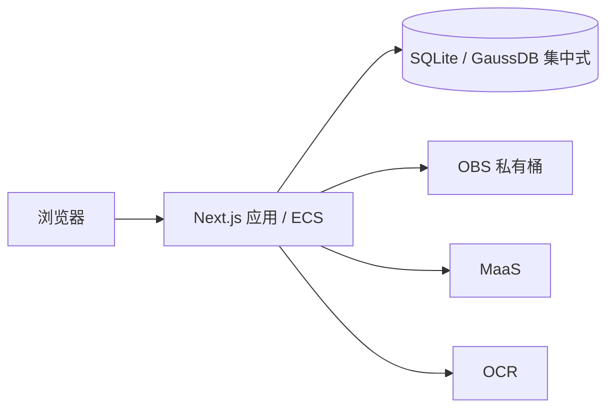

# 架构

## 应用边界

使用 Next.js App Router 和 TypeScript 构建单体应用，pnpm 管理依赖。
页面、Route Handlers 和服务端业务共用一个代码库，以 Node.js runtime 运行在 ECS 或 Zeabur。
首版只运行一个应用实例，不配置独立 FastAPI、Fastify 或 Worker 服务。

| 位置 | 职责 |
| --- | --- |
| `src/app/` | 页面、布局、HTTP 入口；身份检查与调用服务端业务 |
| `src/components/` | 在实际需要时建立的界面组件 |
| `src/server/` | 在实际需要时建立的业务模块、数据库访问、云服务适配和任务执行 |
| `src/shared/` | 在实际需要时建立的有限数据契约与校验；不包含密钥或服务端连接 |

Route Handlers 保持薄，业务计算与来源校验不写在页面里。
服务端模块用 `server-only` 保护导入边界；模块导入不启动任务、不连接云服务、不读取材料。
项目资源鉴权必须在服务端业务入口执行，不能依赖页面隐藏或代理层检查。
包含私有资料的响应不进入跨用户共享缓存，公共健康接口不返回配置、凭据或业务资料。

## 数据与外部服务

数据库通过 `DATABASE_PROVIDER` 选择 SQLite 或 GaussDB 集中式，详见[数据库与单体部署](04-database-deployment.md)。
SQLite 用于单实例部署，数据目录挂载持久卷；GaussDB 优先评估基础版，独立于应用容器，
通过内网连接，具体区域、版本、兼容模式、规格、权限与费用需实测登记。
不能因 PostgreSQL 协议兼容就认定所有 SQL、驱动、ORM 或迁移工具兼容。
接入前验证事务、精确金额、JSON、索引、迁移和连接安全；不预先绑定未经验证的 ORM。
已配置 SQLite 初始 schema 与 GaussDB 驱动适配；GaussDB 未连接真实实例，不声明兼容性验收通过。

当前编辑器原件、文档版本和元数据保存在选定数据库；未来业务使用 OBS 保存原件、核验证明和导出文件，
业务数据、不可变来源与版本关系保存在数据库。
MaaS 和 OCR 经独立的小接口调用；模型身份、上下文、输出预算及 OCR 文档种类以实测为准。
凭据只由服务端运行环境注入，不使用 `NEXT_PUBLIC_` 前缀，不作为镜像构建参数。

### 模型网关的最小接入

按用户选择，首个连接使用兼容 Chat Completions 的网关 `https://aigw.saurlax.com/v1`，
模型暂定 `glm-5.3-flash`。服务端环境变量为 `AI_BASE_URL`、`AI_API_KEY`、`AI_MODEL`；
地址仅接受不含凭据、查询参数或片段的 HTTPS URL，密钥必填，空配置显式失败。
应用代码仅从带 `server-only` 保护的 `src/server/ai/` 入口调用；导入模块和构建不会发起请求。

本步仅提供单次纯文本调用及本机 `pnpm ai:smoke` 连通测试，不接入页面、公共 HTTP 接口、
文档读取、数据库、后台业务任务或合同审查。测试只发送固定合成消息“请只回复：连接成功”。
调用 `POST <base>/chat/completions`，Bearer 鉴权，关闭流式，输出预算 256 Token，
请求及响应读取共用 30 秒超时，拒绝重定向；每次执行最多一次请求，不自动重试。
仅在 `finish_reason=stop`、正文非空且没有拒绝/工具调用时返回有效文本；响应上限 1 MiB。
对配置、鉴权、限流、网络、截断及非法响应分别返回明确错误，不把响应正文、底层错误或密钥写入日志。
模型名与用量仅保留经过类型校验的字段。密钥保存在忽略的 `.env.local` 或运行环境中。

MG-01：配置、HTTPS 地址、空输入和输入长度校验；MG-02：请求路径、鉴权和非流式格式；
MG-03：错误脱敏、超时、拒绝、截断、非法/超大响应；MG-04：固定合成消息的真实网关往返，
真实调用独立于自动化测试记录。以上只验收模型连接，不计为法律业务 AC 通过。

### 合同审查模块的联调契约

本次增加可交接的 Node.js 审查模块，服务端统一入口为 `@/server/contract-review` 的
`reviewText(input)`；可注入模型的纯编排与本地 CLI 位于 `tools/contract-review/`。
输入为合同文字、标题、明确提供的主体/项目/地域条件及可选文档版本、解析快照标识和完整性信息。
不得从正文猜测审查立场；条件不明的规则保留待核实，条件不符的规则记录排除原因。
入口仅供已经完成权限检查的 Node.js 后端或持久化任务调用；本次不新增 HTTP 路由、账号、
数据库任务或网页入口，也不表示 AC-03、AC-15、AC-23 已验收。

输出使用 `schemaVersion: 1`，包含本次结果 ID、输入摘要、模式、执行状态
（`success` / `partial` / `failed`）、六类覆盖、有效/拒绝条目、未定位条目、警告、脱敏错误及调用次数。
成功仅表示声明范围内全部必要检查完成；正常无风险可以成功，漏答、无规则、来源不足、
解析不完整、预算耗尽及全部条目无效均不能显示完整成功或无风险。
已处理批次在后续失败时保留；输出对象由调用方保存，CLI 每次创建独立目录，不覆盖历史报告。

未定位条目分两种并分别记录：`no-match` 表示非必检规则未命中任何条款线索、未纳入本次检查；
`outline-only` 表示只提供了目录，没有定位到正文，不能视为已完成检查。
任何未定位条目均阻止完整成功；报告单列「未定位的检查项」并声明不计为已通过。

默认只读取已发布规则包、规则和来源；停用内容始终排除。`mode: "debug"` 可使用草拟/待核对
材料，但 JSON、Markdown 和返回对象均保留调试模式及未核对声明。当前内置资料均待核对。
场景必检规则不依赖关键词命中；缺失条款使用检查范围与规则定位，不要求虚构引文。
有效引文、合法来源 ID 不代表法律适用正确。

### 条款块与定向取材

解析结果按条款编号切成块（第X条/章/节、一、、（一）、1. 等），无编号时按段落边界累积，
不切段落内部。每块保留原段落编号，因此引文校验、缺失条款的检查范围与原文定位不受切块影响。
切块后生成全文目录（块名与段落范围），作为每次取材的固定表头。

每批只送命中段落所在的块及前后各一块，相邻块用于跨条约定；未命中任何块时仍送目录，
对应项目保留待核实，不得因为目录没有标题或未提供正文而判定缺失。
完整合同原文不再是每批的固定内容。调用方不提供条款块时保持整篇发送的旧行为。

固定编排每次外部调用默认 90 秒，总执行时间最多 600 秒，合计最多 3 次请求（包含最多一次瞬时重试）。
Agent 入口的计次另见下节；不得以工具、索引或技能选择为名绕过同一任务的总预算。
网关只发送一次请求，统一编排分批、计次和重试；永久性 4xx 不重试。提供发送前预算预留回调，
供后端持久化计数及复查权限；调用方仍须实现跨恢复预算、幂等、租约和任务持久化。
默认每批 7 条规则、最大单份输入 100,000 字符，单批提示默认上限 240,000 字符（含目录与相关条款）；
这属于联调保护值，不是模型容量实测结果，超限明确返回错误，不截断合同，也不静默缩小取材范围。
正式开放 AI 前仍按产品 §2 验证并固化上下文预算；服务端正式模式需显式配置已验证的提示上限。

CLI 限于 TXT 和已通过现有 DOCX 验证器的基础 DOCX。DOCX 在设置 512 MiB 堆限制 / 60 秒时限的子进程中
提取，保留正文/表格顺序及表格行列；不支持的结构明确拒绝。文字 PDF、人工复核与 DOCX
成果导出仍由后续集成实现。本次验证计划覆盖 AC-03/AC-21 的编排、引用、缺失和覆盖反例，
以及 AC-23/AC-24 的局部预算和输入边界；测试编写不等同于业务验收通过。

### 合同审查 Agent 的增量入口

采用 Vercel AI SDK 的有界单 Agent 工具循环，运行在现有 Node.js 应用内。
`tools/contract-review/src/agent` 提供 `reviewWithAgent`，后端增加 `reviewTextWithAgent`；
旧固定编排入口保留。CLI 显式使用 `--agent`。仅完成模块升级，不表示网页、持久化任务或业务验收已经接通。

技能存放在 `tools/contract-review/skills/` 的登记 ID 目录：SKILL.md 定义适用条件、步骤、必检类别和输出约定，
skill.json 定义 ID、版本和发现信息。规则和参考资料继续以现有 rules/ 为唯一数据源。
Agent 先看到技能名称和用途，再调用 loadSkill 加载正文和规则。系统固定六类必检规则，不由 Agent 自行删减。
正式模式只使用已发布且经核对的资料；调试模式保留原有未核对声明。技能说明本身不构成法律依据。

工具限定为本任务的解析快照、目录、搜索/读取段落、技能加载、读取规则允许的来源、提交结论和查看覆盖。
解析沿用现有受限子进程，在模型调用前固定快照；Agent 的 parseDocument 工具读取该快照，不接受任意文件路径。
搜索只返回线索，不计为已读正文。实际返回给模型的段落和依据才登记为已读。
每条提交记录其当时已读范围和来源集合，后读资料不能为先前提交补造检查范围。
仅允许引用已读原文及已读且规则允许的依据 ID。缺失/无问题结论要求解析完整并已读取全文；
局部阅读可提出有真实引文的问题或待核实，不能证明条款缺失或完整无风险。
后端固定文档版本/解析快照、校验结构与逐字引文、补齐未答必检项为待核实，并输出六类覆盖。
Agent 自然语言总结不成为报告；只有 submitFindings 经校验的结构化条目可进入结果。

结果保持 ReviewResult 的兼容字段，另增可选 agent 记录：技能版本与摘要、已读段落/来源、工具轨迹和提交时阅读范围。
引用附带后端固定的版本标识、段落/表格位置和经核对的来源元数据；不把 DOCX 页码作为稳定定位。
后端按最终 findings 生成风险摘要，人工复核状态沿用原契约。

Agent 联调默认实际模型请求上限 25 次，可由可信后端设置 1–40；恢复计数包含此前占用次数。
每个实际请求发送前调用 onBeforeCall，供调用方复查权限并持久化预留；SDK 自动重试关闭。
模型单次输出预算维持 8192 token；submitFindings 单批最多 3 条，提示每回合只调用一次提交工具，
不把全部必检项挤进一次响应。所有规则仍须覆盖，分批请求继续计入原任务预算。
对大小限制内可解析的 JSON 响应，先持久化本次请求体和响应，再检查结束原因；
截断、拒绝及其他异常结束分别处理，不采用不完整工具参数、不把失败当作无风险。
每次 Agent 尝试遇到长度截断时，最多在原上下文修正一次，明确要求只提交一条结果；
修正发送前仍复查权限、预留次数并受原累计预算及时限约束。拒绝及其他异常不自动重发。
全部适用规则已有有效提交时由后端停止循环，不再请求额外的自然语言总结。
失败记录不包含密钥/请求头，沿用原任务的权限、执行令牌及保留清理约束；记录失败则停止处理。
单次默认 90 秒、总计最多 600 秒，提示和工具结果均有字符限制，超限明确失败，不静默截断原文。
这些是联调保护值，未实测模型工具调用或容量；正式入口仍要求显式配置已验证的提示预算。
onProgress 提供可等待的进度通知，调用方负责持久化、租约、执行令牌及恢复；钩子不等于数据库任务已实现。

后续验证项目：技能按需加载、六类覆盖、跨条补读、已读引文/来源约束、局部阅读不能清空风险、预算及取消、CLI 和后端接入。
本轮按用户要求只实现代码，不运行这些验证，不记录通过结论。

## 任务执行

### 主审与复核的受控对照实验

保留前期独立 Node.js CLI 对照实验作为调试入口；网页新任务现使用下文规定的多 Agent 主线，历史对照结果不代表当前发布验收。
实验固定相同输入、规则/来源和模型，先运行一次主审并保存原始结果，再让独立复核 Agent
按每批最多 3 条核对原文、依据支持、适用条件、建议矛盾、重复与疑似漏检。
复核输入包含固定解析范围、主审全部结论、本批规则及允许的来源正文；材料与模型输出均为不可信数据。
只开放结构化提交核对意见的工具，不开放网络、文件、项目写入或改写主审结果的权限。
意见绑定原规则及逐字原文，依据须属于该规则允许且本次可用的来源；无效、漏答和失败单独记录。
复核的「保留」仅为机器意见，全部意见仍待人工复核；缺证、待核实及执行失败不能被该意见消除。

主审与复核串行共用每份输入最多 40 次实际请求和累计 600 秒，外发前使用同一预留入口；
复核不得重置次数、为每个角色各分配 40 次或用新请求绕过原权限。
复核失败保留主审原件和已有核对意见，未核对规则明确列出。实验不接入网页任务或成果复核状态。
JSON/Markdown 分别保存主审、复核意见、原始响应与对照指标，不能覆盖已保存报告。
复核工具以本批规则 ID 和来源 ID 枚举约束提交，仍保留服务端逐条绑定校验。
CLI 可显式设置复核推理强度为 low，随实验配置及原始请求保存；不更改主审或网页服务的模型设置。
供应商不支持该设置时明确失败，不静默替换模型或提高预算。每次独立对照运行均遵守上述累计上限。

对照复用同一次主审结果，记录增加复核前后的调用数、耗时、已知 token、原始输出、
拒绝项、待核实和建议核对项。没有独立标注时仅报告观察到的差异，不声称漏检/误报改善或法律准确率。
合成故障注入与自然主审输出分开记录，不计入自然改进数据；先封存检查预期再运行真实模型。
验收覆盖：规则/来源及引文约束、预算与取消、复核失败保留主审、不能改变人工复核状态、
重复/漏答不算完成，以及同输入真实模型运行记录。此实验不替代产品 §12.1 的业务质量闸门。

### 合同审查网页任务增量

网页新任务提交审查立场及地域，场景默认 `auto`；识别停止后的手选新任务遵循产品 §4.2，输入固定场景来源、原任务、理由和服务端时间。默认执行 `multi-agent-v1`：独立路由、主审和复核 Agent 串行协作，手选与 CLI 共用适配函数，不能绕过排除条件。
场景与规则边界由产品 §1.2、§4.2 负责。当前目录为机电安装、装饰装修、幕墙、钢结构四类房建专业分包。
路由仅获得固定解析材料、候选元数据和 selectScene；主审仅获得所选场景的规则/技能及材料；复核仅能提交核对意见。
各角色有独立模型上下文。程序持久化交接，不通过共享自由聊天传递权限或事实，也不允许复核改写主审。
每份新任务固定四个场景资源包（目录、规则/来源、技能及摘要）与流程版本；只把当前模式可用资源列为候选，正式模式仍排除未发布规则。
机电安装沿用现有规则；其他场景在固定通用清单上绑定本场景，并添加各自专项清单和技能。派生组合保持待核对，不继承发布资格。
路由完整输入超限或解析不足时明确失败/待确认，不静默截断。完整已提交正文可用于选择证据校验；合同指令不赋予工具权限。
一次路由最多 4 次请求；主审在共享预算内预留 ceil(本场景规则数/3)+1 次给复核，不能为每个角色重新分配 40 次。
三角色所有实际外发、长度修正、失败与恢复合计最多 40 次、600 秒，发送前使用同一事务权限及预算预留入口。
新任务可固定已验证的复核推理配置 default/low；不支持时明确失败，不能静默替换模型或放大预算。
检查点保留路由原件、主审工作结果/封存状态和复核进度；恢复复用已完成角色，只继续未完成角色并沿用累计次数。
封存主审内容用于复核摘要绑定，复核恢复校验主审及规则摘要。旧尝试不能写入新令牌；恢复前未完成的外发仍按已预留次数计费预算。
复核失败保留主审和已有意见，显示未核对规则；不能显示整体完整成功。人工复核状态始终独立。
JSON 与报告保留各角色结果、实际覆盖与聚合用量；原始模型交换按任务工件单独保存，不并入报告。
存在复核疑点时阻止完整无风险文案，但不把机器意见包装为已确认错误。
旧任务没有流程版本时继续原单 Agent 流程，不能恢复时突然换成多 Agent 或新场景规则。

新选择生成修订稿的网页任务固定 `multi-agent-revision-v1`，在主审后加载场景修订技能，并以独立上下文核对整份修改后正文；不再复用原合同的机器复核意见。
输入清单另固定修订技能及版本摘要。检查点保留主审原件、逐段修订/处理映射、修订稿摘要及独立核对进度；不同摘要的意见不能互相复用。
原检查每条均有处理说明，未改正文由程序保留；修订只通过受限结构工具提交，不授予模型文件写入或发布权限。
四个角色共用原任务权限、预留入口、默认 25/最大 40 次及累计 600 秒；主审预留修订和核对所需调用，恢复跳过已完成阶段，不自动增加预算。
独立核对失败或有问题时保留建议稿及原审查，不开放 Word 导出。通过结构校验和完整核对后，在受限子进程生成 DOCX 并存入同一任务的不可变工件；下载仅鉴权并返回已存字节。
旧任务没有新流程标识时保持原恢复行为。报告下载与合同修订稿下载分别标注，不把报告重新命名为合同。

### 新任务主审材料准备与成本边界

路由、主审/修订、独立复核分别允许 `AI_ROUTER_MODEL`、`AI_PRIMARY_MODEL`、`AI_AUDIT_MODEL`，未配置时回落 `AI_MODEL`。新任务固定三档模型，恢复不得随环境变化；每次调用摘要保存实际请求/响应模型。仍保持独立模型上下文和原调用/时限预算，不通过删除复核降成本。
场景资源按已读取原始文件内容及目录元数据的 SHA256 缓存不可变装配结果；返回隔离副本，文件内容变化即失效，不按路径或 mtime 复用旧内容。不缓存项目或上传材料。
主审公共提示与工具 schema 复用装配，批次仍为六类、本批规则和独立请求；本轮不增加单批上限。成本对照固定合同、模型、预算及策略，记录 calls/tokens/耗时，不把单次网络耗时差异当作优化证明。

新任务固定 `AI_EXCHANGE_RETENTION=summary|full`（默认 summary）。每次响应在 checkpoint 前持久化独立摘要：调用序号、角色、请求/响应模型、usage（未知保留未知）、请求/响应哈希、耗时、结束原因及工具名；full 模式另存全文工件，随原期限清理。预算累计读取摘要，并兼容旧 model-exchange 全文记录；相同调用不重复计数。保留完整解析快照、结构化结果及恢复 checkpoint，summary 不能删掉恢复所需业务数据，哈希也不能重放完整请求。表单明示当前全文留存模式与保留天数，策略变化要求重新确认。
修订下载不自动改选子任务：原审查 ID 若有修订子任务，返回 `REVISION_TASK_REQUIRED` 和经双任务权限校验的 `revisionTaskId`；无子任务返回 `REVISION_NOT_READY`。前端展示目标任务并由用户打开，禁止静默选择其他版本下载。

显式 `pnpm ai:compat` 仅发送合成文本及微型合同结构化核对，分别走 askModel 和 ToolLoopAgent，至多两次请求、无自动重试。记录实际端点主机、模型、结束原因、usage、calls、耗时及脱敏错误码；不存请求响应全文，不声明未配置端点兼容。默认测试离线覆盖正常/截断/空/refusal/缺 usage 及工具形态、空参数、非 JSON；兼容性不是法律质量验收。

新网页任务在输入中固定 `primaryStrategy=prepared-v1`；原流程版本继续区分普通审查和合同修订。策略、主审/修订推理配置和 token 阈值同时进入任务配置及流程摘要；旧任务缺字段时沿用原工具循环和原配置，不因部署升级切换。

程序按已选场景加载固定技能，直接提供完整固定解析正文、任务立场、本批规则和这些规则允许且本模式可用的依据；准备工作不调用模型。主审依次按六类规则分批，每批最多四条，规则顺序固定；一个主审角色分批工作，不增加六个子 Agent。每个请求重新装配必要材料和本批尚未接受的规则，不携带前批完整结论、工具轨迹或模型思考。失败纠正只带本批拒绝原因；已接受项不可被后续批次覆盖。

当前先支持完整正文可放入提示上限的合同，不按关键词裁掉正文；任一完整批次超限则明确失败并保留已有结果。技能中的工具取材步骤在此策略中由程序完成；技能不成为法律依据。正文、规则和来源仍是不可授予权限的业务输入。

只在本批完整输入已发送且取得可用模型响应后登记该批交付范围和提示摘要，并据此校验原文和来源。提交只能包含本批规则；缺失/无问题仍要求完整解析和本次全文交付。记录交付不声称证明模型理解，后读资料不能为早先提交补造范围。恢复验证策略及输入版本，保留已接受结果、用量及交付记录，只处理未完成规则。

新任务可固定主审与修订 `default/low` 推理配置，默认 low；既有独立核对配置继续独立保存。不支持配置时明确失败，不静默改模型或提高输出上限。实际请求默认25/最大40、单次8192输出及累计600秒继续共享；长度截断不采用不完整参数。

新任务同时固定 `revisionStrategy=prepared-v1`：修订按尚未处理的问题锚点分组，每批最多六项处理说明/三处修改，独立请求只带原合同全文、本批原审查和规则/来源、已保存修改及简明处理映射，不累积对话或重复发送全部原审查/来源。相同原段问题优先一起处理，已接受修改仍不可覆盖，跨批同段可引用已有修改或明确待确认。只允许本批规则的编辑和说明；JSON或领域校验失败保留本批反馈，长度截断缩为单项、仍失败则停止。旧任务缺字段时保持旧修订循环，恢复不得混用修订策略。

生成修订稿的新任务另固定 `auditStrategy=prepared-v1`：修改后核对仍收到完整原正文、改后正文和修改位置映射，仅提供本批原主审、处理说明、规则及允许来源；不重复在映射中复制已提供的前后正文。核对工具结构保持稳定，服务端逐条校验批次和来源范围。单项无效只拒绝该项，保留同批有效项并返回未完成规则，已有核对意见不可覆盖；只有全部原规则均取得有效意见且无存在问题项才允许导出。旧核对策略及其恢复不改变。

审查完成后可另建 `revision-only-v1` 任务：输入固定原主审结果、所选规则及原场景包摘要，跳过路由和主审；只修订所选规则并只核对所选规则，未修改正文按原快照重建并在导出前校验；未选规则保留原审查，不重新生成。所选规则全部核对且无存在问题项才允许导出，报告与 Word 标注本次范围。该任务独立计次、600 秒与 token 阈值，保留期限不超过原任务。

新任务固定 `maxKnownTokens` 已记录总 token 停止阈值，默认600000，可由可信服务端配置10000–2000000。每次外发预留前，在当前执行令牌和授权事务中汇总原任务全部尝试的不可变模型交换 usage；达到阈值时不再发送，已有结论和实际消耗保留。它按已返回用量停止，最后一次请求可能超过阈值；上游未返回或缺 usage 时无法确定实际计费，不记为零成本，仍受次数/时间上限约束。阈值不是供应商 token 硬预扣或人民币预算。缓存命中仍计入输入 token，不伪报免费或保证节省比例。

验收：完整材料无需模型准备调用；本批来源/引文及规则校验；六类必检全覆盖；无前批历史串入；拒绝后仅补未完成项；超限/截断/空回答/依据缺失/文档指令不冒充完成；跨恢复保留用量和原策略；token达到阈值及旧令牌禁止外发；同一合成输入记录调用和实际用量，业务准确率另行验收。

以下单 Agent 场景阶段契约继续用于存量任务和显式调试入口：
网页存量自动场景任务提交审查立场及地域，场景使用 `auto`；解析后在同一个 Agent 中执行场景识别、技能加载和审查。
后端固定本次可用候选目录（ID、名称、版本、适用/排除条件、技能绑定）及其规则/技能快照；存量任务沿用提交时的目录。
首阶段只开放固定快照的目录、搜索、正文读取和 `selectScene`，不开放依据、技能加载或提交审查结论。
选择必须引用前一模型回合已读取段落中的逐字原文；匹配要求完整解析、已读全文、已登记候选及与用户确认立场一致。
未知场景、伪造引文、试图替换已保存选择和越阶段工具调用均由服务端拒绝，不依赖模型提示遵守。
支持 `matched`、`unsupported`、`needs-confirmation` 三种结果；后两者停止工具循环并保存非成功结果，不生成风险结论。
仅 matched 后按该场景绑定的技能开放 `loadSkill`，规则必检范围及发布闸门保持有效。
场景识别消耗同一任务累计最多 40 次请求/600 秒，沿用外发守卫、预留、心跳、原始响应与检查点持久化。
恢复复用已校验选择，不重新路由或重置预算；当前模型上下文的正文与依据仍须重新读取才能提交新审查引文。
候选目录变更进入 configurationId，既有任务使用固定目录；存量显式场景任务继续原流程。
验收包括：匹配后六类检查、不适配/不确定、真实已读证据、未知 ID、正文指令、立场冲突、跨恢复选择与预算及网页状态。

匿名文档工作台增加会话内审查联调任务，不替代账号/项目授权，不计 AC-01 通过。
仅处理同一 HttpOnly 会话有权访问的已保存 DOCX；提交、读取、领取及每次外发均复查归属。
审查沿用数据库规格的 X-Document-Context 协议及删除日志重放就绪屏障，不另建数据库连接或旧 cookie 通道。
任务固定提交时的 contextId；新会话、过期、撤销和存量未登记均不得访问旧任务。
存量只读导出窗口只允许读取已有报告及取消任务，不允许新分析、重试、解析或模型外发。
每次调用预算预留与会话 review 守卫在同一短事务内完成；恢复必须再次检查原会话。
用户明确确认发送所选版本及记录保留期限，未保存编辑先保存。生产默认 published、开发默认 debug，
由 AI_REVIEW_MODE 固定，浏览器不能切换；调试模式还需确认未核对资料标记并在报告持续显示。

任务固定版本/哈希、确认条件、授权、规则全文/摘要、技能全文/版本/摘要及模型地址/名称。
领取后以资源受限子进程解析，持久化不可变解析快照，恢复复用原快照。
任务表作为队列，独立单行租约保证串行领取；任务执行令牌防止旧尝试写回。
15 秒心跳、60 秒租约、最多 3 次尝试，请求与累计 600 秒预算跨恢复/重试保留。
发送前事务预留，检查点和原始模型请求/响应存库，密钥/header 不进入产物。
恢复保留已接受条目，新会话仍须读取材料才能引用；不把旧阅读记录当成新上下文。
取消撤销后续发送及令牌写回；不承诺已在上游执行的请求可撤回或不计费。
同一幂等 key/输入返回原任务，变化输入返回 409；重试不重置预算，新分析须显式提交新 key。

AI_REVIEW_RETENTION_DAYS 在生产必配正整数，开发联调默认 7 天，提交前展示并确认。
任务到期取提交时确认的审查期限与原会话固定期限的较早值；确认文案同时展示原资料期限优先的约束。
任务固定到期立即拒读/执行/外发，后台删除任务及派生物；原文档仍按原保留契约处理。
任务外键随原文档/版本清理级联删除，不为原资料续期。完整项目/备份恢复仍需单独验收。
接口 /api/contract-reviews 支持配置/列表及提交，/[id] 支持详情、取消、预算内重试。
响应 private,no-store，写接口同源校验，输入白名单；列表无全文，详情只返回本会话任务。
所有审查请求携带 X-Document-Context，成功响应回传该上下文；序列化后再次检查权限和上下文。
错误沿用数据库规格的 HTTP 状态、code 和可选 session，不把会话错误降为无类型的通用错误。
网页轮询真实阶段，关闭页面不取消任务，重新打开文档或任务列表可查看历史。
引文显示任务固定解析快照、版本及段落，而不是当前已修改正文。此轮只写代码，不运行验收。

整合验收：缺失/错误上下文拒绝请求；到期、撤销及只读窗口阻止新任务、重试和模型预算预留；
原文档清理级联删除任务及模型产物；幂等、累计预算、租约恢复和旧令牌保护有独立合成测试。
内置未核对规则包保持待核对，published 模式拒绝使用，不能用临时 reviewer 标记跳过发布检查。

后续实现采用数据库持久化任务和应用进程内串行执行器，默认全局并发为 1。
任务提交后返回标识，页面查询状态；不依赖浏览器保持连接，也不在 HTTP 请求中等待整个工作流。
执行器由明确的 Node.js 启动生命周期初始化且每进程仅启动一次，不在构建阶段启动。

幂等提交、短领取事务、租约、心跳、每次尝试的执行令牌和调用预算仍按
[产品契约第 9 节](01-product.md#9-任务错误与恢复)实现。
任务状态存库，启动后处理可恢复任务；外部调用中断后不得承诺供应商侧恰好执行一次。
`after()`、内存数组和未等待的 Promise 均不替代持久化任务及恢复。
解析使用有资源限制的短生命周期子进程，防止阻塞主应用；这不构成独立常驻 Worker 服务。
人工确认发生在任务之外。只有实际容量或隔离要求证明必要时，再讨论拆分执行进程。

## 交付边界

Docker 使用 Next.js `standalone` 输出，非 root 用户运行，包含静态资源和 `public/`。
应用通过有效 HTTPS 入口提供访问；本地 Compose 默认只映射回环地址。
GaussDB 托管备份不能替代包含 OBS 对象、版本、配置和删除记录的完整项目恢复演练。
不引入 Redis、独立消息队列、向量数据库、Kubernetes 或通用智能体编排平台。

当前实现提供公开的 [工作台界面预览](02-workbench-ui.md) 和 `GET /healthz` 存活检查。健康响应不证明数据库、OBS、MaaS、OCR
可用，也不证明 AC-01 的受控登录与 HTTPS 已通过。镜像流水线与部署方式见
[部署指南](../docs/deployment.md)。
