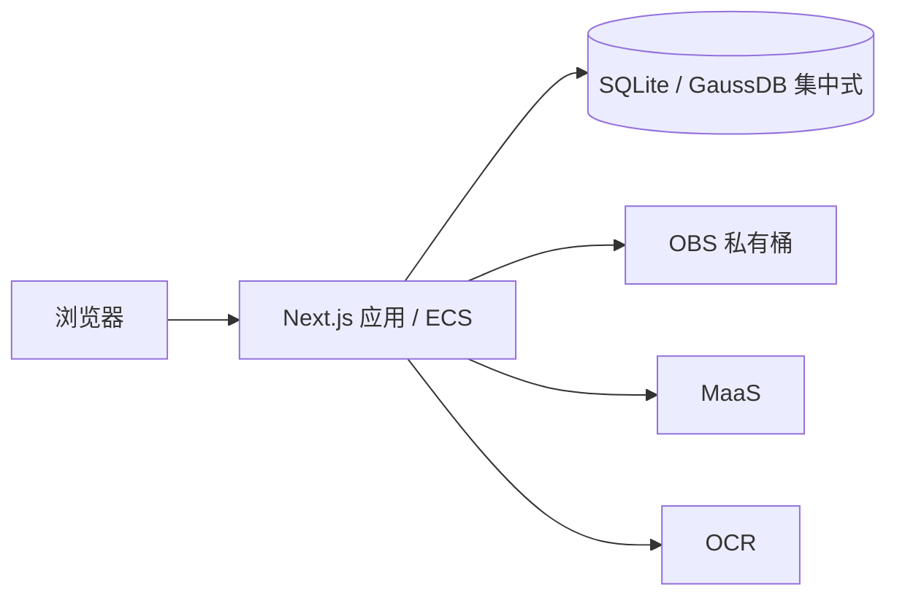

# 架构

## 应用边界

使用 Next.js App Router 和 TypeScript 构建单体应用，pnpm 管理依赖。
页面、Route Handlers 和服务端业务共用一个代码库，以 Node.js runtime 运行在 ECS 或 Zeabur。
首版只运行一个应用实例，不配置独立 FastAPI、Fastify 或 Worker 服务。

| 位置 | 职责 |
| --- | --- |
| `src/app/` | 页面、布局、HTTP 入口；身份检查与调用服务端业务 |
| `src/components/` | 在实际需要时建立的界面组件 |
| `src/server/` | 在实际需要时建立的业务模块、数据库访问、云服务适配和任务执行 |
| `src/shared/` | 在实际需要时建立的有限数据契约与校验；不包含密钥或服务端连接 |

Route Handlers 保持薄，业务计算与来源校验不写在页面里。
服务端模块用 `server-only` 保护导入边界；模块导入不启动任务、不连接云服务、不读取材料。
项目资源鉴权必须在服务端业务入口执行，不能依赖页面隐藏或代理层检查。
包含私有资料的响应不进入跨用户共享缓存，公共健康接口不返回配置、凭据或业务资料。

## 数据与外部服务

数据库通过 `DATABASE_PROVIDER` 选择 SQLite 或 GaussDB 集中式，详见[数据库与单体部署](04-database-deployment.md)。
SQLite 用于单实例部署，数据目录挂载持久卷；GaussDB 优先评估基础版，独立于应用容器，
通过内网连接，具体区域、版本、兼容模式、规格、权限与费用需实测登记。
不能因 PostgreSQL 协议兼容就认定所有 SQL、驱动、ORM 或迁移工具兼容。
接入前验证事务、精确金额、JSON、索引、迁移和连接安全；不预先绑定未经验证的 ORM。
已配置 SQLite 初始 schema 与 GaussDB 驱动适配；GaussDB 未连接真实实例，不声明兼容性验收通过。

当前编辑器原件、文档版本和元数据保存在选定数据库；未来业务使用 OBS 保存原件、核验证明和导出文件，
业务数据、不可变来源与版本关系保存在数据库。
MaaS 和 OCR 经独立的小接口调用；模型身份、上下文、输出预算及 OCR 文档种类以实测为准。
凭据只由服务端运行环境注入，不使用 `NEXT_PUBLIC_` 前缀，不作为镜像构建参数。

### 模型网关的最小接入

按用户选择，首个连接使用兼容 Chat Completions 的网关 `https://aigw.saurlax.com/v1`，
模型暂定 `glm-5.3-flash`。服务端环境变量为 `AI_BASE_URL`、`AI_API_KEY`、`AI_MODEL`；
地址仅接受不含凭据、查询参数或片段的 HTTPS URL，密钥必填，空配置显式失败。
应用代码仅从带 `server-only` 保护的 `src/server/ai/` 入口调用；导入模块和构建不会发起请求。

本步仅提供单次纯文本调用及本机 `pnpm ai:smoke` 连通测试，不接入页面、公共 HTTP 接口、
文档读取、数据库、后台业务任务或合同审查。测试只发送固定合成消息“请只回复：连接成功”。
调用 `POST <base>/chat/completions`，Bearer 鉴权，关闭流式，输出预算 256 Token，
请求及响应读取共用 30 秒超时，拒绝重定向；每次执行最多一次请求，不自动重试。
仅在 `finish_reason=stop`、正文非空且没有拒绝/工具调用时返回有效文本；响应上限 1 MiB。
对配置、鉴权、限流、网络、截断及非法响应分别返回明确错误，不把响应正文、底层错误或密钥写入日志。
模型名与用量仅保留经过类型校验的字段。密钥保存在忽略的 `.env.local` 或运行环境中。

MG-01：配置、HTTPS 地址、空输入和输入长度校验；MG-02：请求路径、鉴权和非流式格式；
MG-03：错误脱敏、超时、拒绝、截断、非法/超大响应；MG-04：固定合成消息的真实网关往返，
真实调用独立于自动化测试记录。以上只验收模型连接，不计为法律业务 AC 通过。

### 合同审查模块的联调契约

本次增加可交接的 Node.js 审查模块，服务端统一入口为 `@/server/contract-review` 的
`reviewText(input)`；可注入模型的纯编排与本地 CLI 位于 `tools/contract-review/`。
输入为合同文字、标题、明确提供的主体/项目/地域条件及可选文档版本、解析快照标识和完整性信息。
不得从正文猜测审查立场；条件不明的规则保留待核实，条件不符的规则记录排除原因。
入口仅供已经完成权限检查的 Node.js 后端或持久化任务调用；本次不新增 HTTP 路由、账号、
数据库任务或网页入口，也不表示 AC-03、AC-15、AC-23 已验收。

输出使用 `schemaVersion: 1`，包含本次结果 ID、输入摘要、模式、执行状态
（`success` / `partial` / `failed`）、六类覆盖、有效/拒绝条目、未定位条目、警告、脱敏错误及调用次数。
成功仅表示声明范围内全部必要检查完成；正常无风险可以成功，漏答、无规则、来源不足、
解析不完整、预算耗尽及全部条目无效均不能显示完整成功或无风险。
已处理批次在后续失败时保留；输出对象由调用方保存，CLI 每次创建独立目录，不覆盖历史报告。

未定位条目分两种并分别记录：`no-match` 表示非必检规则未命中任何条款线索、未纳入本次检查；
`outline-only` 表示只提供了目录，没有定位到正文，不能视为已完成检查。
任何未定位条目均阻止完整成功；报告单列「未定位的检查项」并声明不计为已通过。

默认只读取已发布规则包、规则和来源；停用内容始终排除。`mode: "debug"` 可使用草拟/待核对
材料，但 JSON、Markdown 和返回对象均保留调试模式及未核对声明。当前内置资料均待核对。
场景必检规则不依赖关键词命中；缺失条款使用检查范围与规则定位，不要求虚构引文。
有效引文、合法来源 ID 不代表法律适用正确。

### 条款块与定向取材

解析结果按条款编号切成块（第X条/章/节、一、、（一）、1. 等），无编号时按段落边界累积，
不切段落内部。每块保留原段落编号，因此引文校验、缺失条款的检查范围与原文定位不受切块影响。
切块后生成全文目录（块名与段落范围），作为每次取材的固定表头。

每批只送命中段落所在的块及前后各一块，相邻块用于跨条约定；未命中任何块时仍送目录，
对应项目保留待核实，不得因为目录没有标题或未提供正文而判定缺失。
完整合同原文不再是每批的固定内容。调用方不提供条款块时保持整篇发送的旧行为。

固定编排每次外部调用默认 90 秒，总执行时间最多 600 秒，合计最多 3 次请求（包含最多一次瞬时重试）。
Agent 入口的计次另见下节；不得以工具、索引或技能选择为名绕过同一任务的总预算。
网关只发送一次请求，统一编排分批、计次和重试；永久性 4xx 不重试。提供发送前预算预留回调，
供后端持久化计数及复查权限；调用方仍须实现跨恢复预算、幂等、租约和任务持久化。
默认每批 7 条规则、最大单份输入 100,000 字符，单批提示默认上限 24,000 字符（含目录与相关条款）；
这属于联调保护值，不是模型容量实测结果，超限明确返回错误，不截断合同，也不静默缩小取材范围。
正式开放 AI 前仍按产品 §2 验证并固化上下文预算；服务端正式模式需显式配置已验证的提示上限。

CLI 限于 TXT 和已通过现有 DOCX 验证器的基础 DOCX。DOCX 在设置 512 MiB 堆限制 / 60 秒时限的子进程中
提取，保留正文/表格顺序及表格行列；不支持的结构明确拒绝。文字 PDF、人工复核与 DOCX
成果导出仍由后续集成实现。本次验证计划覆盖 AC-03/AC-21 的编排、引用、缺失和覆盖反例，
以及 AC-23/AC-24 的局部预算和输入边界；测试编写不等同于业务验收通过。

### 合同审查 Agent 的增量入口

采用 Vercel AI SDK 的有界单 Agent 工具循环，运行在现有 Node.js 应用内。
`tools/contract-review/src/agent` 提供 `reviewWithAgent`，后端增加 `reviewTextWithAgent`；
旧固定编排入口保留。CLI 显式使用 `--agent`。仅完成模块升级，不表示网页、持久化任务或业务验收已经接通。

技能存放在 `tools/contract-review/skills/contract-review`：SKILL.md 定义适用条件、步骤、必检类别和输出约定，
skill.json 定义 ID、版本和发现信息。规则和参考资料继续以现有 rules/ 为唯一数据源。
Agent 先看到技能名称和用途，再调用 loadSkill 加载正文和规则。系统固定六类必检规则，不由 Agent 自行删减。
正式模式只使用已发布且经核对的资料；调试模式保留原有未核对声明。技能说明本身不构成法律依据。

工具限定为本任务的解析快照、目录、搜索/读取段落、技能加载、读取规则允许的来源、提交结论和查看覆盖。
解析沿用现有受限子进程，在模型调用前固定快照；Agent 的 parseDocument 工具读取该快照，不接受任意文件路径。
搜索只返回线索，不计为已读正文。实际返回给模型的段落和依据才登记为已读。
每条提交记录其当时已读范围和来源集合，后读资料不能为先前提交补造检查范围。
仅允许引用已读原文及已读且规则允许的依据 ID。缺失/无问题结论要求解析完整并已读取全文；
局部阅读可提出有真实引文的问题或待核实，不能证明条款缺失或完整无风险。
后端固定文档版本/解析快照、校验结构与逐字引文、补齐未答必检项为待核实，并输出六类覆盖。
Agent 自然语言总结不成为报告；只有 submitFindings 经校验的结构化条目可进入结果。

结果保持 ReviewResult 的兼容字段，另增可选 agent 记录：技能版本与摘要、已读段落/来源、工具轨迹和提交时阅读范围。
引用附带后端固定的版本标识、段落/表格位置和经核对的来源元数据；不把 DOCX 页码作为稳定定位。
后端按最终 findings 生成风险摘要，人工复核状态沿用原契约。

Agent 联调默认实际模型请求上限 8 次，可由可信后端设置 1–16；恢复计数包含此前占用次数。
每个实际请求发送前调用 onBeforeCall，供调用方复查权限并持久化预留；SDK 自动重试关闭。
单次默认 90 秒、总计最多 600 秒，提示和工具结果均有字符限制，超限明确失败，不静默截断原文。
这些是联调保护值，未实测模型工具调用或容量；正式入口仍要求显式配置已验证的提示预算。
onProgress 提供可等待的进度通知，调用方负责持久化、租约、执行令牌及恢复；钩子不等于数据库任务已实现。

后续验证项目：技能按需加载、六类覆盖、跨条补读、已读引文/来源约束、局部阅读不能清空风险、预算及取消、CLI 和后端接入。
本轮按用户要求只实现代码，不运行这些验证，不记录通过结论。

## 任务执行

### 合同审查网页任务增量

匿名文档工作台增加会话内审查联调任务，不替代账号/项目授权，不计 AC-01 通过。
仅处理同一 HttpOnly 会话有权访问的已保存 DOCX；提交、读取、领取及每次外发均复查归属。
用户明确确认发送所选版本及记录保留期限，未保存编辑先保存。生产默认 published、开发默认 debug，
由 AI_REVIEW_MODE 固定，浏览器不能切换；调试模式还需确认未核对资料标记并在报告持续显示。

任务固定版本/哈希、确认条件、授权、规则全文/摘要、技能全文/版本/摘要及模型地址/名称。
领取后以资源受限子进程解析，持久化不可变解析快照，恢复复用原快照。
任务表作为队列，独立单行租约保证串行领取；任务执行令牌防止旧尝试写回。
15 秒心跳、60 秒租约、最多 3 次尝试，请求与累计 600 秒预算跨恢复/重试保留。
发送前事务预留，检查点和原始模型请求/响应存库，密钥/header 不进入产物。
恢复保留已接受条目，新会话仍须读取材料才能引用；不把旧阅读记录当成新上下文。
取消撤销后续发送及令牌写回；不承诺已在上游执行的请求可撤回或不计费。
同一幂等 key/输入返回原任务，变化输入返回 409；重试不重置预算，新分析须显式提交新 key。

AI_REVIEW_RETENTION_DAYS 在生产必配正整数，开发联调默认 7 天，提交前展示并确认。
任务固定到期立即拒读/执行/外发，后台删除任务及派生物；原文档仍按原保留契约处理。
任务外键随原文档/版本清理级联删除，不为原资料续期。完整项目/备份恢复仍需单独验收。
接口 /api/contract-reviews 支持配置/列表及提交，/[id] 支持详情、取消、预算内重试。
响应 private,no-store，写接口同源校验，输入白名单；列表无全文，详情只返回本会话任务。
网页轮询真实阶段，关闭页面不取消任务，重新打开文档或任务列表可查看历史。
引文显示任务固定解析快照、版本及段落，而不是当前已修改正文。此轮只写代码，不运行验收。

后续实现采用数据库持久化任务和应用进程内串行执行器，默认全局并发为 1。
任务提交后返回标识，页面查询状态；不依赖浏览器保持连接，也不在 HTTP 请求中等待整个工作流。
执行器由明确的 Node.js 启动生命周期初始化且每进程仅启动一次，不在构建阶段启动。

幂等提交、短领取事务、租约、心跳、每次尝试的执行令牌和调用预算仍按
[产品契约第 9 节](01-product.md#9-任务错误与恢复)实现。
任务状态存库，启动后处理可恢复任务；外部调用中断后不得承诺供应商侧恰好执行一次。
`after()`、内存数组和未等待的 Promise 均不替代持久化任务及恢复。
解析使用有资源限制的短生命周期子进程，防止阻塞主应用；这不构成独立常驻 Worker 服务。
人工确认发生在任务之外。只有实际容量或隔离要求证明必要时，再讨论拆分执行进程。

## 交付边界

Docker 使用 Next.js `standalone` 输出，非 root 用户运行，包含静态资源和 `public/`。
应用通过有效 HTTPS 入口提供访问；本地 Compose 默认只映射回环地址。
GaussDB 托管备份不能替代包含 OBS 对象、版本、配置和删除记录的完整项目恢复演练。
不引入 Redis、独立消息队列、向量数据库、Kubernetes 或通用智能体编排平台。

当前实现提供公开的 [工作台界面预览](02-workbench-ui.md) 和 `GET /healthz` 存活检查。健康响应不证明数据库、OBS、MaaS、OCR
可用，也不证明 AC-01 的受控登录与 HTTPS 已通过。镜像流水线与部署方式见
[部署指南](../docs/deployment.md)。
