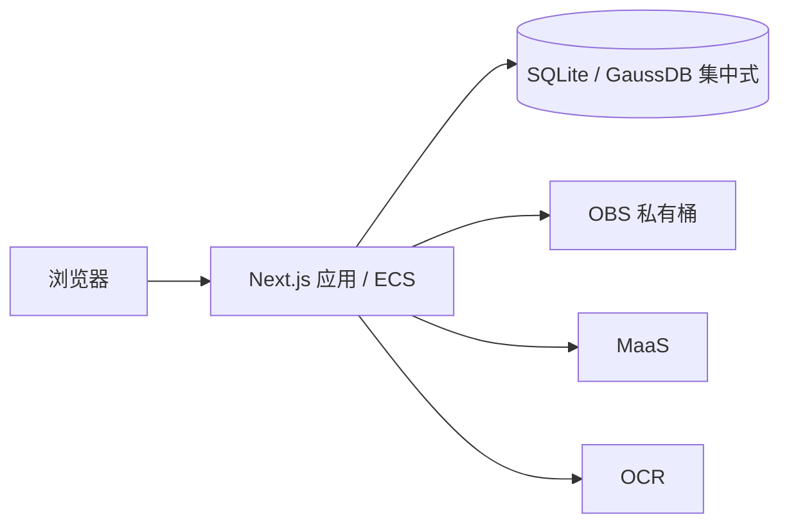

# 架构

## 应用边界

使用 Next.js App Router 和 TypeScript 构建单体应用，pnpm 管理依赖。
页面、Route Handlers 和服务端业务共用一个代码库，以 Node.js runtime 运行在 ECS 或 Zeabur。
首版只运行一个应用实例，不配置独立 FastAPI、Fastify 或 Worker 服务。

| 位置 | 职责 |
| --- | --- |
| `src/app/` | 页面、布局、HTTP 入口；身份检查与调用服务端业务 |
| `src/components/` | 在实际需要时建立的界面组件 |
| `src/server/` | 在实际需要时建立的业务模块、数据库访问、云服务适配和任务执行 |
| `src/shared/` | 在实际需要时建立的有限数据契约与校验；不包含密钥或服务端连接 |

Route Handlers 保持薄，业务计算与来源校验不写在页面里。
服务端模块用 `server-only` 保护导入边界；模块导入不启动任务、不连接云服务、不读取材料。
项目资源鉴权必须在服务端业务入口执行，不能依赖页面隐藏或代理层检查。
包含私有资料的响应不进入跨用户共享缓存，公共健康接口不返回配置、凭据或业务资料。

## 数据与外部服务

数据库通过 `DATABASE_PROVIDER` 选择 SQLite 或 GaussDB 集中式，详见[数据库与单体部署](04-database-deployment.md)。
SQLite 用于单实例部署，数据目录挂载持久卷；GaussDB 优先评估基础版，独立于应用容器，
通过内网连接，具体区域、版本、兼容模式、规格、权限与费用需实测登记。
不能因 PostgreSQL 协议兼容就认定所有 SQL、驱动、ORM 或迁移工具兼容。
接入前验证事务、精确金额、JSON、索引、迁移和连接安全；不预先绑定未经验证的 ORM。
已配置 SQLite 初始 schema 与 GaussDB 驱动适配；GaussDB 未连接真实实例，不声明兼容性验收通过。

当前编辑器原件、文档版本和元数据保存在选定数据库；未来业务使用 OBS 保存原件、核验证明和导出文件，
业务数据、不可变来源与版本关系保存在数据库。
MaaS 和 OCR 经独立的小接口调用；模型身份、上下文、输出预算及 OCR 文档种类以实测为准。
凭据只由服务端运行环境注入，不使用 `NEXT_PUBLIC_` 前缀，不作为镜像构建参数。

### 模型网关的最小接入

按用户选择，首个连接使用兼容 Chat Completions 的网关 `https://aigw.saurlax.com/v1`，
模型暂定 `glm-5.3-flash`。服务端环境变量为 `AI_BASE_URL`、`AI_API_KEY`、`AI_MODEL`；
地址仅接受不含凭据、查询参数或片段的 HTTPS URL，密钥必填，空配置显式失败。
应用代码仅从带 `server-only` 保护的 `src/server/ai/` 入口调用；导入模块和构建不会发起请求。

本步仅提供单次纯文本调用及本机 `pnpm ai:smoke` 连通测试，不接入页面、公共 HTTP 接口、
文档读取、数据库、后台业务任务或合同审查。测试只发送固定合成消息“请只回复：连接成功”。
调用 `POST <base>/chat/completions`，Bearer 鉴权，关闭流式，输出预算 256 Token，
请求及响应读取共用 30 秒超时，拒绝重定向；每次执行最多一次请求，不自动重试。
仅在 `finish_reason=stop`、正文非空且没有拒绝/工具调用时返回有效文本；响应上限 1 MiB。
对配置、鉴权、限流、网络、截断及非法响应分别返回明确错误，不把响应正文、底层错误或密钥写入日志。
模型名与用量仅保留经过类型校验的字段。密钥保存在忽略的 `.env.local` 或运行环境中。

MG-01：配置、HTTPS 地址、空输入和输入长度校验；MG-02：请求路径、鉴权和非流式格式；
MG-03：错误脱敏、超时、拒绝、截断、非法/超大响应；MG-04：固定合成消息的真实网关往返，
真实调用独立于自动化测试记录。以上只验收模型连接，不计为法律业务 AC 通过。

### 合同审查模块的联调契约

本次增加可交接的 Node.js 审查模块，服务端统一入口为 `@/server/contract-review` 的
`reviewText(input)`；可注入模型的纯编排与本地 CLI 位于 `tools/contract-review/`。
输入为合同文字、标题、明确提供的主体/项目/地域条件及可选文档版本、解析快照标识和完整性信息。
不得从正文猜测审查立场；条件不明的规则保留待核实，条件不符的规则记录排除原因。
入口仅供已经完成权限检查的 Node.js 后端或持久化任务调用；本次不新增 HTTP 路由、账号、
数据库任务或网页入口，也不表示 AC-03、AC-15、AC-23 已验收。

输出使用 `schemaVersion: 1`，包含本次结果 ID、输入摘要、模式、执行状态
（`success` / `partial` / `failed`）、六类覆盖、有效/拒绝条目、警告、脱敏错误及调用次数。
成功仅表示声明范围内全部必要检查完成；正常无风险可以成功，漏答、无规则、来源不足、
解析不完整、预算耗尽及全部条目无效均不能显示完整成功或无风险。
已处理批次在后续失败时保留；输出对象由调用方保存，CLI 每次创建独立目录，不覆盖历史报告。

默认只读取已发布规则包、规则和来源；停用内容始终排除。`mode: "debug"` 可使用草拟/待核对
材料，但 JSON、Markdown 和返回对象均保留调试模式及未核对声明。当前内置资料均待核对。
场景必检规则不依赖关键词命中；模型读取完整的受限输入、相关规则及来源正文，
缺失条款使用检查范围与规则定位，不要求虚构引文。有效引文、合法来源 ID 不代表法律适用正确。

每次外部调用默认 90 秒，总执行时间最多 600 秒，总请求最多 3 次（包含最多一次瞬时重试）。
网关只发送一次请求，统一编排分批、计次和重试；永久性 4xx 不重试。提供发送前预算预留回调，
供后端持久化计数及复查权限；调用方仍须实现跨恢复预算、幂等、租约和任务持久化。
默认每批 7 条规则、最大单份输入 100,000 字符，提示正文默认上限 24,000 字符；
这属于联调保护值，不是模型容量实测结果，超限明确返回错误，不截断合同。
正式开放 AI 前仍按产品 §2 验证并固化上下文预算；服务端正式模式需显式配置已验证的提示上限。

CLI 限于 TXT 和已通过现有 DOCX 验证器的基础 DOCX。DOCX 在设置 512 MiB 堆限制 / 60 秒时限的子进程中
提取，保留正文/表格顺序及表格行列；不支持的结构明确拒绝。文字 PDF、人工复核与 DOCX
成果导出仍由后续集成实现。本次验证计划覆盖 AC-03/AC-21 的编排、引用、缺失和覆盖反例，
以及 AC-23/AC-24 的局部预算和输入边界；测试编写不等同于业务验收通过。

## 任务执行

后续实现采用数据库持久化任务和应用进程内串行执行器，默认全局并发为 1。
任务提交后返回标识，页面查询状态；不依赖浏览器保持连接，也不在 HTTP 请求中等待整个工作流。
执行器由明确的 Node.js 启动生命周期初始化且每进程仅启动一次，不在构建阶段启动。

幂等提交、短领取事务、租约、心跳、每次尝试的执行令牌和调用预算仍按
[产品契约第 9 节](01-product.md#9-任务错误与恢复)实现。
任务状态存库，启动后处理可恢复任务；外部调用中断后不得承诺供应商侧恰好执行一次。
`after()`、内存数组和未等待的 Promise 均不替代持久化任务及恢复。
解析使用有资源限制的短生命周期子进程，防止阻塞主应用；这不构成独立常驻 Worker 服务。
人工确认发生在任务之外。只有实际容量或隔离要求证明必要时，再讨论拆分执行进程。

## 交付边界

Docker 使用 Next.js `standalone` 输出，非 root 用户运行，包含静态资源和 `public/`。
应用通过有效 HTTPS 入口提供访问；本地 Compose 默认只映射回环地址。
GaussDB 托管备份不能替代包含 OBS 对象、版本、配置和删除记录的完整项目恢复演练。
不引入 Redis、独立消息队列、向量数据库、Kubernetes 或通用智能体编排平台。

当前实现提供公开的 [工作台界面预览](02-workbench-ui.md) 和 `GET /healthz` 存活检查。健康响应不证明数据库、OBS、MaaS、OCR
可用，也不证明 AC-01 的受控登录与 HTTPS 已通过。镜像流水线与部署方式见
[部署指南](../docs/deployment.md)。
