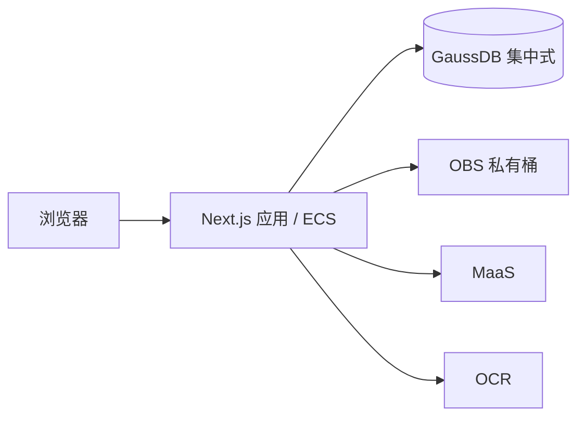

# 架构

## 应用边界

使用 Next.js App Router 和 TypeScript 构建单体应用，pnpm 管理依赖。
页面、Route Handlers 和服务端业务共用一个代码库，以 Node.js runtime 运行在 ECS。
首版只运行一个应用实例，不配置独立 FastAPI、Fastify 或 Worker 服务。

| 位置 | 职责 |
| --- | --- |
| `src/app/` | 页面、布局、HTTP 入口；身份检查与调用服务端业务 |
| `src/components/` | 在实际需要时建立的界面组件 |
| `src/server/` | 在实际需要时建立的业务模块、数据库访问、云服务适配和任务执行 |
| `src/shared/` | 在实际需要时建立的有限数据契约与校验；不包含密钥或服务端连接 |

Route Handlers 保持薄，业务计算与来源校验不写在页面里。
服务端模块用 `server-only` 保护导入边界；模块导入不启动任务、不连接云服务、不读取材料。
项目资源鉴权必须在服务端业务入口执行，不能依赖页面隐藏或代理层检查。
包含私有资料的响应不进入跨用户共享缓存，公共健康接口不返回配置、凭据或业务资料。

## 数据与外部服务

GaussDB 集中式是业务数据库选型，优先评估基础版。数据库不部署在应用容器内，
通过内网连接，具体区域、版本、兼容模式、规格、权限与费用需实测登记。
不能因 PostgreSQL 协议兼容就认定所有 SQL、驱动、ORM 或迁移工具兼容。
接入前验证事务、精确金额、JSON、索引、迁移和连接安全；不预先绑定未经验证的 ORM。
本次初始化不安装数据库驱动、不提供占位迁移，也不声明已经连接 GaussDB。

OBS 保存原件、核验证明和导出文件；业务数据、不可变来源与版本关系保存在数据库。
MaaS 和 OCR 经独立的小接口调用；模型身份、上下文、输出预算及 OCR 文档种类以实测为准。
凭据只由服务端运行环境注入，不使用 `NEXT_PUBLIC_` 前缀，不作为镜像构建参数。

## 任务执行

后续实现采用数据库持久化任务和应用进程内串行执行器，默认全局并发为 1。
任务提交后返回标识，页面查询状态；不依赖浏览器保持连接，也不在 HTTP 请求中等待整个工作流。
执行器由明确的 Node.js 启动生命周期初始化且每进程仅启动一次，不在构建阶段启动。

幂等提交、短领取事务、租约、心跳、每次尝试的执行令牌和调用预算仍按
[产品契约第 9 节](01-product.md#9-任务错误与恢复)实现。
任务状态存库，启动后处理可恢复任务；外部调用中断后不得承诺供应商侧恰好执行一次。
`after()`、内存数组和未等待的 Promise 均不替代持久化任务及恢复。
解析使用有资源限制的短生命周期子进程，防止阻塞主应用；这不构成独立常驻 Worker 服务。
人工确认发生在任务之外。只有实际容量或隔离要求证明必要时，再讨论拆分执行进程。

## 交付边界

Docker 使用 Next.js `standalone` 输出，非 root 用户运行，包含静态资源和 `public/`。
应用通过有效 HTTPS 入口提供访问；本地 Compose 默认只映射回环地址。
GaussDB 托管备份不能替代包含 OBS 对象、版本、配置和删除记录的完整项目恢复演练。
不引入 Redis、独立消息队列、向量数据库、Kubernetes 或通用智能体编排平台。

当前实现提供公开的 [工作台界面预览](02-workbench-ui.md) 和 `GET /healthz` 存活检查。健康响应不证明数据库、OBS、MaaS、OCR
可用，也不证明 AC-01 的受控登录与 HTTPS 已通过。镜像流水线与部署方式见
[部署指南](../docs/deployment.md)。
