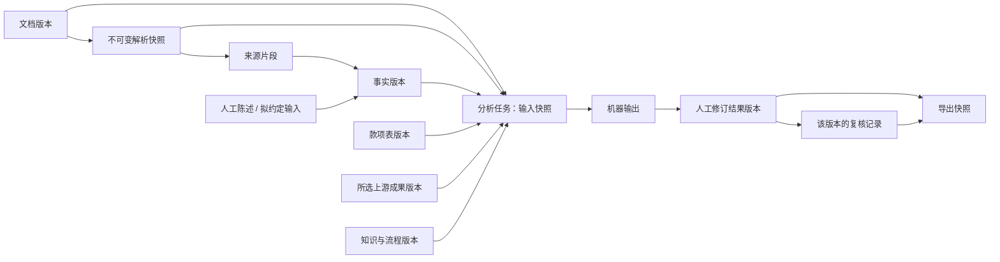

# 工程承包企业法律风险与文书协同平台：Demo 与完善版设计规格

- 版本：1.3，补充 2026-10-22 用户确认的前端分步交付与业务交互边界
- 日期：2026-10-22（Asia/Shanghai；首次规格日期为 2026-10-19）
- 用途：华为 ICT 大赛创新赛赛道一
- 工期约束：开工后 12 天交付可演示 Demo，Demo 交付后另有一个月完善，主要借助 AI 开发
- 设计状态：模块化单体与业务契约保留；界面采用文档/规范库和编辑器/Agent，按工作台、编辑器、业务交互顺序推进。
- 实现状态：已有 Next.js 工作台、DOCX 编辑与服务端版本、SQLite / GaussDB 配置、健康接口及镜像配置；
  GaussDB 未经真机验证，账号/项目权限、四业务、Agent 及其他云服务尚未实现。新增 UI 契约不表示已实现。

## 1. 产品目标与完成定义

平台服务中国大陆房建工程专业分包企业内部的法务、商务及投标人员，默认代表专业分包人。
围绕同一个工程项目，完成投标材料核验、合同审查、文书撰写和工程款争议分析。
应用部署在华为云，通过网页操作；暂不承担正式商业服务的交付范围。

完整可用以业务流程验收：用户提供支持范围内的新材料，系统实际解析并执行规则和模型处理，
结果能够关联原文、接受人工修订、保存版本、重新打开并导出 DOCX。
预置示例帮助演示，不能替代对新输入的处理，也不能作为模型或外部核验失败时的替代答案。

核心价值假设是项目事实、来源和人工修订在四个模块间可靠复用。投标要求可以被签约审查引用，
合同付款与变更约定可以被纠纷分析引用，已确认事实可以进入合同、补充协议和催款函。
每次使用这些资料，都明确记录本次选用的版本；模块间不进行静默自动更新。

### 1.1 两阶段完成定义

| 阶段 | 完成定义 | 保留的边界 |
| --- | --- | --- |
| Demo：D1—D12 | 四业务入口均有真实、受限的新输入处理；三类文书采用固定模板；贯通合同审查、款项核对、证据整理和催款函；可保存、重开、复核及导出 | 受控账号、一个专业分包类型、已验证的规则和输入预算；明确展示不支持和未核实事项 |
| 完善版：Demo 交付后一个月 | 在相同架构上完善条款、模板、规则、独立业务评测、恢复验证和交互；形成有实测质量及容量边界的比赛交付版 | 不自动扩大为商业化服务、全行业法律平台或任意长文处理系统 |

两个阶段都要求真实处理、项目隔离、不可变来源、准确金额口径及人工修订保护。
完善期增加覆盖深度和验证强度，不能作为 Demo 阶段绕过这些要求的理由。
Demo 已有功能不达标时按第 13 节缩减可承诺场景并公开缺项，不以静态页面冒充完成。

### 1.2 主体、合同链与事实时点

首个业务基线沿用样例中的房建机电安装专业分包，先支持合法专业分包关系下的内部辅助工作。
按当前开发范围扩展房建装饰装修、幕墙、钢结构专业分包的授权联调；四类均代表专业分包人，
新增场景的通用规则组合、专项清单及技能保持待核对，不能计为已发布法律能力或已通过业务验收。
项目登记建设单位、总承包人、专业分包人；每份合同分别登记发包合同方、承包合同方、
实际付款人及授权签证/通知主体，均使用项目内主体 ID，不把“甲方/乙方”映射为固定角色。
合同链关联上游合同和本次分包合同；未知关系和资质条件保留待核实。
未取得上游合同原件不阻止本次分包合同的文本审查，但依赖上游约定或责任的结论必须保留待核实。

规则按项目地域、主体身份与规模、签约/履约时间及必要的案件受理时点判断适用条件。
借用资质、转包、违法分包、多层合同链或跨主体直接追款等超出基线的情形，
可整理材料和争点，但不自动沿用合法专业分包的权利结论。
经办人确认是本次工作流状态，不构成证据真实性或法院认定的证明。

### 1.3 业务价值验证

Demo 记录同一项目跨模块复用字段数、重复录入次数、修正次数及最终复核耗时，
不以页面数量或模型输出数量证明价值。完善期安排至少 3 次目标岗位任务访谈或授权观察，
覆盖法务、商务、投标职责；同一参与者可承担多个职责，需披露样本限制。
用独立案例比较人工整理与系统辅助的总耗时，包含等待、纠错和人工复核。
访谈及评测未完成时仅称为待验证的价值假设，不宣称具有普遍创新性或确定节省比例。

## 2. 比赛约束与建设边界

赛题要求以用户提供的说明作为设计输入：云上部署、可视化 Demo 展示核心流程，
体现华为云产品在需求理解、代码生成、构建、修复和部署环节的使用价值。
项目采用码道代码智能体及必要的 CodeArts 工具链记录实际研发过程。
这里不将尚未独立读取的当届评分细则、指定产品清单或权重写成赛事硬性要求。
开工时由项目负责人登记实际届次、赛区、阶段、赛题原件和材料要求，形成版本化赛事约束清单。
未取得的评分条款标为外部依赖未核实，不据其他届次材料增加技术组件或宣称参赛合规已通过。

两阶段业务范围如下：

| 范围 | 十二天 Demo | 随后一个月完善 |
| --- | --- | --- |
| 工程与合同 | 房建机电安装专业分包；一套已核对合同规则；专业分包人立场 | 完善同类型条款及适用条件，不承诺覆盖全部专业 |
| 投标场景 | 要求候选提取、人工确认、主体/证照类别/日期/简单条件组合及材料匹配 | 增加同场景规则、补遗冲突样本和复杂条件提示 |
| 争议场景 | 人工核对的简化款项表、时间线、证据目录、缺证项与有条件建议 | 完善期次、扣抵及争议口径，扩大独立样本验证 |
| 文书类型 | 合同、补充协议、催款函三套固定模板，填充已确认输入并有限生成指定章节 | 完善同类型条款选项、章节联动及模板质量，不做任意合同自动起草 |
| 输入格式 | DOCX、可提取文字的 PDF、已验证种类的清晰 PNG/JPEG 证照图片 | 提升边界识别及同类材料成功率；新增格式需单独评审 |
| 输出格式 | 网页结构化结果、统一排版的可编辑 DOCX 报告或文书 | 完善长表、分页、字体及来源附件的呈现 |
| 使用方式 | 受控登录、三种项目角色、项目隔离、操作记录 | 完善撤权、历史访问及低频异常验证，不建设复杂组织平台 |

首版采用以下可配置输入上限作为资源保护默认值：单个文档 20 MiB，单张证照图片 4 MiB，
单个 PDF 100 页，单次任务最多 10 份文件。DOCX 单文件最多提取 100,000 个字符，
单次任务全部资料的提取文本最多 200,000 个字符。
这些是文件接收与资料整理的硬上限，不等于单次模型调用可接受全部文本。
每次调用还要校验服务端配置的模型上下文预算，包含提示、规则、资料、依据及预留输出。
第 1—2 天以实际开通模型验证可支持预算，并将受测文本上限配置到服务端和页面；
未配置或未验证预算时不开放正式 AI 分析。超出任一限制时说明原因，要求减少资料或拆分任务，
禁止静默截断，不以此隐含承诺实现长文分片综合分析。
调整上限时同步修改配置、说明和验收用例，不能只改变后台行为。

接收上限还包括：图片单边不超过 8,192 像素、总像素不超过 4,000 万且满足选定 OCR 限制；
DOCX 解压总量不超过 100 MiB、包内条目不超过 2,000 个，拒绝嵌套压缩包及活动内容。
单文件解析默认最多 60 秒、解析子进程内存上限 512 MiB，超限终止该次解析并回收临时文件。
这些是服务端初始资源保护值，D1—D2 必须在实际 ECS 验证；达不到时降低并同步展示支持上限。
文件扩展名、实际类型、容器结构和路径均需校验；不读取文档外链，不执行宏、脚本或嵌入对象。

整份扫描标书、旧版 DOC、加密文件、宏文档、任意复杂表格还原、原合同无损排版编辑、
Word 修订痕迹和多人实时协作不进入两阶段验收。
DOCX 表格需要提取文本与单元格来源，证照图片必须有真实 OCR 处理及人工确认入口。
文书采用统一排版模板，保留用户修订内容，不承诺复制上传合同的原始样式。
混合扫描 PDF、关键嵌图、修订标记、文本框和无法可靠读取的复杂结构必须检测并提示，
按第 6 节拒绝正式分析或明确仅处理可识别范围，不能因提取到少量文字而显示全文已检查。

外部资质真实性采用人工权威查询留证流程；本期不依赖批量官方查询 API。
全行业规则、全量法规与案例实时搜索、多租户计费、复杂审批、单点登录和私有化运维平台后置。

## 3. 用户与权限

| 角色 | 权限 |
| --- | --- |
| 项目管理员 | 创建和管理自己有权访问的项目、管理项目成员，执行编辑成员的操作 |
| 可编辑成员 | 上传及更正资料、运行任务、修订结果、复核、保存和导出 |
| 只读成员 | 查看获授权项目的资料、任务和已保存成果，下载该项目原件及已保存导出；不能触发新分析或新导出 |

本期采用受控创建的账号，不建设公众注册、计费和找回密码流程。
账号由有部署运维权限的负责人通过仅服务器可执行的维护入口创建、停用或重置凭据；
不提供公众创建账号的 HTTP 接口，也不把项目管理员的成员管理权限扩展为全局账号管理。
维护输入明确账号标识和操作；密码通过交互式隐藏输入或私有标准输入传入，禁止放进命令参数、日志或公开记录。
账号标识重复、密码不合要求及无效操作明确失败，不静默覆盖；不得内置默认账号或默认密码。
重置密码、停用账号撤销其现有登录会话；重新启用也不恢复旧会话。
操作审计只记录账号标识、操作、操作者及时间，不记录密码、散列或会话令牌；
账号维护成功不自动授予任何已有项目权限，项目成员授权仍须独立执行。
用户身份与项目成员关系由服务端校验，网页隐藏按钮不构成权限控制。
文件读取、原文片段、任务、成果、历史版本和下载均检查所属项目，
模型上下文只能包含当前获授权项目的材料及公共知识条目。
业务日志不记录密钥、完整合同或完整模型输入。

两个阶段均按项目授权，不另设逐份成果下载审批；生成导出属于编辑操作，读取已有导出属于只读操作。
服务端同时校验所选文档、事实、核验记录及上游成果属于同一项目，关键关联用数据库约束保护。
任务记录提交人及项目；领取任务和向模型/OCR 发送材料前重新检查当前权限，已撤权则停止后续阶段。
已经发送的外部请求无法保证撤回；其返回可按原项目安全留存，但撤权用户不能继续访问或复核。
每次读取、预览和下载均校验当前权限，Demo 通过应用代理读取私有对象，不向用户发放长期对象链接。

登录使用服务端可撤销的会话、密码安全散列、Secure/HttpOnly/SameSite Cookie，
写操作校验 CSRF，登录失败按账号和来源限流；登出、停用账号及撤权按当前会话规则生效。
资料与模型输出按不可信内容转义，禁止直接呈现任意 HTML 或自动加载其中的外部资源。
原件、预览、成果及下载响应不进入公共缓存。

### 3.1 本地认证基础参数

账号标识为 3—64 位 ASCII 字母、数字、点、下划线或连字符，首位为字母或数字；
首尾空白去除并转小写，统一参与唯一性及限流。新设/重置密码为 12—128 个 Unicode 码点、UTF-8 不超过 512 字节，原样处理，不 trim 或规范化密码。
密码用 Node.js 异步 scrypt（N=131072、r=8、p=1，16 字节随机盐、64 字节派生值）保存，记录算法版本；
核验仅接受固定参数及规范编码，不由存储内容任意提高计算资源；未知账号也执行同等派生工作，返回统一凭据错误。
单进程同时最多一个密码派生、七个等待请求；超限返回认证繁忙，不分配额外 scrypt 工作内存。
已持久化的登录占位不会因派生队列繁忙而清零，客户端稍后显式重试；不在后台无限重试。
账号散列核验期间不持有数据库事务；签发前在事务内确认账号仍启用且凭据版本未变化。

登录令牌为随机 256 位，数据库只存 SHA-256；有效期固定 12 小时，不因访问续期。登出删除该会话，
停用/重置撤销账号全部会话；重新启用不恢复旧会话。当前用户结果不包含密码散列、令牌或权限推断。
认证准备阶段不接公开登录接口或页面；后续 HTTP 接入使用独立 cookie，不复用匿名文档 cookie，生产 HTTPS 必须 Secure/HttpOnly/SameSite=Lax。
写请求（包括登录/登出）要求 Origin 严格等于配置应用 origin，拒绝跨站请求；生产缺可信 origin 时拒绝写入，不信任任意转发头。

登录尝试先在数据库原子占位：每规范账号 15 分钟最多 5 次、每可信来源 15 分钟最多 30 次，
成功和失败均占位，限流计数不因重启或成功登录清零，过期窗口在下次同 key 访问时替换。
可信来源由服务器接入层确定，不直接使用客户端伪造的转发地址；缺有效来源拒绝，超限不执行密码派生。
数据库仅保存账号/来源的摘要键；对未找到和停用账号使用相同错误；会话过期/撤销返回未认证。

本地行为验收覆盖重复账号、密码正确/错误/格式边界、未知账号、停用与重置撤销、核验中凭据变化、
会话固定到期、重开数据库、并发登录限流、来源限流和跨站写拒绝；这些不替代项目授权、真实 HTTPS 或 GaussDB 验收。

## 4. 页面与交互：文档与 Agent 工作区

入口以文档与规范库两个页签组织，文档打开后进入编辑器与右侧 Agent 会话。
具体导航、工作台完善、编辑器完善及业务交互接入由 [工作台界面规格](02-workbench-ui.md) 负责。
项目授权、资料选择、来源定位、结构化结果、保存版本、复核与导出仍须按本规格实施。
旧布局截图仅保留在历史设计中，不再约束当前页面结构。

前端先完善现有文档操作，再以合同审查接通项目授权、任务、来源、保存、复核及导出，
依次扩展款项核对、证据整理和催款函，随后补齐其他 Demo 业务与模板。
业务操作在结构化任务和成果区域可独立完成，不依赖 Agent 自由问答。
UI-01—UI-23 是界面检查编号，不替代本规格 AC，也不作为业务准确率样本。

### 4.1 共用操作流程

1. 从当前项目资料库选择明确的文件版本，填写少量任务条件。
2. 只有解析快照可用且覆盖范围满足任务要求的文件能用于正式分析；页面显示状态、遗漏及更正入口。
3. 运行独立的事实准备任务，查看真实阶段。完成后展示提取事实，允许人工更正和保存确认状态。
4. 用户保存本次事实版本后显式提交业务分析，立即取得持久化任务编号；离开页面不取消任务。
5. 在结果中点击来源，定位到原文；风险、要求、事实、证据和草稿使用不同的结构化呈现。
6. 编辑结果时提示未保存内容，切换前提示保存或明确放弃；条目支持采纳、驳回和修订。
7. 保存生成新版本并重新校验，对整份已保存版本复核；任何内容再次编辑后，整份成果恢复待复核。
8. 导出已保存版本，或在成果历史中重新打开指定版本。

事实准备任务完成即释放任务执行槽位，不在后台任务中等待人工操作。
用户保存事实时可以明确保留待核实字段，并不等于确认了全部字段。
待核实事实可形成有条件的分析和缺证提示，但不能作为确定金额或完整文书的事实输入。
只展示当前任务需要的字段，优先列出冲突、缺失及高影响项，保留原值、更正理由与来源类型。
事实表按主体、合同、时点/期次组织；不要求用户逐项确认与本次任务无关的全项目字段。
既有事实与拟约定条款分别输入，不能把拟约定金额、日期或送达计划写成已经发生的事实。

资料库显示文件类型、所属类别、解析状态、版本和原文预览。
成果历史按模块、时间和状态筛选，明确区分打开历史版本与运行新任务。
聊天不是唯一操作入口；本期不依赖聊天才能上传、修订或导出。
风险、充分性、条目处理、整份复核和过期状态均有文字标签，不单靠颜色区分；
长列表支持筛选、定位和键盘访问。Demo 对四模块各完成一次新输入交互验证，完善期测量复核操作成本。

### 4.2 合同风险审查

输入为专业分包合同及可选的招标、项目资料，先确认合同双方与专业分包人立场。
合同审查入口在保存版本解析后，由独立场景识别 Agent 根据正文匹配后端登记场景，
主审 Agent 使用该场景绑定的技能和规则，独立复核 Agent 再核对主审与原文、来源及适用条件。
三个角色使用独立模型上下文、不同工具权限，串行共用一个持久化任务；不新增服务或开放无界代理平台。
用户确认其代表的审查立场与地域，不预选工程场景；合同中的主体称谓不能证明上传者代表哪一方。
场景目录声明适用与排除条件、版本及绑定技能、规则资源。即使只有一个候选，也必须判断是否适配，不能默认选中。
场景选择保存候选目录快照、状态、场景标识、理由、已读原文证据和待补信息，并绑定文档版本与解析快照。
匹配明确且后端校验通过时自动继续；不支持的场景或材料不足/冲突时停止审查，分别显示「场景不支持」或
「场景待确认」及原因。不得展示无风险或套用现有规则；补充材料后显式提交新任务，不在后台等待用户。
文档指令不能决定场景、技能权限或规则发布状态；引用真实不等于场景判断正确，匹配质量须独立验证。
已有显式场景的后端/CLI 与历史任务保留原执行语义；网页新任务默认使用多 Agent 流程。
路由未匹配时停止；主审与复核失败各自保留已有结果和未完成项。机器复核意见单独保存、逐条可追溯，
不能改写主审、清除缺证或代替人工复核。主审未发现问题但复核存在疑点时，不能呈现完整无风险。
只有主审声明范围完成且复核覆盖全部主审规则时，整体执行才可完整成功；机器意见仍须人工判断。
重点检查付款条件与时间、计量结算、工期、变更签证、违约责任和争议约定。

每项结果包含风险说明、严重程度、原条款位置、触发依据、业务影响、修改建议、
待核实事实与复核状态。风险程度与资料充分性分开显示。
明确区分法律依据、企业审查规则和招标要求，不能把所有商业不利条款自动判断为违法。
上述六类检查分别输出发现问题、未发现问题、缺失条款、待核实或未覆盖，说明已检查的文档范围。
缺失条款引用检查范围和规则，不虚构一个不存在的条款片段；正常无风险可成功，不等同于分析失败。
严重程度按规则预置的重大关注、一般关注、提示三档及触发条件判断；
模型提出的新风险默认待人工定级，不得把资料不足自动等同于低风险。
对上游回款、审计结算等约定先核对主体及适用规则，分别呈现商业风险与有条件的法律判断。

审查输出以简短的问题和修改方向为主：risk 目标不超过 80 字，suggestion 目标不超过 120 字，
impact 目标不超过 60 字；保留实质条件，不重复抄录引文、影响和依据，不默认起草整段替换条款。
没有经确认的拟约定输入时，不自行填入建议天数、费率、金额或机构名称。
不同规则仍逐条检查、保存，不为缩短报告合并或漏掉必检项。
提交前核对删除/保留动作与原条款、所选争议解决方式是否一致；互斥方案分开表达。
服务端在完整已读范围内对能确定的局部矛盾拒绝采用并保留原因，未答项仍按待核实/未完成处理。
确定性检查仅覆盖明确条款编号及相邻删除/保留动作，不宣称覆盖全部语义矛盾或法律适用。

用户可采纳、驳回或修订建议，并填写理由。导出合同审查报告；
需要重写合同条款时，在文书模块依据已确认事实和建议生成新的草稿。

### 4.3 投标资质与材料核验

输入包括招标文件、澄清或补遗、企业资质、人员资格及相关投标材料。
先把资格与材料要求整理成可复核清单，再关联对应材料及来源。
招标原件与补遗冲突时显示冲突；依据明确补遗规则修订清单，规则不明时交由人工确认。

检查要求是否有材料支持、主体名称与证号等字段是否一致、证照日期是否满足本次要求。
有效期使用招标文件要求的时间点；无法确定时间点时请求人工确认，不能默认用今天替代。
招标未提出的条件不凭模型常识新增为否决项。

每条要求记录义务主体、原文与补遗版本、性质（资格否决/一般提交/可补正/评分）、
字段、比较运算、判定时点和材料关系。性质不明时待人工确认，不得自动作为否决项。
Demo 支持确定字段比较和单层 AND/OR 组；嵌套、例外或超出规则表达能力的条件转人工判断，
完善期按实际样本扩展，不把无法表达的要求默认为满足。模型只提出要求候选，人工保存后运行规则。
证照类别、等级、适用主体和人员归属分别核对，文本相近或日期符合不能代表整条要求通过。

数据与页面分别保留两组状态：

| 状态维度 | 含义 |
| --- | --- |
| 材料检查 | 满足材料要求、材料缺失、字段冲突、日期不满足、待确认 |
| 外部真实性 | 未核验、待人工核验、人工查询记录匹配、记录冲突、未查到、查询失败 |

人工外部核验记录必须包含查询来源、查询时间、核验人、结论及证明材料。
记录同时保留查询主体、证号和查询条件；证明附件按项目授权并进入备份清单。
网页提供官方查询入口和回填操作，不自动将人工录入结果包装为系统实时官方查询。
外部未核验、未查到和查询失败均不能产生真实性通过结论。
导出材料核验表，保留两组状态及所有未完成事项。

### 4.4 合同及法律文书撰写

输入为文书类型、项目事实、选定模板，以及可选的审查建议或争议分析成果版本。
三类文书分别使用有版本的专业分包合同、补充协议和催款函模板。
补充协议要求关联原合同；催款函关联本次人工确认的款项及送达信息。
专业分包合同可从已保存项目事实和人工录入的拟约定输入起草，不以已有文档或上传原件为入口前提；
输入仍须保存为明确版本并遵守来源门槛，不能为了进入流程先伪造材料原件。

起草前展示必需字段及来源，缺失时提示补充。
用户可以生成带明确缺失标记的草稿，系统不得补造当事人、证号、金额、日期或送达事实。
缺少必需字段的文书不能标记为完整复核成果。
文书按章节编辑、保存、复核并导出 DOCX；正文与审查依据附件分开，便于实际使用。

| 文书 | 模板的最小必需输入 |
| --- | --- |
| 专业分包合同 | 项目及地点、双方主体、工程范围、计价/价款、付款条件、工期、质量与验收、争议约定及拟签署日期 |
| 补充协议 | 原合同版本及双方、变更条款/事项、拟变更内容、生效约定及拟签署日期 |
| 催款函 | 发函及收函主体、合同依据、核对截止日、已到期未付金额与来源、到期依据、履行要求、拟发送日期和拟用送达方式/地址 |

必需字段及条件必需字段由模板版本声明。拟约定条款和拟发送计划可由用户明确输入并确认；
已发生的付款、到期和送达事实须保留事实来源。材料仅支持部分金额或存在冲突时只能生成条件草稿，
不能由一次人工复核自动升级为事实齐备。仅有经办人陈述的关键债权金额不进入完整复核催款函。
Demo 合同采用一套经核对模板并限于明确章节生成，补充协议先支持付款或履约安排的有限变更；
完善期增加同一专业内的条款选项。三类文书均保留编辑、保存和导出，不宣称覆盖全部合同附件与条款体系。

### 4.5 纠纷分析与建议

输入为合同、计量及结算资料、付款记录、签证、通知和往来函件。
先提取并允许人工更正事实，再形成时间线、争点、证据对应表、缺证项和行动建议。
区分材料支持的事实、经办人陈述、冲突事实与待核实事项，
不把系统整理的事实表述为法院已经认定的事实。

金额按人民币处理，使用精确十进制或分为单位保存，不使用浮点近似计算金额。
按人工确认的相同合同、截止日及统计口径计算：已到期未付额 = 累计已到期应付款净额 − 归属该口径的已核实付款额。
计算式、输入值、来源和事实版本可查看；负值提示核对口径，不自动取零。
争议主张金额单列，不混入已确认金额。
利息和违约金参数不得由模型推定，缺失部分进入待核实清单。

Demo 采用人工核对的简化款项表，每行记录合同、期次、金额性质（计量/应付/付款/扣抵/争议）、
本期或累计、人民币单位、含税口径、到期条件/日期、确认状态及来源。累计值按截至期次取值，
不得把每期累计数相加；付款按凭证及业务标识去重并确认归属。
材料记载余额、尚未到期应付款、已到期未付和争议主张分列。
净应付款需说明支付比例、预付款抵扣、质保金及其他已确认扣项如何处理，已计入净额的扣项不得再次扣除。
无法分配的付款或有争议扣款单列；影响确定口径时不输出确定的欠款总额，只给计算草案和待核对项。

合成计算用例：计量确认 100 万元、当前到期比例 80%、已核实同口径付款 30 万元，
在无其他扣抵且到期条件已确认时，已到期未付为 50 万元，不能用计量额直接相减得到 70 万元。
完善期增加期次和扣抵场景验证；自动生成会计账簿、自动确认结算及推断资金归属不进入本期。

建议可以覆盖补证、催款、沟通和进一步专业评估等有条件的下一步，
必须说明所依赖的事实。报告不输出精确胜诉率，也不自动向外发送函件或提交诉讼材料。
导出纠纷分析报告；已确认事实可进入催款函起草流程。

## 5. 技术架构

技术选型、组件边界与运行拓扑由 [架构规格](00-overview.md) 负责。
使用 Next.js / TypeScript 单体与 GaussDB 集中式，任务在应用进程内串行执行。
主体、事实、来源、版本和金额契约由本规格负责，移除独立 Worker 不改变这些业务要求。

## 6. 文档解析与来源定位

先完成格式与大小检查，通过后保存原文件和文档版本，再在后台解析。
文字 PDF 直接提取；DOCX 按正文、标题和表格单元格提取；证照图片实际调用 OCR。
检测为扫描 PDF 或无法提取文字的 PDF 时提示改用支持格式，本期不静默返回空分析。
保存不可变解析快照，记录解析器/OCR、清洗规则版本和原文件摘要；重新解析创建新快照。
PDF 按页记录是否具有可用文字、顺序异常及扫描/图像提示；DOCX 记录提取段落、表格和未处理结构。
检测到嵌图、文本框或修订标记时显示具体位置，不能自动把图片里的业务内容当作已读取。
正文和表格按文档顺序保留，无法可靠解析的嵌套/合并结构进入不完整清单。

解析状态为待解析、解析中、可用、部分可用、解析失败。部分可用允许查看已提取片段，
但不能参与“全文缺失条款/全面资格要求”检查；用户可明确选择已覆盖范围做局部任务，
其结果持续显示范围限制。缺失关键页或关键证据时拒绝相应正式分析，要求更换支持材料。
检测规则只能提示已知的遗漏风险，不能保证识别所有隐藏内容；页面提供原件与提取视图供人工比对。

| 类型 | 最低可用定位 |
| --- | --- |
| PDF | 1 起始页码、原文片段；可提供坐标时用于高亮 |
| DOCX | 标题路径、段落序号或表格行列、原文片段；不承诺 Word 页码 |
| 证照图片 | 原图、识别字段及原文；有可靠坐标时定位到区域 |

片段 ID 在同一不可变解析快照内稳定，并关联原文件版本。事实、风险、要求、证据和草稿引用这些 ID。
图片已经产出可查看的原文时，文档状态为可用；字段识别不清、疑似金额和证号错误、
关键字段为空等确认状态记录在事实版本中。无法产出可用原文时才标记解析失败。
数据库记录文件摘要用于识别重复上传，不能用摘要替代访问权限或证明证据真实性。

### 6.1 证照 OCR 验证

D1—D2 使用合成或明确授权的企业证照和人员证照样本，比较适用的通用文字/表格接口，
登记实际开通接口、证照种类、字段、坐标、服务限制及失败情况；仅把通过实测的种类写入页面支持清单。
通用表格接口的存在不代表全部证照均适用；防伪底纹、旋转、日期和证号易混淆样本需分别核对。
保留识别原值、原图、可用坐标和人工修订，不以 OCR 置信度证明证件真实性。
没有形成可用原文时解析失败；有原文但关键字段不清时，原文可查看、字段待核实。
完善期扩大同种证照样本，不以增加 OCR 调用量代替字段质量评测。

## 7. 规则、检索与生成

使用固定业务边界，合同审查允许有界单 Agent 按 skill 选择读取和补读工具；
权限、必检范围、预算和结果校验由后端控制。避免依赖开放式多智能体循环。

1. 读取任务指定的资料和用户已保存的事实版本，准备当前项目允许的来源集合。
2. 执行可确定的材料、日期、字段和金额检查。
3. 先加载经发布的场景必需规则包，再按条款标签、关键词和适用条件补充精选依据，记录未覆盖类别。
   条款按编号切块后建立标签；每批取材限于命中块及相邻块，未命中任何块时仍提供全文目录，
   同时记为未定位，不得据此声称该类约定已检查。
   Agent 路径按架构规格的工具契约加载 skill、读取和补读；目录或搜索线索不代替正文阅读。
   缺失/无问题结论要求完整解析并读取全文，局部阅读保留问题或待核实，不补造全文检查记录。
4. 将事实、规则结果、原文片段及合法来源 ID 提供给模型，要求结构化输出。
5. 校验结果结构、来源、引文、关键数值、必需字段、生成停止原因及检查覆盖清单。
6. 保存有效条目、无效条目的失败原因和待核实清单，进入人工复核。

来源类型区分上传材料、法律依据、企业规则、招标要求、人工陈述/更正、拟约定输入和计算派生。
引用上游成果时同时记录成果版本及其底层来源，不因模块转换抹去原有未核实或冲突状态。
法律条目记录名称、发布机关、效力层级、官方来源、公布/施行/废止信息、地域、版本、核对人及时间，
规则另记录适用主体、事实前提、时间条件和必要的过渡适用说明。
模板及企业规则具有版本，企业规则不得使用法律条文的展示样式暗示法律效力。
知识库初始采用经过人工核对的精选条目，覆盖本期合同与争议场景，不能宣称全量覆盖。

### 7.1 法律与规则发布基线

初始法律基线核对民法典、建筑法、与本次交易有关的招标投标法及实施条例、
现行建设工程司法解释、保障中小企业款项支付条例及第三方回款前提相关批复，官方入口见第 15 节。
2026 年建设工程司法解释（二）已于 6 月 30 日施行，其过渡适用需要结合案件时点核对；
2025 年支付条例及相关批复的主体条件不能仅凭合同文字猜测。
这些条目是候选基线，逐条完成人工适用性核对并发布后，才能进入有效法律判断。
不依据“最新”标签一概替代旧规则，也不以签约日期单独决定全部法律适用。

知识与规则使用草拟、待核对、已发布、已停用四种发布状态；任务只引用已发布的不可变版本。
每条规则明确输入、触发条件、检查类别、严重程度、依据和预期样本；企业规则保持独立展示样式。
项目负责人登记领域核对人；未落实核对人的法律条目不发布，可继续做明确标注的材料整理或企业规则演示。
完善期按独立案例补充反例及适用条件，不以知识条目数量代表准确率。

### 7.2 结果有效性与检查覆盖

模型只能引用本次提供的来源 ID。引文可规范空白，不能更改实质内容。
ID 不存在、跨项目引用或引文不匹配的条目标为无效，不进入有效结论。
人工点击复核不能直接消除引用错误；需要更正来源并重新校验。
依据不足的判断进入待核实清单，不能通过编造法条、案例或引用填补。
有效引用不等于正确的法律适用，报告及复核界面保留这一区别。
检查覆盖、引用真实性、来源是否支持结论、法律适用分别验证；后两项由业务标注与人工复核评价，
不能只依靠同一个生成模型自评分。未召回必需依据或适用条件未知时，对应检查项进入待核实/未覆盖。
机器输出可以没有风险条目，但必须给出已完成的检查类别；全部候选条目校验失败不能伪装成无风险。
第 12 节分别统计漏检、误报、引用有效及支持程度、未完成与人工纠错，避免以拒答掩盖低效。

上传文档属于业务数据，其中的提示词不能改变系统流程、授权范围或调用权限。
模型没有任意网址访问、命令执行、权限变更或写入已复核成果的工具权限。
不以提示词保证模型绝不受文档指令影响；服务端限制上下文和输出结构，并测试诱导遗漏、改写和伪造依据的材料。

## 8. 数据对象与版本约定

| 对象 | 关键数据与约束 |
| --- | --- |
| Project / Membership / Party / Contract | 项目、成员、主体及合同链；项目业务对象关联项目，公共知识不属于某一私有项目 |
| Document / DocumentVersion | 逻辑文件、不可变原文件版本、摘要、类型及对象键 |
| ParseSnapshot / SourceFragment | 原件版本、解析配置、覆盖清单、原文和位置；解析与片段不可被人工结果编辑覆盖 |
| FactVersion / FactItem | 主体/合同/时点内的类型化字段、候选及选用值、来源类型、支持和冲突来源、确认与证据状态 |
| PaymentLedgerRevision | 简化款项表版本、期次/累计/税口径、扣抵、付款归属、到期条件和计算明细；引用所选事实版本 |
| KnowledgeVersion / RuleVersion / TemplateVersion | 不可变知识、规则与模板；适用条件、核对和发布记录 |
| AnalysisTask / Attempt | 输入清单、提交人、幂等标识、租约/执行令牌、阶段、尝试、时限和错误 |
| MachineResult | 当次尝试的原始结构化输出和校验结果 |
| ResultRevision / ValidationRecord | 人工修订内容、机器输出、基础版本及该保存版本的结构/来源/数值/必需字段校验结果 |
| ReviewRecord | 指定整份结果版本的复核状态、人员和时间；条目处理决定另行保存 |
| VerificationRecord | 人工外部核验的来源、时间、证明及结论 |
| ExportSnapshot | 成果及复核快照、校验记录、文件摘要、模板/渲染版本、生成时间和替代关系 |
| AuditEvent | 创建、分析、更正、复核、导出和权限变更的操作记录 |

### 8.1 新分析、重试与人工修改

- 新文件产生新文档版本；事实修改保存为新事实版本。
- 资料或事实变化后，相关旧成果显示“基于旧版本”；旧成果和导出仍可查看。
- 使用新资料或事实创建新分析任务；不自动覆盖任何已有成果。
- 失败重试沿用原输入快照，新增尝试和机器输出，不覆盖人工修订。
- 输入清单固定文档/解析、事实、款项表、核验记录、上游成果、实际提供的来源集合及知识/规则/模板版本。
- 同时记录提示/流程/结果结构版本、模型 ID、可取得的服务版本、配置、请求标识、停止原因与用量；不承诺外部模型逐字重放。
- 人工保存提交所依据的结果版本；基础版本过期时提示冲突，不能静默覆盖。
- 事实、款项表和成果的人工更正均保护基础版本；冲突时保留基础、最新保存内容和当前修改，
  由用户合并后基于最新版本另存新修订并重新校验，不直接替换基础版本标识覆盖重试。
- 条目的采纳、驳回和修订属于处理状态，不能单独代表整份成果已经复核。
- 编辑任何内容并保存后，新版本的整份复核状态为待复核，不沿用旧版本标记。
- 每个人工保存版本重新执行结构、来源/引文、关键数值绑定及必需字段校验；修改值显示作者与理由，不沿用机器校验通过标记。
- 复核针对明确的整份已保存成果；操作记录保留曾经复核的历史事实。
- 布局草图中的条目复核按钮在正式实现中用作条目处理入口，整份复核在保存区执行。

Demo 对项目资料、事实、款项表、核验及上游成果的更新采用保守的项目级过期提示，
显示变化对象、旧/新版本及“需检查是否受影响”，允许多提示但不静默漏掉关联成果。
完善期按任务输入清单细化依赖传播，保留其传递关系；场景知识更新显示独立的“依据已更新”提示。
过期不删除旧成果，也不表示旧内容必然错误；用户必须显式选择旧输入复看或新输入分析。

### 8.2 导出与草稿

导出只使用已保存的结果版本及该版本的复核状态，不触发新的模型生成。
复核和导出读取同一保存版本的校验记录；点击复核不能绕过无效引用、关键数值冲突或必需字段缺失。
网页有未保存修改时，要求先保存或明确选择导出上次保存版本。
分析报告可以保留部分完成或待复核状态，并列出未核实事项。
无效引用条目不作为有效结论导出，只在问题清单记录其校验失败原因。
缺少必需字段的文书只能以带明确标记的草稿导出，不能显示为完整复核文书。
用户修订的正文在 DOCX 中保持一致，不能在导出时被模型重新润色或替换。
部分完成的分析报告可复核其现有内容和问题清单，但仍保留部分完成状态及失败项，
不能因整份人工复核就变为资料齐备或引用有效。
模板或渲染程序变化时，原导出文件及摘要保持不变；确需使用新模板/渲染器时创建新的导出快照，
保留所用成果版本及替代关系。导出文件可以继续在外部编辑，但外部修改不回写为平台已复核版本。

### 8.3 事实身份、来源与使用门槛

每条事实至少包含项目、关联主体/合同、字段类型、发生时点或统计区间、单位与口径，
保留提取原值、候选值、选用值、支持/冲突来源，以及确认人、时间和更正理由。
报价、合同价、累计计量、到期应付与争议金额使用不同字段类型，不能因同名而覆盖。
事实性质区分既有事实、经办陈述、拟约定值和计算派生；源文件片段不会因人工更正而改变。

人工确认状态为未确认、已确认、待核实；证据状态分别为材料支持、仅人工陈述、材料冲突或缺少支持。
“已确认”只表示用户选择了本次使用值，不能消除材料冲突或改变来源类型。
人工输入的拟约定价款与计划日期经确认后可用于起草，但不得成为纠纷分析中的已发生事件。
计算派生事实引用输入事实、公式及规则版本；任一必要输入未核清时仅保留计算草案。
仅人工陈述可用于标明条件的事实整理与分析；关键债权金额、付款和到期事实须有经核对材料支持，
才能进入确定金额及完整复核催款函。主体、地域等规则必要条件不明时，不输出确定的法律适用结论。

## 9. 任务、错误与恢复

匿名工作台的合同审查联调按架构「合同审查网页任务增量」实施：会话隔离、明确外发同意、固定输入和到期限制。
此范围不替代第 3 节账号/项目权限，不计为正式项目业务验收。

文档解析状态按第 6 节记录；字段确认与证据状态独立记录在事实版本中。
分析任务状态为排队、处理中、成功、部分完成、失败。
处理中另外显示真实阶段，不用模拟百分比冒充实际进度。
成果复核状态与任务状态独立：任务成功不意味着成果已获人工复核。

任务先入库，再由应用进程内的串行执行器领取执行，默认并发为 1。
领取记录具有租约与心跳，进程中断后可识别过期任务；阶段结果幂等保存。
提交携带用户/项目范围内的幂等标识，重复点击返回同一任务，不能重复产生付费任务。
同一标识提交不同输入快照时拒绝并说明冲突；确需新分析时使用新的标识。
每次尝试分配独立执行令牌，续租、阶段产物及终态写入均校验当前令牌；旧尝试迟到返回只能留痕，
不能覆盖恢复后状态。阶段产物按任务/尝试/阶段唯一保存，成功终态与已提交产物保持原子一致。
默认心跳间隔 15 秒、租约 60 秒；解析与外部调用期间继续续租，失去所有权后停止后续工作。
单次模型或 OCR 请求默认超时 90 秒，对限流、网络和服务暂时错误自动重试最多 1 次。
权限、格式和输入校验错误不自动重试，页面说明需要采取的动作。
结构化输出不合法时最多进行 1 次修正尝试；仍不合格则如实失败或保留可校验的部分结果。
瞬时错误重试与结构修正共用预算：固定流程每个事实准备/业务任务最多 3 次模型请求；
合同审查 Agent 的选择技能、阅读、补读和作答共用架构规格定义的单一请求预算（联调默认 25、可信后端最多配置 40），
SDK 不自动重试，不把索引或工具循环排除在计数之外。固定流程继续遵循下列 3 次上限，
每张证照最多 2 次 OCR 请求；不因切换阶段而重置上限。限流按服务要求退避，退避也计入任务时限。
外部发送前持久化计次与预算占用，进程恢复不重置调用预算；未知用量按保守占用核对，不能当作免费失败。
单任务累计执行时间默认 600 秒，每次解析仍受第 2 节限制；任务最多 3 次 Attempt，
包括进程恢复和用户手动重试。达到累计预算后终态失败；显式新建同输入任务需提示将重新消耗资源。
排队和等待用户开始新业务任务不计入执行时间；原任务不暂停等待用户确认。
预算、超时与队列配置在实际服务验证后固化到交付配置，并记录变更，不进行无上限循环。
超时不保证供应商未处理或未计费；记录请求 ID、返回用量及不确定调用，禁止声称外部调用恰好执行一次。

成功要求任务范围内的必要检查均有有效结果，正常未发现风险也可成功。
部分完成要求至少存在可用的检查/分析结果且明确列出失败或未覆盖项；
全部候选结果校验失败、输出截断影响必要内容或模型拒绝时，不能显示完整成功或无风险。
材料不足但已完整产出约定的缺证分析，与系统执行失败分别呈现。

| 情形 | 系统行为 |
| --- | --- |
| 格式、大小、页数或文本上限不满足 | 拒绝本次输入并说明限制，不截断后声称已全面分析 |
| 文件无法解析、OCR 关键字段不清 | 标记失败或待人工确认，保留原文件 |
| 模型请求失败或输出不合法 | 显示具体阶段和可操作原因，保留已有资料及成果 |
| 部分条目引用无效或依据不足 | 标为部分完成，剔除无效结论并列出问题；允许使用有效部分 |
| 模型拒绝、输出截断或全部条目无效 | 记录停止原因，失败或在存在有效检查结果时部分完成，不伪装成无风险 |
| 应用进程中断、页面关闭或刷新 | 入库任务和已保存成果保留；后台恢复后按原任务处理 |
| 外部查询未查到或失败 | 保留对应状态和时间，仍待核验 |
| 导出失败 | 成果保存不受影响，可以重试同一保存版本的导出 |

事实提取作为独立准备任务使用同一执行机制。业务分析只引用用户保存的事实版本，
不能在同一个运行任务中暂停等待人工确认。
处理失败时禁止悄悄切换成演示数据或固定回答。
解析、事实准备、分析和导出共用受限队列，分别记录排队与执行耗时；
长任务受时限约束，Demo 不承诺多任务同时执行，排队长度和可提交数见第 10 节。

## 10. 华为云部署与研发记录

### 10.1 运行资源

ECS 使用 Docker Compose 运行一个 Next.js 应用，部署拓扑由 [架构规格](00-overview.md) 负责。
GaussDB 集中式通过内网连接，不在 ECS 自建数据库；每日备份并在验收中验证恢复。
OBS 为私有桶，原文件及成果由应用鉴权后读取；网页预览不依赖 OBS 默认域名直接展示。
应用代理根据授权设置正确的响应类型、预览/下载头及必要的范围读取；不通过公开桶解决预览问题。
模型、OCR 和 OBS 凭据仅保留在服务端配置，不能进入前端、版本库或演示录屏。
在线 Demo 使用 HTTPS，允许授权评委账号进入；可使用合规域名或平台分配的有效 HTTPS 入口。
域名、证书和公网入口必须在前两天完成可用性验证，不承诺未经验证的自定义域名已可访问。
优先验证已备案且可用的入口，或经赛事和提供商确认适用的受控 HTTPS 入口。
全新大陆网站备案可能超出十二天；未完成时登记外部阻塞和替代演示安排，不能把临时隧道默认视为合规交付，
也不能仅因使用平台分配域名就宣称免于适用要求。D12 无有效入口时 AC-01 不通过。

从首个数据库闭环验证 GaussDB 兼容性，不在交付末期更换数据库或引入额外编排平台。
所有配置使用样例变量名说明，实际密钥通过运行环境注入，代码库只保存非敏感配置样例。

Demo 容量目标为最多 5 个已登录交互用户、全局 1 个执行任务和最多 10 个排队任务；
每位用户最多保留 2 个未终结任务，超出明确拒绝并提示稍后重试，不模拟进度或保证精确等待时间。
批量上传的解析按一个父任务计数，最多 10 份文件作为其顺序子阶段，不因拆成子阶段绕过并发与预算限制。
这些是待实测的配置目标，D2 登记 ECS CPU/内存/磁盘、模型配额、最大受测输入及费用预算，
D9 按实际配置验证；达不到时同步降低页面及验收所称容量。完善期先测量再决定是否提高任务并发或扩充资源。
用量记录包括模型输入/输出 Token、OCR 次数、外部耗时、排队时长和导出用量；
调用前检查配置的任务及项目预算，预算未登记或额度不足时不发起新的付费处理。
项目负责人按实际云账号定价设定预算及告警，不能在本规格编造固定云费用或延迟保证。

### 10.2 第 1—2 天的外部依赖验证

用户已有实名认证账号和可用额度；这不等于具体云服务或模型已经开通。
使用实际参赛账号确认 ECS、OBS、OCR、MaaS 的权限、区域、额度、网络和调用结果。
MaaS 官方首次调用文档当前注明预置服务支持西南—贵阳一，需完成访问委托授权；
模型 ID、上下文预算与凭据以账号实际可调用并测试通过的配置为准。

首个纵向验证使用一份真实测试合同和一张清晰证照图片：
实际上传、解析或 OCR、调用模型、定位一条来源、人工修改、保存并导出 DOCX。
同时验证中文字体、模板、数据库、OBS 文件和云端入口。
模型不可用时先验证同服务内其他可用文本模型；仍无法调用则记录并报告依赖风险，
不以静态结果冒充通过，也不自行转为境外模型。
合同及证照必须是合成或明确授权的测试材料；“真实测试”指真实处理调用，不表示有权使用任意真实个人材料。
验证矩阵同时登记 CodeArts/码道、各服务的区域、角色权限、额度、网络、API、模型上下文、
输出预算和结构化能力，以及拒绝、截断、限流和超时行为。模型配置必须同时支持事实提取与所选文书输出。
接口可用不等于通过质量验证；至少保留普通、无风险、缺证和错误输入的结果。

### 10.3 实际研发证据

| 环节 | 保存的证据 |
| --- | --- |
| 需求理解 | 输入需求、码道形成的规格与任务、人工确认记录 |
| 代码生成 | 实际任务记录、对应代码差异、提交和人工审查 |
| 构建与测试 | 来源提交、构建日志、测试结果、制品或镜像版本 |
| 问题修复 | 真实失败、定位与修改、修复后的测试结果 |
| 部署 | 部署任务、目标环境、版本、健康检查及可访问入口 |
| 功能演示 | 同一项目贯穿四模块、对新材料的处理、错误与复核流程 |

这些证据整理为独立答辩材料，业务页面集中于用户任务。
效率指标取自实际记录；不编造 AI 生成比例、节省时间或功能准确率。

### 10.4 备份、恢复与保留

备份集包含数据库、OBS 原件/核验证明/导出的对象清单与摘要、应用及模板版本、
非敏感配置清单和密钥安全恢复说明。数据库每日备份至 ECS 之外的私有存储，不能只保存在同机磁盘。
原件与证明采用不可覆盖对象键，开启对象版本保护或等效的独立备份；删除策略不得先清除仍被引用的对象。
Demo 完成一次新环境项目级恢复，能够登录、打开原件、定位来源、读取核验证明与历史成果并下载导出；
完善期补充对象误删和中断恢复演练。恢复时清除过期租约，按第 9 节处理在途任务，不能继续信任旧进程。
比赛版恢复目标为最近 24 小时内的已验证备份、4 小时内完成恢复；这是验收目标，实际演练耗时与损失窗口必须报告。
重建证明某备份集完整，不代表所有时点都可恢复；配置、代码和对象清单必须能相互对应。

### 10.5 材料授权、隐私与清理

两个阶段默认使用合成或明确授权材料。上传时记录材料来源和处理授权，
对人员证号、联系方式、银行账户等按本次任务最小化；不能把上传动作视为所有主体的无限授权。
向模型/OCR 发送的内容、处理区域、服务声明及适用的数据处理安排形成清单，开通验证时一并核对。
日志仅保留元数据；含材料的机器输出及证明附件按项目权限保护，不进入公共研发记录和截图。

合成比赛项目保留到项目负责人确认归档；真实授权项目在导入前登记处理目的和到期日，
未登记不接收。申请删除或授权到期时先撤销在线访问并启动项目清理，
覆盖原件、派生片段、事实、结果、导出及临时文件；有合法保留义务时记录依据并限制访问。
默认每日备份保留 7 天，每次新部署前备份也使用相同到期策略；恢复后重放删除清单，
不能使已经删除的项目重新对外可见。完善期验证整个生命周期清理。
不可变版本防止静默修改，不构成永久保留个人信息的理由。

受控内部演示与未来面向公众的服务分别评估适用监管要求。
本期在生成结果及导出中保留“AI 辅助生成、人工复核状态、成果编号”等标识；
若实际服务属于生成合成内容标识规定的适用情形，按对应规则落实文件元数据等要求。
不因使用国内云模型就宣称应用全部合规，也不未经适用判断要求公众服务的全套流程。

## 11. 样例资料与演示主线

预置一个明确标为合成数据的房建机电安装专业分包项目，约 12—16 份相关材料：
招标文件与补遗、企业及人员资料、合同、计量与付款材料、变更签证、往来通知等。
企业、人员、证照、金额和时间在样例中相互一致，预设缺件和风险有清晰的预期结果。
样例明确建设单位—总包—专业分包的合同链、企业规模测试条件和各阶段时点；
贯穿四模块的是同一项目的合成历史资料，不暗示真实项目在一次操作中完成整个生命周期。
外部核验样例明确标为演示记录，不伪装为官方实时查询。

另设一个独立项目用于验证权限隔离，并准备未预置结果的输入变体验证真实处理。
精选知识与规则条目逐项保留出处和版本，演示知识库数量不作为准确率证明。
开发样例之外保留独立验证集，加入正常无风险、缺失条款、累计/本期混合、付款重复、
未到期款、仅人工陈述、主体不符、补遗变化、混合 PDF 和文档诱导指令。
项目资料库可有 12—16 份文件；单次仍最多选择 10 份，依据任务范围选择版本，不承诺一次分析全部资料。

答辩演示顺序：

1. 在项目资料库查看并上传一份新材料，展示真实解析状态。
2. 投标核验发现缺件或字段冲突，查看招标要求和对应材料，保留待人工外部核验状态。
3. 合同审查定位付款或签证条款，编辑建议并保存新成果。
4. 纠纷分析整理付款和签证证据，人工核对款项表，查看金额计算式、缺口及有条件的建议。
5. 引用同一确认事实及纠纷成果版本起草催款函，编辑、保存、复核并导出；另展示合同与补充协议的模板流程。
6. 修改关键事实后显示下游过期提示，显式重新分析，展示新旧成果及来源追溯。
7. 展示模型/OCR 失败或缺证时的真实状态，以及实际开发、修复、构建和云上部署记录。

## 12. 验收标准

以下均为待实现的通过标准，交互草图和本次规格修订不等于验收通过。
AC-01—AC-18 保留原编号，按两个阶段明确深度；AC-19—AC-26 补充审查发现的关键场景。
Demo 列全部适用；完善版继承 Demo 底线，并完成右列增强，不把完善事项写成十二天已完成。

| 编号 | 场景 | Demo 通过标准 | 一个月完善标准 |
| --- | --- | --- | --- |
| AC-01 | 云端访问与登录 | 授权账号经有效 HTTPS 访问；未登录不能读取材料；会话可撤销 | 补充过期会话、停用和入口恢复验证 |
| AC-02 | 新资料处理 | 三种格式真实解析；已验证证照实际 OCR；超限及不支持内容可识别 | 扩大同类格式样本，验证阅读顺序、表格及部分覆盖提示 |
| AC-03 | 合同审查 | 六类检查有覆盖状态；独立新合同的声明必检项按标注检出，可定位、处理、保存、重开及导出 | 扩大同专业规则及反例，按 §12.1 验证漏检、误报及法律适用 |
| AC-04 | 投标核验 | 要求经人工确认；缺件、主体冲突、日期和单层条件组合符合预期；两组状态独立 | 补遗、评分/否决、等级及无法表达条件有独立样本 |
| AC-05 | 三类文书 | 三套固定模板均可真实填充/有限生成、编辑、保存及导出，缺必需字段保持草稿 | 完善同类型章节与选项，验证主体、数值及拟约定/既有事实不混淆 |
| AC-06 | 纠纷分析 | 新材料产生来源支持的时间线、争点、证据目录和缺口；人工款项表形成可复算的确定金额或核对草案 | 验证累计、本期、扣抵、未到期和争议口径及法律关系边界 |
| AC-07 | 跨模块复用 | 四模块共享明确版本；合同—纠纷—催款函复用事实，无需重复录入 | 验证上游修订、核验变化及传递依赖，报告复用与纠错成本 |
| AC-08 | 来源检查 | 各种来源可追溯；假 ID、跨项目及失配引文不能成为有效结论 | 独立评价引文是否支持结论，覆盖 OCR 更正、人工陈述和派生来源 |
| AC-09 | 新旧版本 | 新资料、事实、款项表或上游成果触发项目级变化提示；旧结果可追溯 | 细化关联影响；重新解析和更新知识不改变旧片段与旧文件 |
| AC-10 | 人工修订保护 | 重试、新分析及过期页面保存均不静默覆盖人工修订 | 并发保存和旧尝试迟到写回的异常组合通过 |
| AC-11 | 复核与导出 | 编辑后重新校验且恢复待复核；DOCX 与所选保存版本一致；无效引用及缺字段不能由复核绕过 | 长表、分页、中文字体和模板/渲染升级后快照保持通过 |
| AC-12 | 持久化与恢复 | 刷新、重登和重启后数据保留；在途任务按租约和执行令牌恢复 | 增加阶段中断、数据库短暂不可用及反复重启验证 |
| AC-13 | 失败与部分结果 | 模型/OCR/网络、非法结构、截断、拒绝和导出失败如实呈现；全部条目无效不冒充无风险 | 验证重试总预算、限流退避及有效部分边界 |
| AC-14 | 外部核验边界 | 未核验/未查到/失败不为真实性通过；人工记录保留来源、时间、条件和证明 | 验证核验更新、过期提示与证明附件恢复 |
| AC-15 | 权限与隔离 | 两项目、三角色覆盖页面/API/关联 ID/来源/原件/导出，撤权阻断后续访问和外部发送 | 验证排队及在途撤权、缓存和历史访问，无跨项目上下文泄漏 |
| AC-16 | 备份与可复现交付 | 从备份集在新环境恢复一个完整项目；依赖、配置及部署说明可复现 | 增加对象误删、删除清单重放及恢复目标实测 |
| AC-17 | 演示真实性 | 示例有标识；可上传新材料真实处理；不支持与缺证如实显示 | 由独立样本验证同义改写、跨文件冲突及非预置输入 |
| AC-18 | 研发证据 | 需求、生成、构建、真实修复和部署记录对应 Demo 版本且脱敏 | 完善期变更、质量评测与最终交付版本同样可对应 |
| AC-19 | 事实身份与来源 | 同名不同口径值不覆盖；人工更正保留原值/理由；陈述和拟约定不冒充材料事实 | 验证冲突候选、依赖传播及跨模块使用门槛 |
| AC-20 | 款项口径 | 比例计付、累计/本期、重复付款、未到期、争议扣项及负值均有确定预期 | 增加跨期付款、抵扣重复及同口径归属不足用例 |
| AC-21 | 覆盖与法律适用 | 混合 PDF/关键嵌图不显示全面检查；主体或时间条件不足不自动适用规则 | 验证 2026 年解释等过渡适用样本和正常无风险反例 |
| AC-22 | 人工版本校验 | 修改引文、关键数值或删除必填项后重新校验，复核不消除错误 | 验证人工新增意见的作者、依据状态及不同导出快照 |
| AC-23 | 任务预算与所有权 | 重复提交、租约过期、旧返回及预算用尽不重复覆盖或无限执行 | 组合故障与调用用量记录可核对，外部重复风险可解释 |
| AC-24 | 文件与文档安全 | 类型伪装、受控超资源文件、外链和文档诱导不能改变权限、计算及有效结果规则 | 扩展解析资源与内容污染回归，临时文件可回收 |
| AC-25 | 材料生命周期 | Demo 数据有来源授权、最小化、保留规则和生成标识；真实材料缺登记不接收 | 验证原件/派生/导出/备份清理，恢复不重新公开已删项目 |
| AC-26 | 容量、质量与价值 | 按已声明用户/队列/输入配置测试并披露耗时与用量，完成 Demo 评测清单 | 完成独立质量集、岗位观察及人工对照报告，调整容量有证据 |

### 12.1 评测集与发布门槛

工程检查与业务质量分开，不用 20—30 个演示检查代替全部验收。

| 评测组 | Demo | 完善版 |
| --- | --- | --- |
| 工程与安全不变量 | AC 对应至少一个正例和必要反例；金额、隔离、非法来源、版本、编辑校验和恢复按明确预期通过 | 增加交叉故障及清理，所有已承诺不变量继续通过 |
| 独立业务样本 | 至少 24 例：合同 8、投标 6、纠纷 4、文书 6；文书覆盖三类；与展示数据分开 | 至少 60 例：合同 20、投标 16、纠纷 12、文书 12；含正常、冲突、缺证和超范围输入 |
| 演示冒烟检查 | 另设约 20—30 项，验证入口、关键操作与演示主线，不当作准确率统计分母 | 每次发布回归主线及曾修复问题 |
| 用户任务观察 | 至少一次新案例从选材料到复核导出的完整演练，记录耗时、错误和操作数 | 完成 §1.3 岗位观察，并用独立案例做人工整理对照 |

样本在运行前由领域核对人登记必检项、正常项、合理待核实/拒绝条件和可接受来源；
同一原件只改姓名或数字可以作为鲁棒性变体，不能计为新的独立来源。
Demo 声明支持规则的必检项必须在该验证集内全部通过，不能以“有一条相关风险”代替；
领域条件不满足时正确保留待核实属于通过，齐备材料却一律待核实则属于业务失败。

完善版的既有 Demo 必检回归及确定性规则不得退化；扩展模型检查暂定合同/投标问题检出率、
各分析模块的结论精确率均不低于 90%。检出率为匹配标注问题数除以全部适用标注问题数；
精确率为有来源支持且适用正确的机器结论数，
除以全部机器提出结论数，包含后续被校验剔除的条目；均使用人工修订前输出。
按模块报告分母、失败项和无适用项情况，不把零分母写成 100%；文书另按字段一致性、完整性和草稿门槛验收。
领域核对人在完善期第一周、运行封存验证集之前确认标注和门槛。
门槛变更需版本与理由，不能根据测试结果事后下调以冒充通过；某模块不达标时缩减所承诺规则并重新验证。
所有对用户显示为有效的结论必须通过确定性来源校验，关键数值与已保存输入一致；
错误法律适用、无依据的债权金额等高影响错误必须修正后才能形成完整复核成果。
同时报告原始无效输出、漏检、误报、引用支持程度、正确待核实和无必要待核实，不能靠过滤隐藏模型问题。
上述比例仅是本项目有限验证集上的发布门槛，不是已达到指标或普遍法律准确率承诺。

## 13. 十二天 Demo 与一个月完善里程碑

实际开工日为 2026-10-21（用户确认）。按用户当前执行要求，开发按任务依赖、可用外部资源和验收结果推进，
不以以下 D 序号或日历日期限制开发、判定延期或阻断不依赖外部服务的本地工作。
下面的时间表保留两阶段目标背景；首轮评测、功能冻结、修复回归和恢复仍是依次落实的质量检查点。

按实际开工日起计算 D1—D12；完善期从 Demo 交付后起算一个月，以周安排并按实际日历确认终点，
不把两阶段总工期误写为十二天。此处为设计级安排，不表示业务功能或验收已完成。

### 13.1 责任与开工条件

排期先按一名主要开发负责人、一个可投入领域核对的角色安排，两者可以由同一人承担但必须登记时间风险。
项目负责人负责赛事原件、账号、入口、预算、范围及验收；开发负责人负责实现、测试和恢复；
领域核对人负责规则/模板、样本标注和法律适用。允许兼任，不假定 AI 能替代领域核对。
D1 登记实际人员、可投入工时及外部依赖；投入不足时优先调整深度和可承诺范围。
未落实领域核对时不发布法律规则或“已获专业审核”声明，技术流程和明确标注的材料整理仍可验证。

### 13.2 十二天 Demo

| 时间 | 可验收成果及闸门 |
| --- | --- |
| D1—D2 | 确认赛事约束、人员、预算及 HTTPS 入口；实测云账号、模型、OCR、最大承诺输入、中文导出；固定主体/事实/来源/权限/任务与版本契约，完成一条合同纵向闭环 |
| D3—D5 | 合同六类检查、简化款项表及证据整理贯通；引用同一事实起草催款函，具备保存、校验、复核及导出 |
| D6—D8 | 补齐投标限定规则、合同及补充协议模板流程；四模块对新输入工作；完成独立业务集首轮、隔离和异常测试 |
| D9 | 功能冻结闸门：逐项核对 Demo AC、真实容量、修订保护及恢复；登记剩余缺陷、负责人和处理次序 |
| D10—D12 | 修复阻断问题，完成完整项目恢复、部署复现、验收清单、录屏和研发记录；交付可访问 Demo 及明确的未完成清单 |

来源、隔离、版本和修订保护从首个闭环实现，后续日期用于回归与故障验证，不允许到 D9 才补数据边界。
前端三个步骤是上述里程碑内的开发顺序，可与服务端并行准备；不得为先完成全部视觉细节而推迟 D1—D2 纵向闭环。
D2 依赖未通过时由项目负责人当天处理入口/模型替代或重新界定演示安排，不能继续按“已通过”排期。
D5 核心闭环未通过时先取消额外条款和视觉扩展；D8 仍有范围风险时进一步限定规则与模板选项，
保留四业务模块和三模板的目标，但未工作的功能必须在交付清单列为未完成，不能将占位入口算作通过。
安全隔离、真实处理、金额及来源有效性、人工版本保护不得作为赶工降级项。

### 13.3 Demo 后一个月

| 时段 | 完善目标 |
| --- | --- |
| 第 1 周 | 依据 Demo 缺陷和岗位观察确认优先级；核对法律与模板基线，封存独立质量样本及门槛，完善事实/款项边界 |
| 第 2 周 | 加强同专业合同、投标条件、期次扣抵和三类文书；细化解析快照、知识更新和下游依赖提示 |
| 第 3 周 | 完成质量、权限、恢复/删除、容量和组合故障评测；优化事实确认、冲突处理、长文阅读和 DOCX 排版 |
| 第 4 周及月末 | 冻结新增范围，修复高影响错误，重跑封存验证集和交付回归，完成对照评测、部署恢复说明及最终答辩材料 |

完善期保留已验证 Demo 发布版本，修改通过对应回归后发布；不在末期无验证迁移数据库或引入新编排平台。
不自动新增专业、扫描标书、全量法律搜索或公众商业服务；超出基线的需求另作范围评审。

### 13.4 两次交付物

Demo 包含源码及版本、依赖锁定与配置样例、云端入口和受控账号、合成样例、
已核对规则与三模板、各项 AC 结果、备份集与恢复记录、部署说明、演示视频、真实研发证据及遗留问题。
完善版在此基础上交付独立业务集和标注、质量/容量/价值报告、法律与模板发布清单、
生命周期与组合故障回归、最终部署恢复文档及与 Demo 的变更记录。
两次交付均明确实际通过与未通过项，不把一个月完善后的能力倒写为十二天 Demo 已完成。

## 14. 设计取舍与风险处置

| 风险或取舍 | 触发条件 | 负责人及处理 |
| --- | --- | --- |
| 十二天 Demo 后一个月完善 | 纵向闭环或冻结闸门未达标 | 项目负责人按 §13 缩减深度，列明缺项；底线约束不后移 |
| 人员或领域核对不足 | 工时不符、法律/模板无人核对 | 项目负责人重排范围；领域核对人未确认的条目不发布，不宣称专业审核已通过 |
| 赛事规则未核实 | 缺实际赛题/评分原件 | 项目负责人保留未验证记录，获取原件后评估影响，不猜测技术硬性清单 |
| 入口或云依赖不可用 | D2 无有效入口、模型/OCR/额度不通 | 项目负责人当天处理替代与演示范围；失败状态真实展示，不冒充完成 |
| 单 ECS 容量限制 | 排队、解析或内存超预算 | 开发负责人执行限额与资源回收，实测后调整公开上限；无证据不扩容承诺 |
| 数据库或对象丢失 | 重启、误删或恢复失败 | 开发负责人验证独立备份及完整项目恢复；不以同机持久卷代替备份 |
| 主体、金额与证据口径不明 | 合同链、累计/期次或扣抵冲突 | 领域核对人保留待核对，确定性计算只使用满足门槛的输入 |
| 法律覆盖及适用不足 | 必需依据缺失、版本或适用条件未知 | 领域核对人更新发布规则或标为待核实/未覆盖，不用人工复核按钮消除事实缺口 |
| 模型错误及内容污染 | 漏检、错误适用、假引文、诱导指令 | 开发负责人做结构/来源/数值保护，领域核对人做独立质量判定；高影响错误修复后再发布 |
| 官方查询授权不确定 | 未查到、失败或无批量 API | 项目负责人保留双状态与人工留证，不自动给真实性通过 |
| Word 原样编辑成本 | 复杂版式或不支持内容 | 开发负责人坚持统一模板和明确覆盖范围，不扩大为原样排版平台 |
| 新资料或知识影响旧成果 | 输入、解析、上游成果或知识版本变化 | 开发负责人给过期原因和显式新分析，旧来源、人工版本及导出不变 |
| 敏感材料授权与保留 | 无授权登记、到期、删除申请 | 项目负责人核对处理基础并启动清理；开发负责人验证派生和备份清理 |
| 价值与质量尚未证实 | 只运行演示或无独立标注 | 项目负责人组织任务观察和封存样本评测，报告分母及失败，不编造节省或准确率 |

## 15. 参考资料与适用说明

以下入口于 2026-10-20 用于规格核对，支持能力及制度背景判断，不表示云账号已开通或法律条目已完成入库审核。
每次规则发布仍按 §7 核验官方原文、最新效力和本次事实条件。

### 15.1 云服务、解析与安全资料

- [CodeArts：从需求到构建、修复与部署的官方实践](https://support.huaweicloud.com/bestpractice-codeartsagent/codeartsagent_bp_0054.html)
- [CodeArts Deploy 与码道代码智能体的工具链集成](https://support.huaweicloud.com/usermanual-deployman/deployman_hlp_4004.html)
- [MaaS：首次调用大模型 API](https://support.huaweicloud.com/qs-maas/qs-maas-0001.html)
- [MaaS：标准 API 的输出预算、停止原因与用量](https://support.huaweicloud.com/model-call-maas/model-call-019.html)
- [MaaS：数据处理与隐私承诺](https://support.huaweicloud.com/security-compliance-maas/security_0004.html)
- [华为云 OCR：通用文字识别接口](https://support.huaweicloud.com/api-ocr/ocr_03_0042.html)
- [华为云 OCR：通用表格识别接口](https://support.huaweicloud.com/api-ocr/ocr_03_0031.html)
- [OBS：浏览器访问默认域名的下载行为](https://support.huaweicloud.com/obs_faq/obs_03_0087.html)
- [华为云：ICP备案流程与所需时间](https://support.huaweicloud.com/usermanual-icp/zh-cn_topic_0000002127712329.html)
- [GaussDB：产品类型与版本](https://support.huaweicloud.com/productdesc-gaussdb/gaussdb_01_693.html)
- [PyMuPDF：阅读顺序与文本提取](https://pymupdf.readthedocs.io/en/latest/recipes-text.html)
- [python-docx：段落、表格与文档结构边界](https://python-docx.readthedocs.io/en/latest/api/document.html)
- [OWASP：文件上传安全](https://cheatsheetseries.owasp.org/cheatsheets/File_Upload_Cheat_Sheet.html)
- [OWASP：文档间接提示注入风险](https://genai.owasp.org/llmrisk/llm01-prompt-injection/)

### 15.2 法律、监管与权威查询入口

- [民法典全文：工信部所属官方站点公布文本](https://tjca.miit.gov.cn/zwgk/zcwj/flfg/art/2020/art_20cf1a2e1b854924b5caa744c8045d1f.html)
- [建筑法：市场监管总局公布文本](https://www.samr.gov.cn/zw/zfxxgk/fdzdgknr/bgt/art/2023/art_2d49caf1d8b94ec692a02ff3b7cd545d.html)
- [招标投标法：市场监管总局公布文本](https://www.samr.gov.cn/zw/zfxxgk/fdzdgknr/bgt/art/2023/art_1f79dd79321441a0831f3aed697b4535.html)
- [招标投标法实施条例：国家行政法规库](https://xzfg.moj.gov.cn/front/law/detail?LawID=1154)
- [最高法：建设工程施工合同司法解释（一）](https://www.court.gov.cn/zixun/xiangqing/282111.html)
- [最高法：2026 年建设工程施工合同司法解释（二）及过渡适用](https://www.court.gov.cn/zixun/xiangqing/504221.html)
- [保障中小企业款项支付条例：工信部公布文本](https://wap.miit.gov.cn/xwfb/gxdt/sjdt/art/2025/art_2610a93b60554b9c81d6e37c2bc8232f.html)
- [最高法：第三方回款前提条款相关批复及说明](https://www.court.gov.cn/fabu/xiangqing/441281.html)
- [全国建筑市场监管公共服务平台](https://jzsc.mohurd.gov.cn/)
- [个人信息保护法](https://www.cac.gov.cn/2021-08/20/c_1631050028355286.htm)
- [生成式人工智能服务管理暂行办法及适用范围](https://www.cac.gov.cn/2023-07/13/c_1690898327029107.htm)
- [人工智能生成合成内容标识办法](https://www.cac.gov.cn/2025-03/14/c_1743654684782215.htm)
- [最高法关于依法审理涉人工智能纠纷案件的意见](https://www.court.gov.cn/zixun/xiangqing/511101.html)

法律及监管知识属于需要持续核对的内容。知识库入库时再次核验原文、版本、
时间和适用条件，不能把本设计文档的参考链接直接当作每个业务问题的适用依据。
涉 AI 纠纷意见属于平台责任与使用边界的背景资料，不代替建设工程合同、支付或资质的实体规则。
赛事原件、账号实况和实际模型效果仍按 §2、§10 登记证据，不由上述链接推定已验证。

## 16. 整体审阅与下一阶段

本次按用户指示直接修订原规格，保留原文件路径及主要章节，以本版两阶段定义替代 v1.0 的十二天全量交付理解。
审查报告是针对 v1.0 的历史记录；其旧行号不用于定位本版。
下表说明审查建议已进入哪些设计契约，“已写入规格”不等于相应功能或外部依赖已验证。

| 审查项 | 本版修订位置 | 阶段安排 |
| --- | --- | --- |
| R01 范围与工期 | §1.1、§2、§12、§13 | 十二天 Demo 与后续一个月分列；底线从 Demo 落实 |
| R02 主体与法律适用 | §1.2、§7.1、§15.2 | Demo 固定合同链和法律基线；完善期扩大适用样本 |
| R03 款项口径 | §4.5、§8、AC-20 | Demo 简化款项表可复算；完善期加强跨期及扣抵 |
| R04 事实身份与来源 | §4.1、§7、§8.3、AC-19 | 两阶段共享同一领域契约 |
| R05 内容及检查覆盖 | §4.2、§6、§7.2、AC-21 | Demo 阻断虚假全面检查；完善期扩大反例与质量评测 |
| R06 人工修改校验 | §8.1—8.2、AC-22 | Demo 保存后重新校验，完善期组合回归 |
| R07 OCR 选型与限制 | §2、§6.1、§10.2 | D1—D2 用实际账号选定支持种类，完善期扩大样本 |
| R08 快照与依赖 | §6、§8、AC-09 | Demo 不可变快照及保守提示，完善期细化传递关系 |
| R09 任务所有权与预算 | §5、§9、AC-23 | Demo 即有限重试与执行令牌，完善期组合故障测试 |
| R10 权限与撤权 | §3、AC-15 | Demo 即统一授权与发送前检查，完善期扩大撤权场景 |
| R11 文件与内容安全 | §2、§3、§7.2、AC-24 | Demo 受限解析与输出控制，完善期扩充回归 |
| R12 完整项目恢复 | §10.4、AC-16 | Demo 一次完整恢复，完善期验证误删和删除清单 |
| R13 云端依赖与容量 | §10.1—10.2、§13、AC-26 | 前两天验证，真实费用/容量随交付披露 |
| R14 隐私与保留 | §10.5、AC-25 | Demo 即授权与保留规则，完善期验证全链清理 |
| R15 质量与效用评测 | §12.1、AC-26 | Demo 独立小样本，完善期封存扩展集及发布门槛 |
| R16 投标条件语义 | §4.3、AC-04 | Demo 有限表达，完善期扩展样本，超范围始终人工判断 |
| R17 功能价值 | §1.3、§2、§11 | Demo 验证复用链，完善期岗位观察与人工对照 |
| R18 人工确认成本 | §4.1、§12.1、AC-26 | Demo 按任务展示关键项，完善期测量并优化成本 |

下一阶段可依据本规格拆分实施任务并估算实际工时；本次只完成文档修订，未声称应用、账号验证、
法律条目发布或验收已经完成。详细命令与部署参数随真实实现核实后写入 README，不编造可运行指令。
